# Git基本原理介绍

> [!NOTE] ✏️ 来源
> [Git基本原理介绍_哔哩哔哩_bilibili](https://www.bilibili.com/video/BV1TA411q75f?vd_source=bf57a3936cdb31aed71aab25cbdfbd70&spm_id_from=333.788.videopod.sections)

## 1. 代码仓库的初始化

这一系列主要介绍日常使用的 Git 命令背后发生了什么。理解这些原理，可以帮助我们更好地掌握 Git 命令。本节先从创建仓库开始，观察执行 `git init` 后生成了哪些文件，再介绍仓库配置文件的作用。这里的操作都在本地进行，暂时不涉及 GitHub 等远程代码服务器。

首先，创建一个名为 `git_demo` 的目录并进入。此时目录还是空的，执行 `git init` 后，它就成为了一个 Git 仓库。

```bash
mkdir git_demo
cd git_demo
git init
```

为了观察初始化前后的变化，也可以打开另一个终端，进入同一目录，使用 `watch` 命令每隔一秒刷新文件列表。执行 `git init` 后，可以看到目录中多出了一个隐藏目录 `.git`。使用 `ls -la`，可以列出包括隐藏文件在内的所有文件及其详细信息。

<p align="center">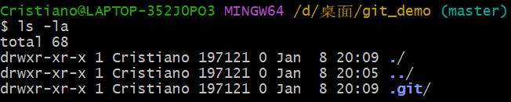</p>

仓库的配置、对象和引用等信息都保存在 `.git` 目录中。执行 `ls -la .git` 查看这个目录，可以看到其中包含多个文件和子目录。

<p align="center">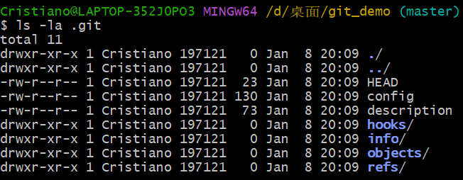</p>

如果要查看 `.git` 下面的所有文件和子目录，可以使用 `find .git`。其中，`hooks` 目录下以 `.sample` 结尾的是钩子示例文件，默认不会生效。演示时可以删除这些示例文件，让目录结构更容易观察。

<p align="center">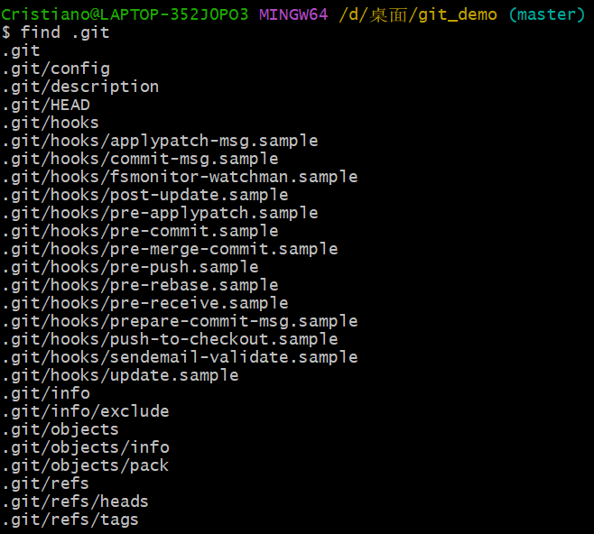</p>

也可以使用 `tree`，以树状结构查看目录。在 Windows 中，可以先安装 Chocolatey，再通过它安装 `tree`。以管理员身份运行 Windows PowerShell，执行以下命令。

```powershell
Set-ExecutionPolicy Bypass -Scope Process -Force; [System.Net.ServicePointManager]::SecurityProtocol = [System.Net.ServicePointManager]::SecurityProtocol -bor 3072; iex ((New-Object System.Net.WebClient).DownloadString('https://chocolatey.org/install.ps1'))
choco -v                   # 查看版本
choco install tree -y      # 安装 tree
```

安装完成后，执行 `tree .git`，就能更直观地查看 `.git` 的目录结构。

<p align="center">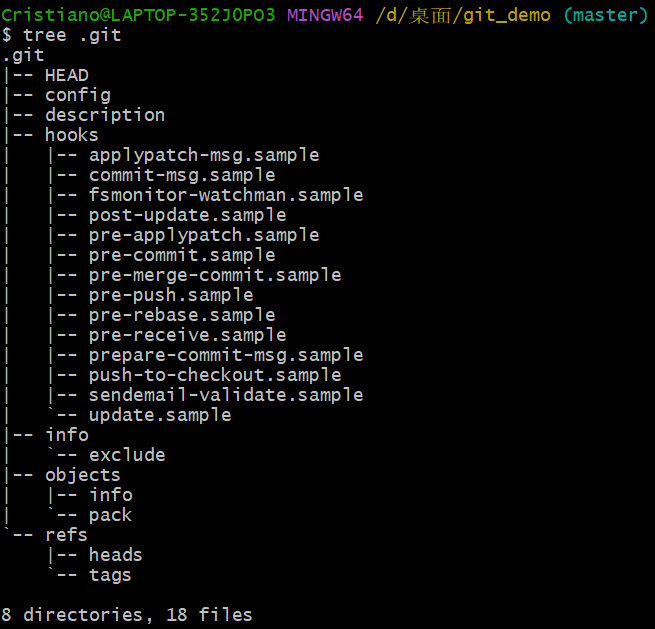</p>

Windows 也自带 `tree` 命令。在 PowerShell 或命令提示符中执行 `tree .git /F`，可以用树状结构查看 `.git` 中的目录和文件，其中 `/F` 表示同时显示文件名，无需额外安装。

这些文件和目录各有作用，可以先有一个大致印象：`HEAD` 指向当前分支或提交，`refs` 保存分支、标签等引用，`objects` 保存 Git 对象，`config` 保存当前仓库的配置。其余部分会在后面的章节中逐步介绍。

```text
.git/                    # Git 仓库核心目录

.git/HEAD                # 当前指向的分支或提交
.git/config              # 当前仓库的配置
.git/description         # 仓库描述（很少用）

.git/hooks/              # Git 钩子脚本（提交、推送前可自动执行）
.git/hooks/*.sample      # 示例脚本（默认不生效）

.git/info/exclude        # 本仓库级 .gitignore（不提交）

.git/objects/            # Git 对象数据库（提交、文件内容）
.git/objects/info        # 对象相关信息
.git/objects/pack        # 压缩后的对象包

.git/refs/               # 引用（分支 / 标签）
.git/refs/heads/         # 本地分支
.git/refs/tags/          # 标签
```

本节先介绍 `config`。`.git/config` 是当前仓库的本地配置文件。除此之外，Git 还有全局配置文件，通常位于用户主目录下的 `.gitconfig`，可以保存用户名、邮箱等配置。

执行 `cat .git/config` 和 `cat ~/.gitconfig`，可以分别查看本地配置文件和全局配置文件的内容。也可以通过 `git config -l` 列出当前仓库生效的配置，其中包括系统、全局和仓库级配置；如果只想查看全局配置，则使用 `git config --global -l`。

<p align="center">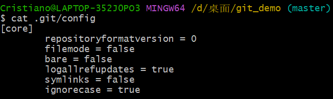</p>

<p align="center">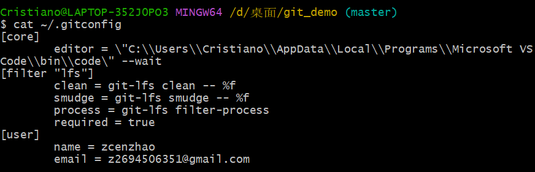</p>

用户名和邮箱用于记录提交者身份。使用 `git config user.name` 和 `git config user.email`，可以分别查看当前生效的用户名和邮箱。

设置时，如果加上 `--global`，用户名和邮箱就会写入全局配置，供未单独设置这些信息的仓库使用。

```bash
git config --global user.name "zcenzhao"
git config --global user.email "z2694506351@gmail.com"
```

如果希望当前仓库使用另一组用户名和邮箱，可以不加 `--global`，单独为它设置本地配置。这些信息会写入 `.git/config`。对于同一个配置项，本地配置的优先级高于全局配置，因此这个仓库之后提交代码时，会优先使用本地设置的用户信息。

```bash
git config user.name "demo"
git config user.email "demo@demo.com"
```

执行这两条命令后，可以看到当前仓库的配置和生效的用户信息发生了变化。

<p align="center">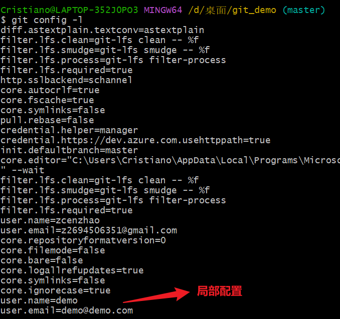</p>

<p align="center">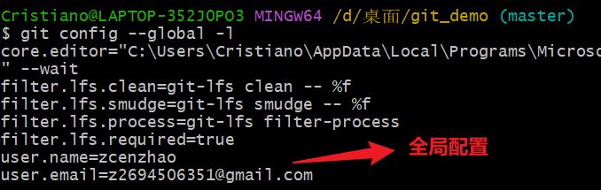</p>

如果不再需要单独设置，可以分别执行 `git config --unset user.name` 和 `git config --unset user.email`，删除当前仓库的用户名和邮箱配置。删除后，如果全局配置中设置了这些信息，Git 就会使用全局配置。

因此，需要在不同仓库中使用不同身份时，可以分别设置各仓库的本地配置，不必反复修改全局配置。

本节主要观察了 `git init` 生成的 `.git` 目录，并介绍了 `config` 的作用。`objects` 如何保存对象、`HEAD` 和 `refs` 如何指向分支与提交，将在后续章节中继续介绍。

## 2. git add 背后发生了什么

上一节初始化了一个本地仓库，并观察了生成的 `.git` 目录。接下来，通过添加一个简单的文本文件，看看执行 `git add` 后，仓库中会发生什么变化。这里不涉及实际编码，使用命令行创建文本文件即可。

执行 `echo "hello git" > hello.txt`，将 `hello git` 写入 `hello.txt`。如果文件不存在，这条命令会创建它。再执行 `cat hello.txt`，就能查看文件内容。

此时，`.git` 目录还没有发生变化。新建的文件位于工作区，尚未被 Git 跟踪，但 Git 已经能够识别它。执行 `git status`，可以看到 `hello.txt` 的状态为未跟踪（untracked）。Git 如何识别这些变化，将在后续章节中介绍。

<p align="center">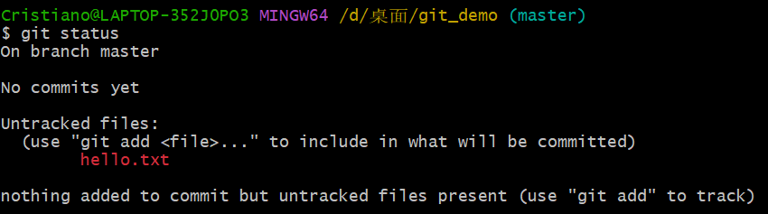</p>

要让 Git 开始管理这个文件，先执行 `git add hello.txt`，将它添加到暂存区（索引区）。可以在执行前后分别使用 `tree .git` 查看目录结构，比较其中的变化。

```bash
git add hello.txt
tree .git
```

<p align="center">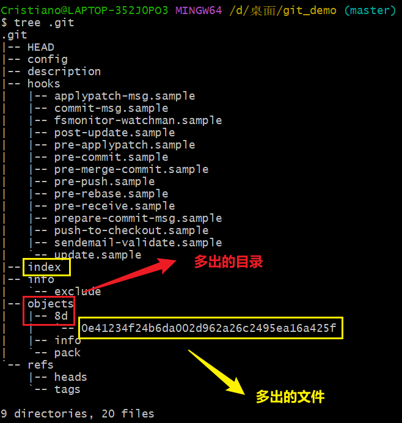</p>

在本次演示中，`.git` 目录由原来的 9 个目录、4 个文件，变成了 10 个目录、6 个文件。新增的内容有两部分：一是 `.git` 下的 `index` 文件，二是 `objects` 下的 `8d` 目录及其中的一个对象文件。本节先介绍这个对象，`index` 的作用留到后面说明。

对象文件的名称看起来是一串字符，实际上来自 SHA-1 哈希值。SHA-1 是一种哈希算法，可以将文件内容或字符串等输入转换成固定长度的值，通常写成 40 位十六进制字符。本例使用的 SHA-1 仓库以这些哈希值标识对象，并将对象存放在 `.git/objects` 中：哈希值的前两位作为子目录名，其余部分作为文件名。

Git 有四种对象：

1. `blob`：用于保存文件内容的对象
2. `tree`：保存目录结构
3. `commit`：保存一次提交信息
4. `tag`：保存标签信息

刚才添加 `hello.txt` 时生成的就是一个 `blob` 对象。可以通过 `git cat-file` 查看对象信息，虽然日常操作中不常用到这个命令，但它能帮助我们理解 Git 如何保存数据。

执行 `git cat-file -t 8d0e41`，可以查看对象类型，返回结果为 `blob`。其中，`-t` 表示查看类型，后面跟对象的哈希值。哈希值不必全部输入，只要前几位足以区分对象即可，这里使用 `8d0e41`。

再执行 `git cat-file -p 8d0e41`，可以查看对象内容，结果就是文件中的 `hello git`。也就是说，执行 `git add` 后，文件内容已经保存到了对象中。

`blob` 对象不保存文件名。如果再创建一个 `tmp.txt`，内容与 `hello.txt` 完全相同，那么即使执行 `git add tmp.txt`，也不会生成新的 `blob` 对象。两个文件的内容相同，可以对应同一个对象。

不过，对象的哈希值并不是只根据文件内容计算的，还包含对象类型等信息。以 `blob` 对象为例，参与计算的数据依次是 `blob `、以字节数表示的文件大小、一个空字符，以及文件内容。其中，`blob ` 的末尾有一个空格。按照这一规则计算出的哈希值，就是该对象的标识。

可以用 Python 验证这个过程。演示中准备了一个位于上层目录的 `get_hash.py` 脚本，运行时传入文件名，就能计算对应的对象哈希值。分别用它计算 `hello.txt` 和 `tmp.txt`，会得到相同的结果，也与 Git 中的对象哈希值一致。脚本的下载链接会在课程视频信息中提供，这里只需了解计算过程，不必记住代码。

既然 `blob` 对象中没有文件名，Git 又是如何区分这些文件的？执行 `git status`，可以看到已经添加到暂存区的文件显示为绿色，属于可提交的更改。此时再新建一个 `test.txt`，但不执行 `git add`，它就会显示为红色的未跟踪文件。

<p align="center">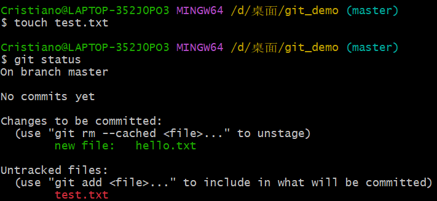</p>

这说明 Git 不仅知道 `hello.txt` 和 `tmp.txt` 的存在，还能区分哪些文件已添加到暂存区、哪些文件尚未跟踪。文件名并没有保存在 `blob` 对象中，那么这些信息记录在哪里？将在后续章节中继续介绍。

## 3. blob 对象和 SHA-1 哈希

上一节介绍了 `git add` 背后的变化：Git 会为文件内容生成一个 `blob` 对象，并用对象的哈希值来命名。本节先介绍哈希值，再通过命令行观察 `blob` 对象的哈希值如何计算，以及对象文件中实际保存了什么。文件名保存在哪里的问题，留到后面继续介绍。

哈希（Hash）算法可以将任意长度的输入转换为固定长度的输出。不同算法的输出长度不同，常见的有：

- MD5：128 位（bit）
- SHA-1：160 位，本节演示的 Git 仓库使用这一算法
- SHA-256：256 位
- SHA-512：512 位

哈希也常用于密码存储等安全相关的场景。它与加密不同，没有通过解密还原输入的过程。算法的设计和输出长度都会影响安全性，MD5 和 SHA-1 都已存在已知的安全问题。另外，尝试找出原始密码，与找到两个哈希值相同的输入，是两类不同的问题。

对于简单或常见的密码，可以通过枚举或查表尝试找到原始输入，所需时间与密码的复杂程度、使用的算法和计算资源有关。MD5 仍可用于普通的文件完整性校验，例如比较下载文件与官方提供的校验值，但不适合用来防范恶意篡改。Git 使用 SHA-1 是否安全，也需要结合它的具体用途来分析。SHA-256、SHA-512 等算法也很常见，例如 Docker 镜像的内容标识中会用到 SHA-256；涉及安全用途时，还需要选择合适的使用方式。

计算哈希值的工具有很多，也可以通过下面的网站计算和验证：

- [MD5 计算页面](https://passwordsgenerator.net/md5-hash-generator/)
- [SHA-1 计算页面](https://passwordsgenerator.net/sha1-hash-generator/)

以不含换行符的字符串 `hello git` 为例，它的 SHA-1 哈希值为 `021d153ca2ec1771bb2b0ca33031f9ef5e6946bd`。这是一个由 40 个十六进制字符组成的值，对应 160 位二进制数：每个十六进制字符表示 4 位二进制，因此只是表示方式不同，信息并没有减少。

```text
十六进制：021d153ca2ec1771bb2b0ca33031f9ef5e6946bd
二进制：0000001000011101000101010011110010100010111011000001011101110001101110110010101100001100101000110011000000110001111110011110111101011110011010010100011010111101
```

接下来，计算 `hello.txt` 对应的 `blob` 对象的哈希值。上一节已经通过 Python 脚本演示过，这里改用命令行观察。先执行 `cat hello.txt` 查看文件内容，再执行 `echo "hello git" | shasum`，计算文本的 SHA-1 哈希值。`shasum` 默认计算 SHA-1，不过这里的 `echo` 会在末尾添加换行符，因此结果是 `d6a96ae3b442218a91512b9e1c57b9578b487a0b`，与前面不含换行的字符串不同，也与 Git 对象的哈希值不同。

Git 计算对象哈希值时，会在文件内容前加上头部。对于 `blob` 对象，参与计算的数据依次为 `blob `、以字节数表示的文件大小、一个空字符，以及文件内容。这里的空字符是 `\0`，与普通空格不同；`blob` 和大小之间则有一个空格。

`hello.txt` 是通过 `echo "hello git" > hello.txt` 创建的，末尾包含换行符，因此共有 10 字节，可以通过 `ls -lh` 查看。计算对象哈希值时，必须保留这个换行符，头部中的大小也应写成 `10`。

```bash
echo -e "blob 10\0hello git" | shasum
printf "blob 10\0hello git\n" | shasum
```

在本次使用的 Git Bash 中，第一条命令通过 `-e` 处理转义字符，并由 `echo` 添加末尾换行；第二条命令则用 `printf` 明确写出空字符和换行符。两条命令得到的结果均为 `8d0e41234f24b6da002d962a26c2495ea16a425f`，与 Git 中的 `blob` 对象哈希值一致。

类型、大小和内容都参与了哈希计算，但不能仅凭哈希值反推出这些信息。要查看它们，需要使用哈希值找到对象，再通过 `git cat-file` 读取。

```bash
git cat-file -t 8d0e    # 查看对象类型，结果为 blob
git cat-file -s 8d0e    # 查看对象大小，结果为 10 字节
git cat-file -p 8d0e    # 查看对象内容，结果为 hello git，末尾含换行
```

<p align="center">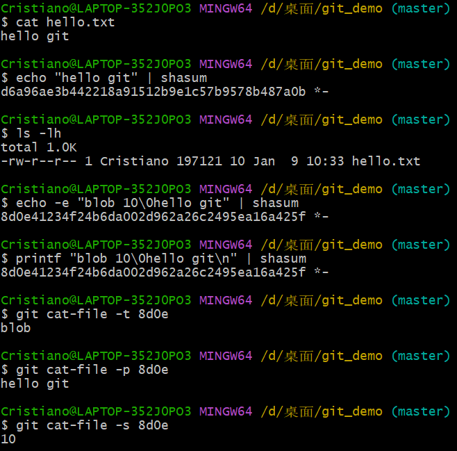</p>

对象文件中实际存储的又是什么？直接执行 `cat .git/objects/8d/0e41234f24b6da002d962a26c2495ea16a425f`，看到的会是类似乱码的内容，因为 Git 会将头部和文件内容一起压缩，再以二进制形式保存。

在仓库根目录执行 `ls -lh`，可以看到原文件大小为 10 字节。再进入 `.git/objects/8d`，使用 `ls -lh` 查看对应的对象文件，会发现它占用了 26 字节，比原文件还大。`8d` 是目录名，后面那串字符才是对象文件名。

这是因为原文件很小，而对象还包含头部以及压缩格式本身的额外信息，压缩后不一定更小。对于较大、内容容易压缩的文本文件，则通常可以看到对象文件比原文件更小。

<p align="center">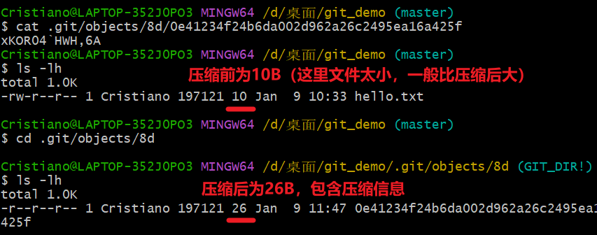</p>

虽然直接查看对象文件无法读出原文，但可以用 Python 的 `zlib` 库解压。以下代码从仓库根目录读取对象文件：

```python
import zlib

with open('.git/objects/8d/0e41234f24b6da002d962a26c2495ea16a425f', 'rb') as f:
    compressed_contents = f.read()

decompressed = zlib.decompress(compressed_contents)
print(decompressed)
```

输出结果为 `b'blob 10\x00hello git\n'`。其中，`\x00` 表示空字符，`\n` 表示换行符。这正是前面计算对象哈希值时使用的数据，包括头部和完整的文件内容。

因此，`blob` 对象的哈希值根据压缩前的头部和文件内容计算，对象文件中保存的则是这些数据压缩后的结果。

## 4. 工作区和索引区

前几节介绍了 Git 中的 `blob` 对象，也提到了工作区（working directory）与暂存区（staging area）。暂存区也称为索引区（index），有时也叫缓存区。工作区中创建或修改的文件，可以通过 `git add` 添加到暂存区，为下一次提交做准备。

<p align="center">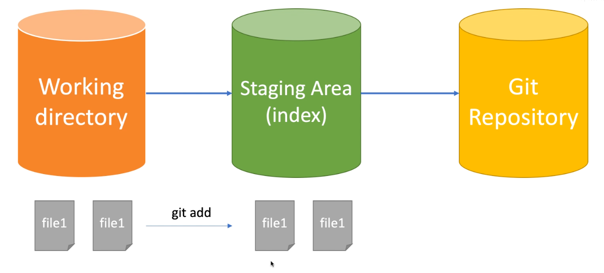</p>

执行 `git add` 后，Git 会保存文件内容对应的 `blob` 对象，并生成或更新索引文件 `.git/index`。`blob` 对象中包含对象类型、大小和文件内容，不包含文件名；文件路径、对应对象的哈希值等信息则记录在索引中。通过这些记录，Git 能够知道每个文件对应哪个对象。

接下来重新初始化一个仓库，创建 `file1.txt` 并添加到暂存区。这里已经删除了之前的仓库，以下操作从新的空仓库开始。

```bash
git init
echo "file1" > file1.txt
git status
git add file1.txt
tree .git
cat .git/index
```

执行 `git add` 前，`git status` 会将 `file1.txt` 显示为未跟踪文件。添加后，查看 `.git` 的目录结构，可以看到新增的 `blob` 对象和 `index` 文件。直接执行 `cat .git/index`，输出的大部分内容无法直接阅读，但仍能辨认出其中的 `file1.txt`。

<p align="center">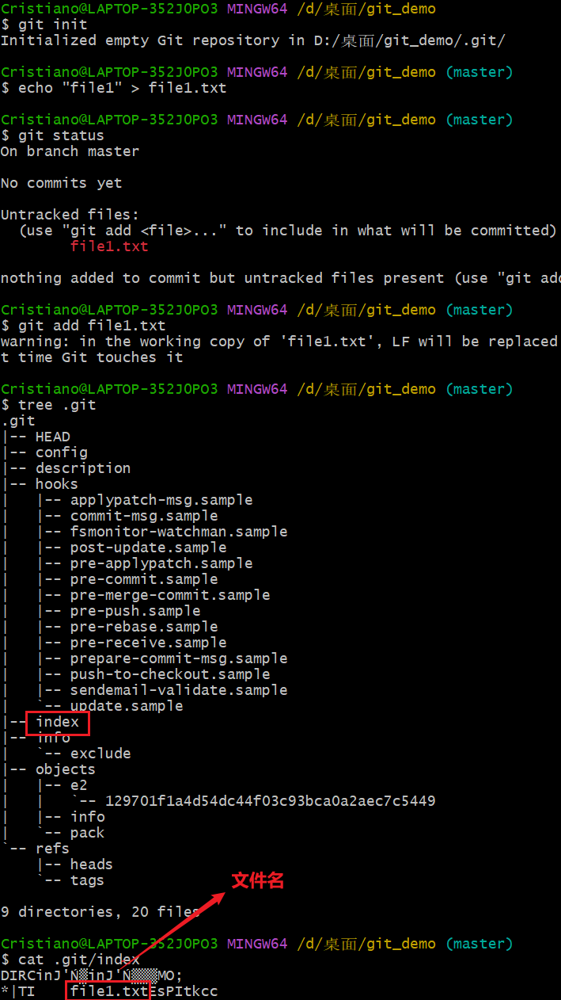</p>

要查看暂存区中的文件，不必直接读取索引文件，可以使用 `git ls-files`。加上 `-s` 参数，即 `git ls-files -s`，还可以显示每个文件对应的对象等信息。输出中的各列依次为：

- 文件模式：包含文件类型和可执行权限等信息，本例为 `100644`
- 对象哈希值：本例指向文件对应的 `blob` 对象，可以用 `git cat-file` 查看其内容
- 暂存阶段编号：本例为 `0`，后续再解释其他取值的含义
- 文件名：本例为 `file1.txt`

<p align="center">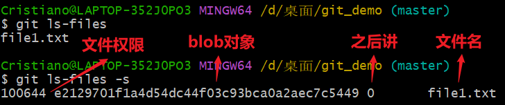</p>

暂存区连接了工作区与代码仓库，用来准备下一次提交的文件状态。目前还没有执行 `git commit`，因此没有生成提交记录，但文件内容已经通过 `git add` 保存为对象。索引记录了待提交的文件及其对应的对象，文件内容本身保存在 `blob` 对象中。

执行 `git commit` 时，Git 会根据暂存区记录的状态创建提交，保存这一版本的目录结构和文件内容。工作区中的修改如果还没有添加到暂存区，就不会包含在这次提交中。

可以通过 `git status` 观察这些状态：它既会显示已经暂存、等待提交的更改，也会显示工作区中尚未暂存的修改，以及未跟踪文件。

先看添加新文件的情况。刚才将 `file1.txt` 添加到暂存区后，如果没有继续修改它，工作区中的内容就与暂存区记录的内容一致。此时执行 `git status`，会看到该文件位于待提交的更改中，说明它已经准备好提交。

再执行 `echo "file2" > file2.txt`，创建第二个文件。通过 `ls` 可以看到工作区中已有两个文件，但执行 `git ls-files -s`，暂存区中仍然只有 `file1.txt`。此时再执行 `git status`，`file2.txt` 会显示为未跟踪文件，因为它尚未添加到暂存区。

执行 `git add file2.txt` 后，再查看 `git status`，两个文件都会出现在待提交的更改中，不再有未跟踪文件。在这个例子中，工作区和暂存区的内容又恢复了一致。

<p align="center">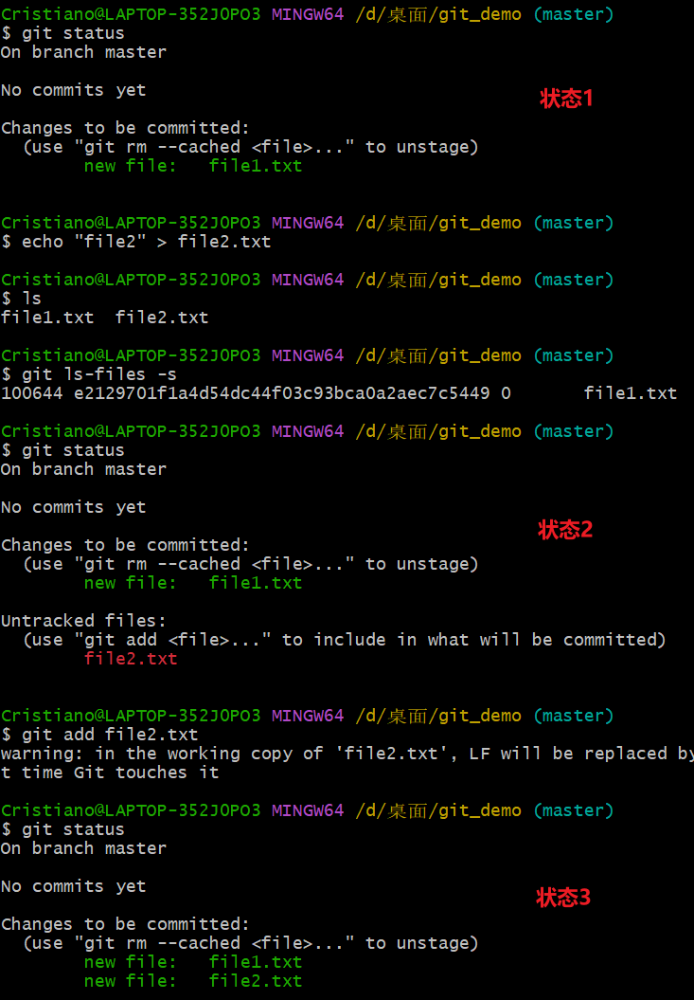</p>

执行 `tree .git/objects`，可以看到两个 `blob` 对象，分别对应两个文件的不同内容。再执行 `git ls-files -s`，可以看到暂存区已记录这两个文件，以及各自对应的对象哈希值。

<p align="center">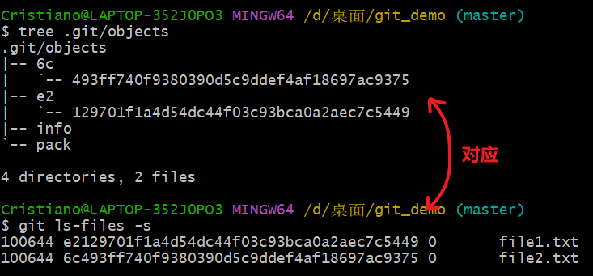</p>

接着观察修改已有文件的情况。执行 `vim file1.txt`，在内容末尾添加一个英文句号 `.`，保存后退出。此时通过 `ls` 查看，文件列表没有变化，但 `git status` 会显示 `file1.txt` 有尚未暂存的修改，标记为 `modified`。

这与新建 `file2.txt` 时的 `untracked` 不同：`file1.txt` 已经记录在索引中，只是工作区中的内容与索引指向的 `blob` 对象不同。此时执行 `git ls-files -s`，仍能看到索引记录的是修改前的对象。

再执行 `git add file1.txt`，将本次修改添加到暂存区。之后，`git status` 不再显示尚未暂存的修改，工作区与暂存区恢复一致。通过 `git ls-files -s` 可以看到 `file1.txt` 对应的对象哈希值已经更新，再用 `tree .git/objects` 查看对象目录，可以看到新增的对象。

<p align="center">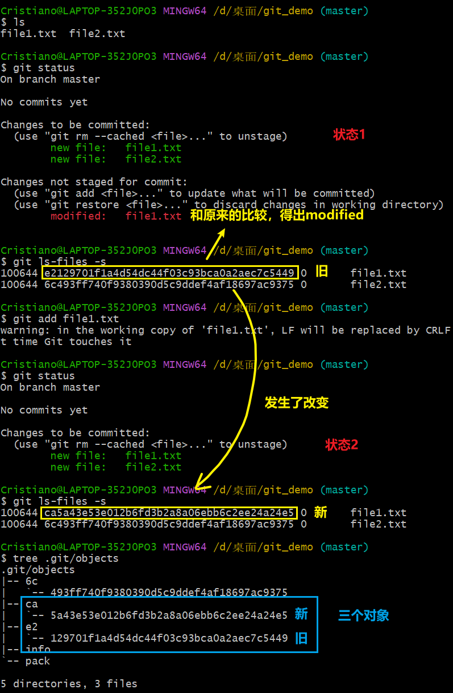</p>

`file1.txt` 在索引中对应的对象由 `e2129` 变成了 `ca5a43`。也就是说，文件内容修改后，再执行 `git add`，Git 为新内容保存了一个新的 `blob` 对象，并更新了索引中的记录。此时对象库中共有三个对象：`file1.txt` 修改前后的两个对象，以及 `file2.txt` 对应的对象。

旧对象 `e2129` 仍然保留在对象库中，但当前索引中 `file1.txt` 的记录只指向新对象 `ca5a43`。因此，是对象库中保存了两份不同的文件内容，而不是当前暂存区同时记录了这个文件的两个版本。

这两份内容与文件的历史版本有什么关系，旧对象之后又会如何处理？接下来将执行提交操作，把暂存区准备好的文件状态记录为一个版本，再继续讨论这些问题。

## 5. git commit 背后发生了什么

上一节介绍了工作区与索引区。通过 `git add`，可以将工作区中新建的文件或对已有文件的修改添加到索引区，为下一次提交做准备。索引记录文件列表以及各文件对应的对象，文件内容则保存在 `blob` 对象中。

本节继续执行 `git commit`，将索引区准备好的文件状态记录为一次提交，观察这个过程中 `.git` 目录发生了哪些变化。

先查看上一节结束时的状态。当前工作区中有 `file1.txt` 和 `file2.txt`，内容分别为 `file1.` 和 `file2`。使用 `cat` 查看文件，再通过 `git cat-file -p ca5a` 和 `git cat-file -p 6c49` 查看对应的对象，可以发现内容一致。执行 `git ls-files -s`，也能看到索引记录了这两个对象。

```bash
cat file1.txt
cat file2.txt
git cat-file -p ca5a
git cat-file -p 6c49
git ls-files -s
git status
```

此时工作区与索引区已经同步，两个文件都处于待提交状态，但仓库中还没有提交记录。演示时可以在另一个终端中每隔一秒刷新 `.git` 的目录结构，便于观察提交前后的变化。

<p align="center">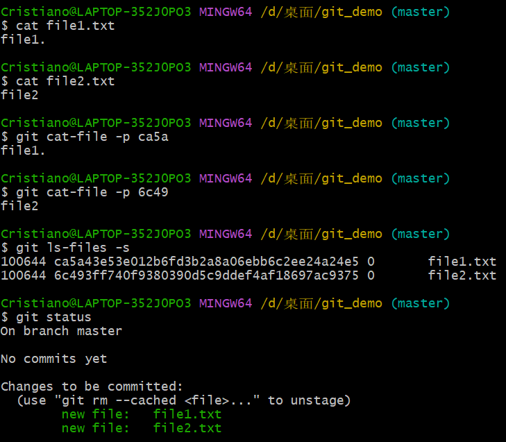</p>

接下来，执行 `git commit -m "1st commit"`。其中，`-m` 用于指定提交信息，这里的信息为 `1st commit`。

<p align="center">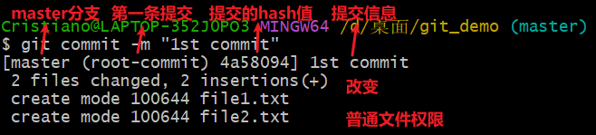</p>

输出中的 `[master (root-commit) 4a58094] 1st commit` 包含了本次提交的基本信息：

- `master`：当前所在的分支
- `root-commit`：这是仓库中的第一次提交，也称为根提交
- `4a58094`：本次提交的哈希值缩写
- `1st commit`：提交信息

下面的 `2 files changed, 2 insertions(+)` 表示本次提交涉及两个文件，共新增两行。两条 `create mode 100644` 表示新增了两个非可执行的普通文件，文件模式为 `100644`。

再比较提交前后的对象目录。提交前，`.git/objects` 中已有三个 `blob` 对象：`ca5a43` 和 `6c493f` 分别对应索引中两个文件的当前内容，`e2129` 则对应 `file1.txt` 修改前的内容。旧对象仍保留在对象库中，但当前索引没有指向它，后续再介绍这类对象如何处理。

<p align="center">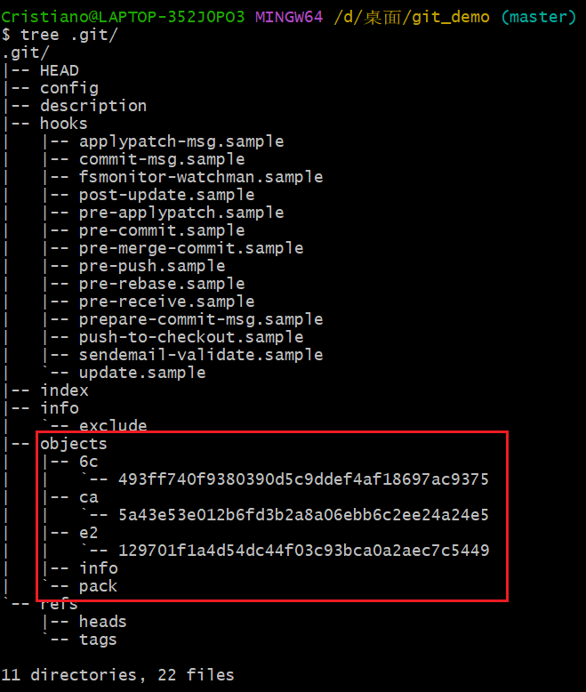</p>

提交后，对象数量由三个变为五个，新增了两个对象：一个 `commit` 对象和一个 `tree` 对象。文件内容对应的 `blob` 对象在执行 `git add` 时已经保存，因此本次提交不需要为它们重新创建对象。

<p align="center">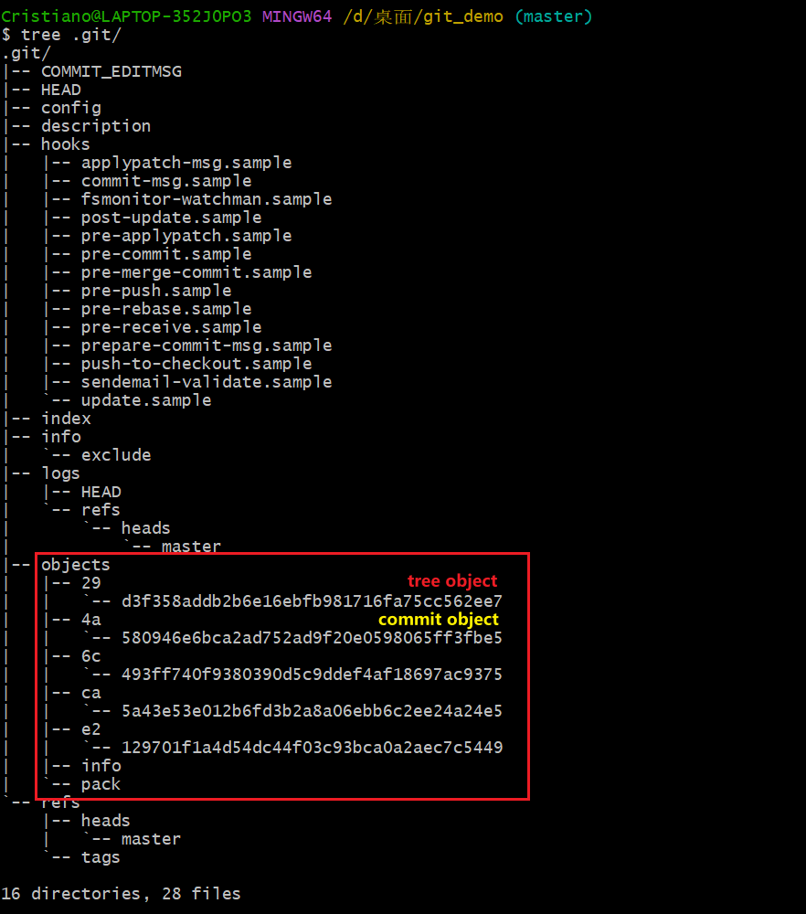</p>

先查看新增的 `commit` 对象。执行 `git cat-file -t 4a58`，返回的类型为 `commit`；再执行 `git cat-file -p 4a58`，可以查看其中的内容。

这个对象主要记录了：

- `tree`：指向本次提交的根目录树对象，本例为 `29d3f3`
- `author`：作者的姓名、邮箱、时间戳和时区
- `committer`：提交者的姓名、邮箱、时间戳和时区
- 提交信息：本例为 `1st commit`

这里的时间戳以自 Unix 纪元起经过的秒数表示，后面还记录了时区偏移。本次提交中作者与提交者相同，但对象中仍分别记录了这两项信息。

<p align="center">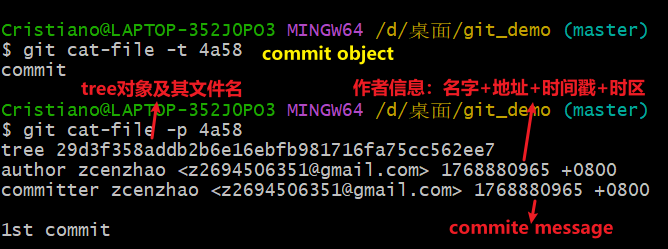</p>

接着查看 `commit` 指向的 `tree` 对象。执行 `git cat-file -t 29d3`，可以确认类型为 `tree`；再执行 `git cat-file -p 29d3`，可以看到其中记录了 `file1.txt` 和 `file2.txt`。

`tree` 对象代表目录结构，其中的条目记录文件模式、对象类型、对象哈希值和文件名。本例中的两个文件分别对应 `ca5a43` 和 `6c493f`。通过文件名和对应的 `blob` 对象，就能找到各文件的具体内容。因此，从这次提交出发，经过 `tree` 对象，就能找到这一版本的文件结构和内容。

<p align="center">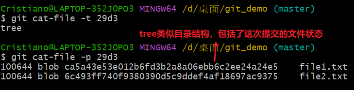</p>

除了新增对象，`.git` 中的其他部分也发生了变化。例如，这次提交后出现了 `.git/logs` 下的相关日志文件，以及 `.git/refs/heads/master` 分支引用文件。还可以看到保存提交信息的 `COMMIT_EDITMSG` 文件。这些文件的作用将在后续章节中继续介绍。

<p align="center">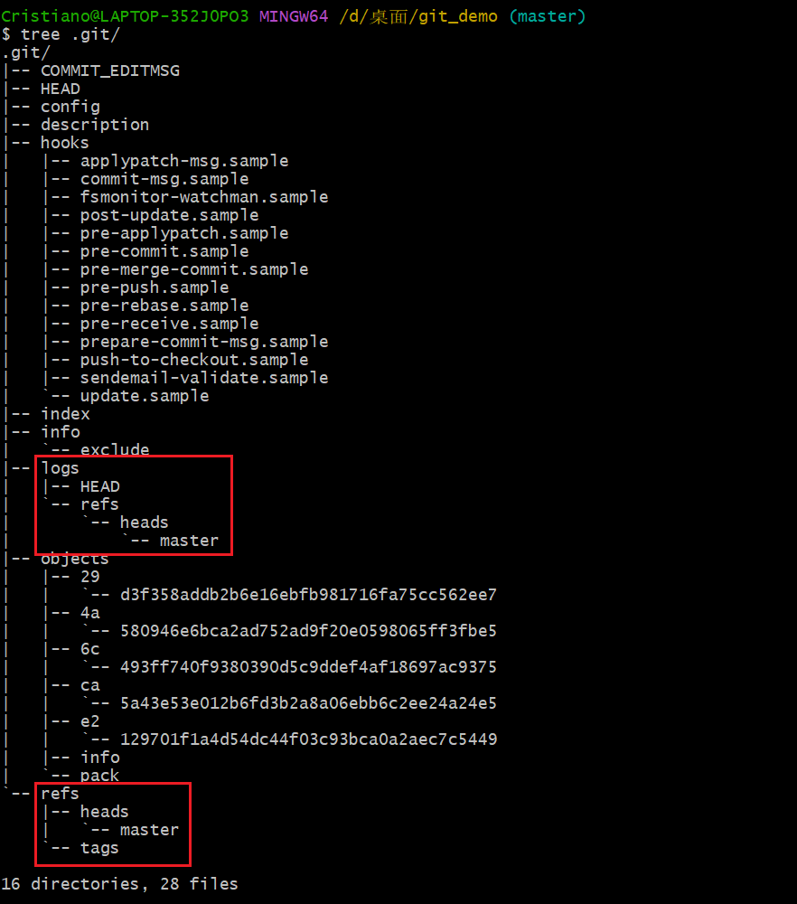</p>

执行 `cat .git/refs/heads/master`，可以看到其中保存的是本次提交的完整哈希值，以 `4a5809` 开头。也就是说，`master` 分支现在指向这次新提交。

再执行 `cat .git/HEAD`，可以看到内容为 `ref: refs/heads/master`。在当前状态下，`HEAD` 指向 `master` 分支，而 `master` 分支引用指向具体的 `commit` 对象。以后切换到其他分支时，`HEAD` 的指向也会随之改变。`HEAD` 也有直接指向提交的情况，后面再介绍。

<p align="center">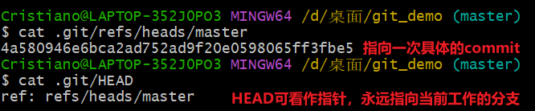</p>

现在可以把仓库中的关系串起来：`HEAD` 指向当前分支，分支指向 `commit` 对象，`commit` 指向根目录的 `tree` 对象，`tree` 再通过文件名和对象哈希值关联到保存内容的 `blob` 对象。

本次提交关联了一个 `tree` 对象和两个 `blob` 对象，分别描述这一版本的目录结构以及两个文件的内容。旧的 `e2129` 对象虽然仍在对象库中，但没有包含在这次提交里。

<p align="center">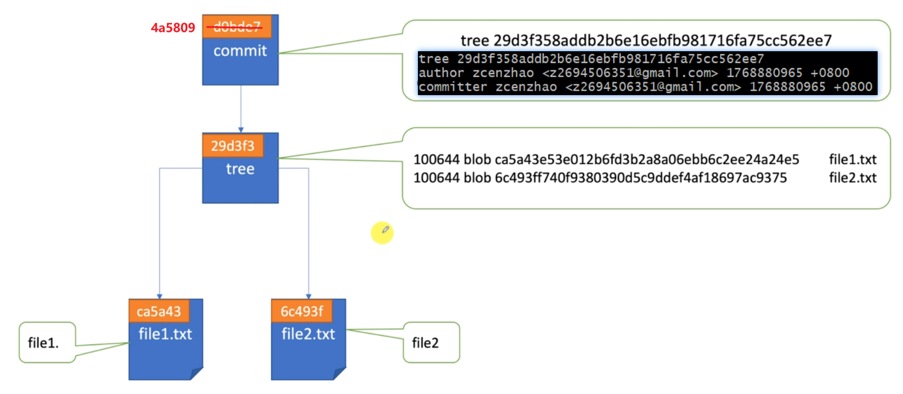</p>

下一节将再创建一次提交，继续观察对象之间的关系如何变化。

## 6. 继续梳理 commit

上一节执行了第一次 `git commit`，将索引区准备好的文件状态记录为一次提交。在本例中，提交新增了一个 `commit` 对象和一个 `tree` 对象。`commit` 指向 `tree`，`tree` 中记录了 `file1.txt` 和 `file2.txt`，分别关联到保存文件内容的 `blob` 对象。

本节从这个状态继续操作，再创建两次提交，观察文件修改和新增子目录后，对象之间的关系如何变化。

<p align="center">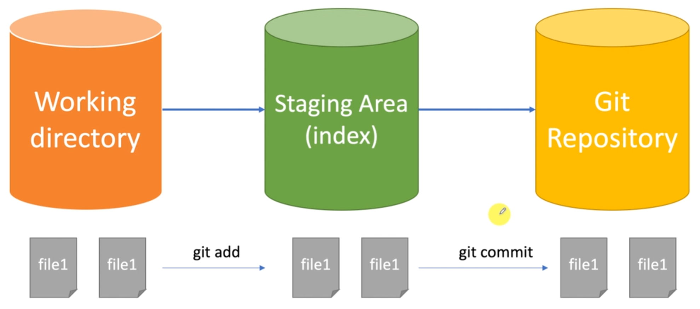</p>

先修改 `file2.txt`，在内容末尾添加一个英文句号 `.`，使内容由 `file2` 变为 `file2.`。保存后，执行 `ls`，仍能看到原来的两个文件；执行 `git status`，则会看到 `file2.txt` 标记为 `modified`，说明工作区中的内容与索引记录的内容不同。文件的各种状态将在下一节集中介绍。

执行 `git add file2.txt`，将修改添加到索引区。此时会生成一个新的 `blob` 对象，哈希值以 `9887c1` 开头，对象库中的对象数量由五个增加到六个。

<p align="center">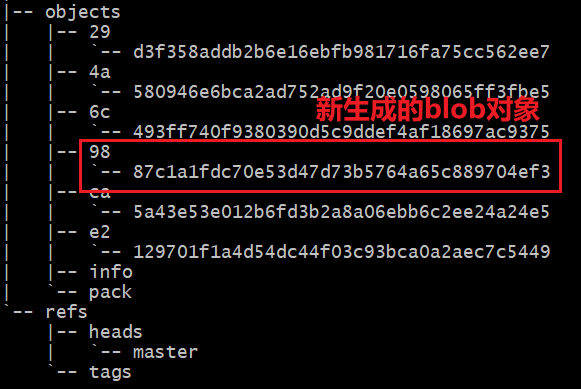</p>

可以分别执行 `git cat-file -p 6c493f` 和 `git cat-file -p 9887c1`，比较修改前后的内容：旧对象中是 `file2`，新对象中是 `file2.`。再执行 `git ls-files -s`，可以看到索引中 `file2.txt` 对应的对象已经更新为 `9887c1`，而 `file1.txt` 仍然对应 `ca5a43`。

<p align="center">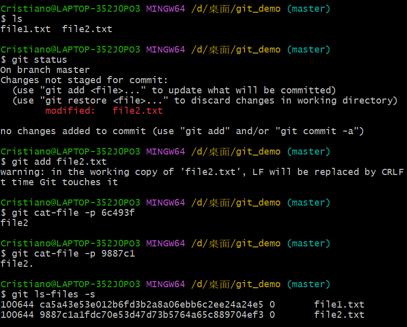</p>

接下来执行 `git commit -m "2nd commit"`，创建第二次提交。使用 `git cat-file -p 27fcc65` 查看新提交，可以看到它指向一个新的 `tree` 对象 `876af0`，同时多了一项 `parent`，指向第一次提交 `4a5809`。这表示第二次提交是在第一次提交的基础上生成的，两次提交通过父提交引用关联起来。

再执行 `git cat-file -p 4a5809`，可以看到第一次提交指向的是 `29d3f3`。本次文件内容发生变化，根目录树中的对象引用也随之改变，因此生成了新的 `tree` 对象。

执行 `git cat-file -p 876af` 查看新树，再通过 `git ls-files -s` 查看索引，可以发现两者记录的文件名及对象对应关系一致：`file1.txt` 对应 `ca5a43`，`file2.txt` 对应 `9887c1`。

<p align="center">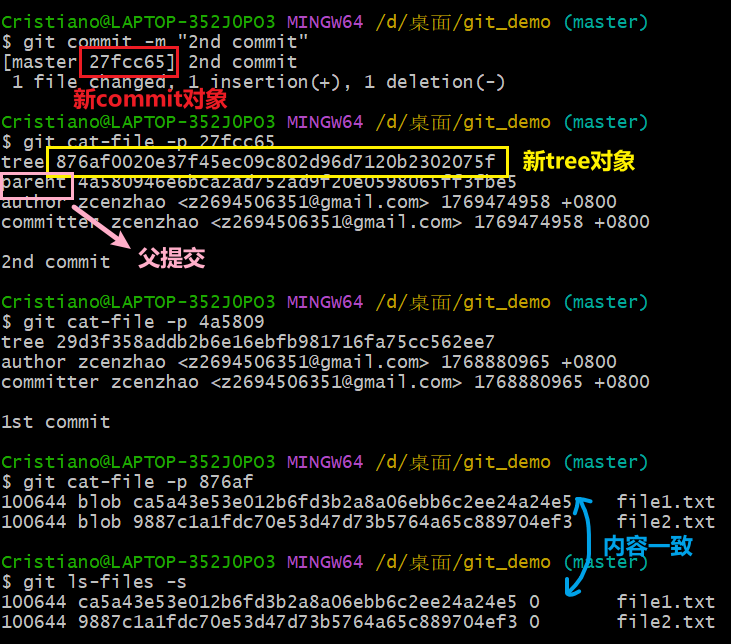</p>

第二次提交新增了一个 `commit` 对象和一个 `tree` 对象，对象总数由六个增加到八个。新的 `blob` 对象在执行 `git add` 时已经生成，不是在这次提交时生成的。

<p align="center">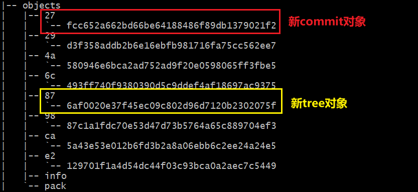</p>

此时最新提交为 `27fcc65`，它的父提交是根提交 `4a5809`。两次提交各自指向一个根目录树，其中 `file1.txt` 的内容没有变化，所以两个树共用同一个 `blob` 对象；`file2.txt` 的内容发生变化，两个树分别指向修改前后的对象。

<p align="center">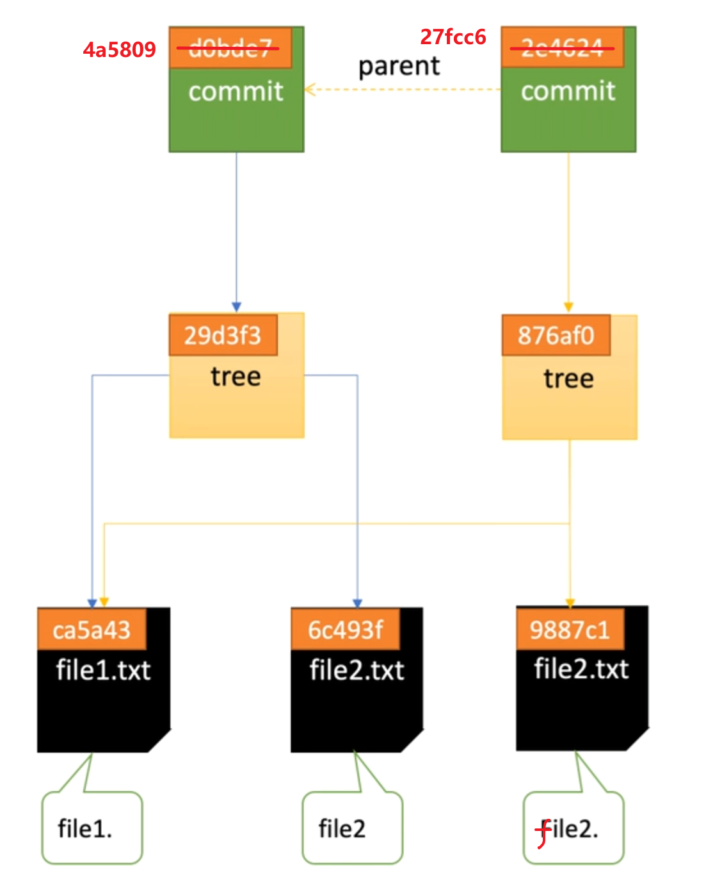</p>

接下来观察子目录的情况。执行 `mkdir folder1` 新建目录，通过 `ls` 可以看到它，但执行 `git status`，仍会显示 `nothing to commit, working tree clean`。这是因为 Git 不跟踪空目录，仅创建空目录不会形成可提交的文件变化。

进入 `folder1`，创建内容为 `file3.` 的 `file3.txt`，然后返回仓库根目录，再检查状态。

```bash
cd folder1
echo "file3." > file3.txt
ls
cd ..
git status
git add folder1/
git ls-files -s
```

创建文件后，`git status` 会在未跟踪文件中显示 `folder1/`。执行 `git add folder1/`，会将这个例子中目录内的文件添加到索引区。随后通过 `git ls-files -s`，可以看到新增的 `folder1/file3.txt`，对应的对象为 `89a53e`。

执行 `git cat-file -t 89a53e`，可以确认对象类型为 `blob`；再执行 `git cat-file -p 89a53e`，可以看到内容为 `file3.`。

<p align="center">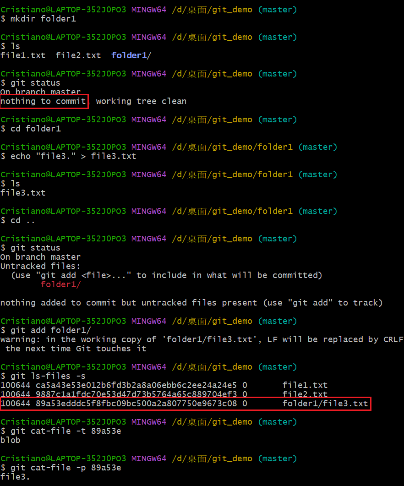</p>

此时对象库只新增了 `file3.txt` 对应的一个 `blob` 对象，总数由八个增加到九个。添加文件到索引区时，还没有为 `folder1` 生成 `tree` 对象；索引通过 `folder1/file3.txt` 这样的路径记录文件所在的位置。

<p align="center">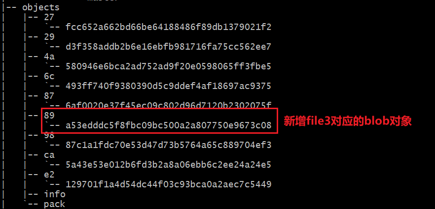</p>

接着执行 `git commit -m "3rd commit"`，创建第三次提交。执行 `git cat-file -p 82e9748` 查看新提交，可以看到它的父提交为 `27fcc65`，指向的根目录树为 `46fcaf`。

执行 `git cat-file -p 46fcaf`，可以看到根目录树包含两个 `blob` 条目和一个 `tree` 条目：两个文件仍是 `file1.txt` 和 `file2.txt`，目录 `folder1` 则对应子树 `e3cfeb`。再执行 `git cat-file -p e3cfeb`，可以看到子树中记录了 `file3.txt`，对应的 `blob` 对象为 `89a53e`。

这说明 `tree` 对象之间可以形成层级关系：根目录的树记录根目录中的文件和子目录，子目录再通过自己的树记录其中的文件。可以将一个 `tree` 对象理解为对某个目录内容的描述。

<p align="center">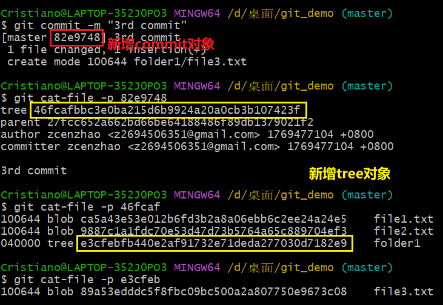</p>

本次提交新增了三个对象：一个 `commit` 对象、一个根目录的 `tree` 对象，以及一个 `folder1` 对应的 `tree` 对象。对象总数由九个增加到十二个。文件内容对应的 `blob` 对象已经存在，本次提交没有新增 `blob` 对象。

<p align="center">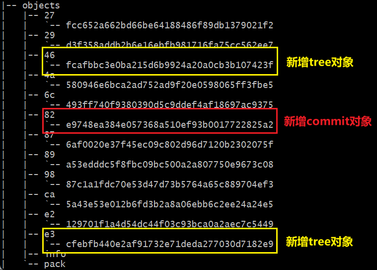</p>

目前共有三次提交。第三次提交 `82e9748` 的父提交是第二次提交 `27fcc65`，第二次提交的父提交又是第一次提交 `4a5809`，由此形成提交历史链。

第三次提交指向根目录树 `46fcaf`。这个树继续使用 `file1.txt` 和 `file2.txt` 已有的 `blob` 对象，同时通过子树 `e3cfeb` 关联到 `folder1/file3.txt` 的内容。前两次提交及其引用的对象仍然保留，因此也能找到之前版本的文件结构和内容。

<p align="center">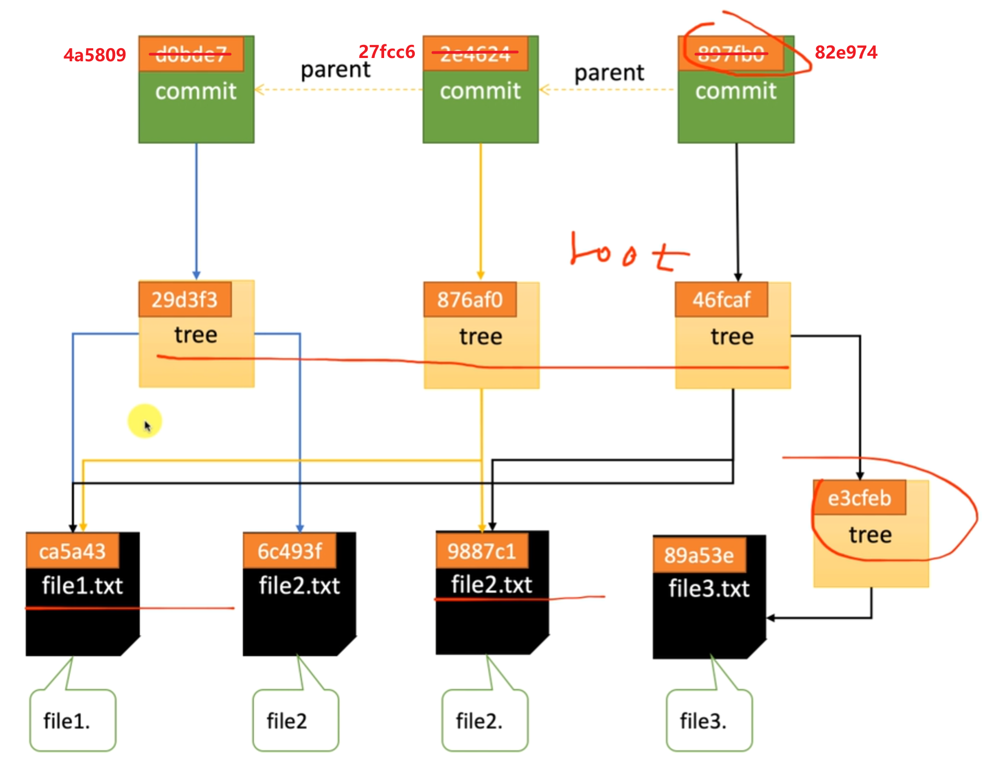</p>

这三次提交可以理解为三个版本。每个 `commit` 对象都指向对应版本的根目录树，沿着树中的引用，就能找到当时的目录结构和各文件的具体内容。下一节将总结文件的各种状态，以及如何通过命令在这些状态之间切换。

## 7. 文件的状态（生命周期）

前几节通过创建、修改、添加和提交文件，观察了工作区、暂存区与代码仓库之间的关系。本节将这些操作对应的文件状态整理如下：

- `Untracked`（未跟踪）：文件尚未被 Git 跟踪，常见于刚创建且未执行 `git add` 的文件
- `Modified`（已修改）：已跟踪文件在工作区中发生了修改，这些修改尚未添加到暂存区
- `Staged`（已暂存）：文件的新内容或其他变更已添加到暂存区，准备包含在下一次提交中
- `Unmodified`（未修改）：文件已被跟踪，工作区和暂存区中的内容均与当前提交一致，没有待提交或尚未暂存的更改

在工作区中新建一个文件后，如果它没有被忽略，通常会在 `git status` 中显示为未跟踪。执行 `git add <文件名>`，就会将它添加到暂存区，由 `Untracked` 转为 `Staged`。

对于已经跟踪的文件，如果修改并保存，工作区中的内容就会与暂存区不同，产生尚未暂存的修改，即 `Modified`。再执行 `git add <文件名>`，可以将当前修改添加到暂存区，变为 `Staged`。

执行 `git commit`，会将暂存区准备好的状态记录为一次提交。如果添加到暂存区后没有再修改文件，提交完成后，工作区、暂存区和当前提交中的内容就会一致，文件处于 `Unmodified` 状态。之后再次编辑并保存，又会产生新的修改。

需要注意，这四种状态是对常见情况的概括。同一个文件也可能既有已暂存的更改，又有尚未暂存的修改。例如，执行 `git add` 后继续编辑文件，但没有再次添加，新旧两部分修改就会分别显示在 `git status` 的不同区域中。

<p align="center">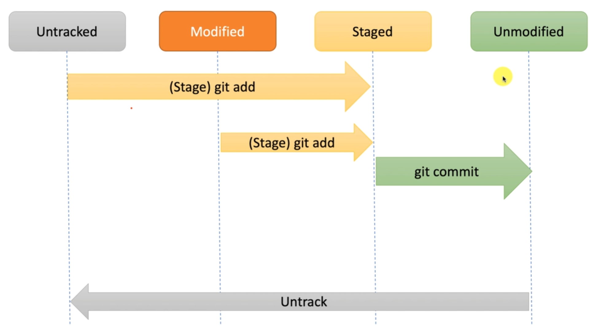</p>

图中从左向右的箭头表示常见的添加和提交过程；反方向还可以进行取消暂存、丢弃工作区修改或停止跟踪等操作。它们的作用不同，并不都涉及撤销已经完成的提交。图中的 `Untrack` 表示停止跟踪：文件可以继续保留在工作区中，但不再由 Git 跟踪。这些操作的具体命令和使用条件留到后续介绍。

<p align="center">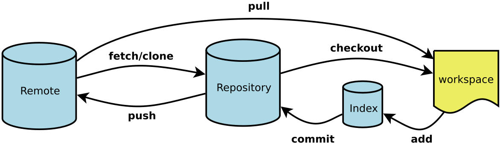</p>

<p align="center">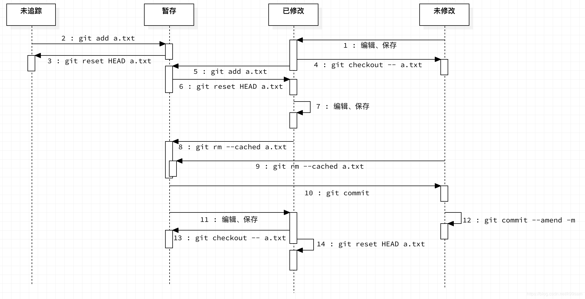</p>

## 8. Branch 和 HEAD

从本节开始介绍分支。先理解分支是什么，以及 Git 如何记录当前所在的分支，创建和切换分支的具体操作将在下一节演示。

Git 的分支本质上是一个有名称、可以移动的指针，指向某个提交对象。例如，`master` 和 `dev` 都是分支名，各自指向一个提交。图中，`master` 指向 `a219fd`，`dev` 指向 `e78125`。通过分支名，就可以找到对应的提交，再沿着 `commit`、`tree` 和 `blob` 之间的引用找到文件结构和内容。

<p align="center">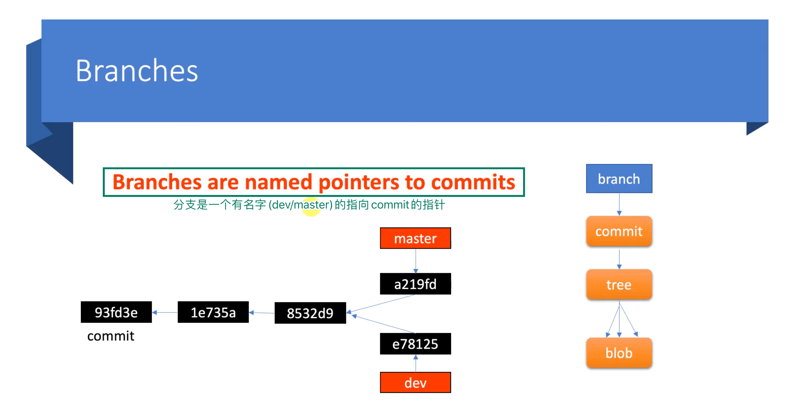</p>

要实现分支，Git 需要记录两类信息：每个分支指向哪次提交，以及当前正在使用哪个分支。

本例初始化仓库时，默认分支名为 `master`。它只是一个普通分支，与自己创建的分支没有区别。初始分支名可以配置，不一定都是 `master`。在当前分支上继续提交时，该分支的指针就会向前移动，指向新提交。

每个分支指向的提交，可以通过对应的分支引用记录。本例中的 `master` 分支引用保存在 `.git/refs/heads/master`，文件内容就是它指向的提交哈希值。

当前使用哪个分支，则由 `.git/HEAD` 记录。在通常的分支工作状态下，`HEAD` 指向当前分支的引用，再通过该分支找到它指向的最新提交。例如，`HEAD` 指向 `master` 时，图中对应的提交是 `a219fd`；切换到 `dev` 后，`HEAD` 改为指向 `dev`，对应的提交就是 `e78125`。切换分支改变的是当前使用哪个分支，不会仅因切换就改变这两个分支各自指向的提交。

<p align="center">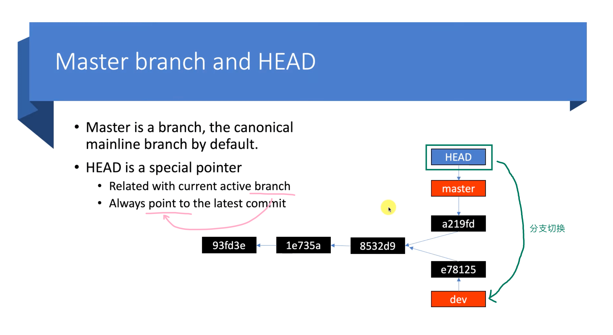</p>

接下来查看实际仓库。这里尚未创建其他分支，当前分支为 `master`。终端提示符中的 `(master)` 是命令行环境提供的分支提示，也可以通过 Git 文件和命令查看相同的信息。

执行 `cat .git/HEAD`，输出为 `ref: refs/heads/master`，表示 `HEAD` 指向 `master` 分支。再执行 `cat .git/refs/heads/master`，可以看到提交的完整哈希值，以 `82e9748` 开头。使用 `git cat-file -t 82e97`，返回类型为 `commit`，说明该分支引用指向的是一个提交对象。

```bash
cat .git/HEAD
cat .git/refs/heads/master
git cat-file -t 82e97
git log
```

执行 `git log`，可以看到最新提交为第 6 节创建的第三次提交 `82e9748`，下面依次是第二次和第一次提交。最新提交旁的 `HEAD -> master` 表示 `HEAD` 指向 `master`，而 `master` 指向这次提交。

<p align="center">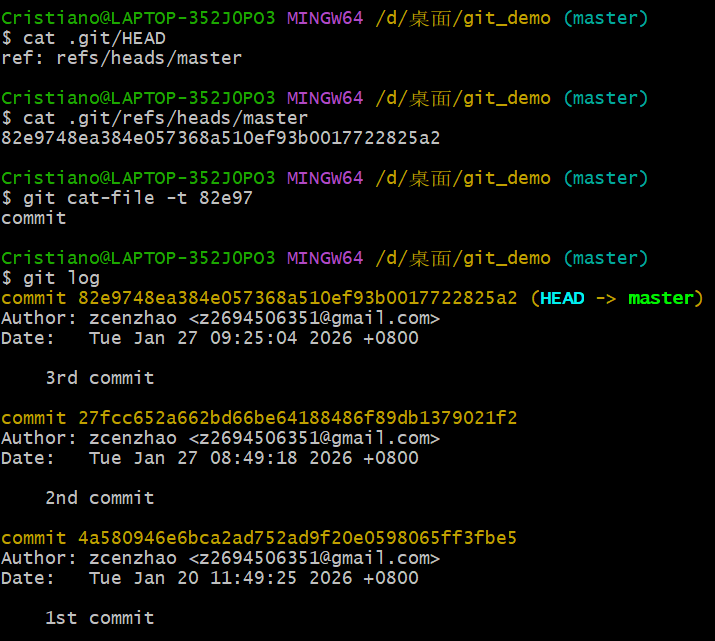</p>

因此，在当前状态下，`.git/HEAD` 记录正在使用的分支，`.git/refs/heads/master` 记录这个分支指向的提交。`HEAD` 也可以直接指向某个提交，而不指向分支，这称为 `HEAD` 游离态，后续会继续介绍。

下一节将创建并切换分支，观察 `HEAD` 和相应分支引用文件的变化。

## 9. 分支操作的背后

上一节介绍了分支与 `HEAD` 的关系，本节通过查看、创建、切换和删除分支，观察相应的引用文件与对象如何变化。查看分支使用 `git branch`，创建分支使用 `git branch <分支名>`，切换分支使用 `git checkout <分支名>`。删除分支可以使用 `git branch -d <分支名>`，需要强制删除时则使用 `-D`。

<p align="center">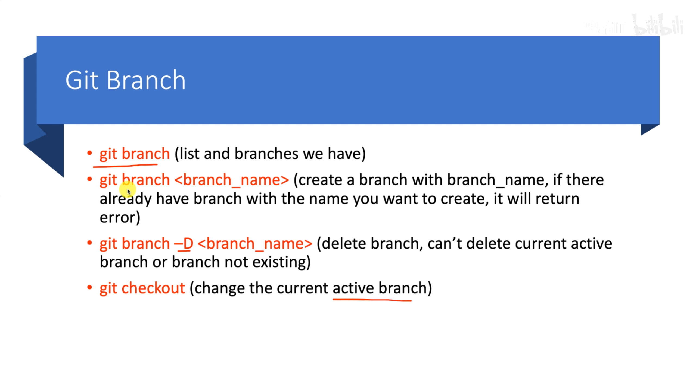</p>

先执行 `git branch`，查看当前已有的本地分支。此时只有 `master`，名称前的星号 `*` 表示它是当前工作分支。执行 `git branch dev`，创建一个名为 `dev` 的分支，再查看分支列表，就会看到两个分支，但星号仍在 `master` 前。创建分支并不会自动切换过去。

这里没有指定其他起点，因此新分支指向当前提交 `82e9748`，与 `master` 一致。通过 `git log`，可以看到两个分支名标在同一次提交旁边。此时 Git 对象没有变化，只增加了一个分支引用。

可以用 `ls .git/refs/heads/` 查看分支引用文件，再分别执行 `cat .git/refs/heads/dev` 和 `cat .git/refs/heads/master`，比较其中的内容。两个文件保存的提交哈希值相同，而 `cat .git/HEAD` 的结果仍为 `ref: refs/heads/master`。

<p align="center">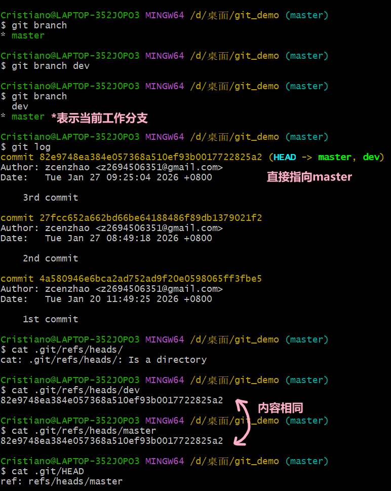</p>

接下来执行 `git checkout dev`，切换到 `dev` 分支。再次执行 `git branch`，星号已经移到 `dev` 前；查看 `.git/HEAD`，内容也变成了 `ref: refs/heads/dev`。

此时两个分支仍然指向同一个提交，但 `git log` 中的标记已经变为 `HEAD -> dev, master`。变化的是当前工作分支，两个分支各自指向的提交还没有改变。

<p align="center">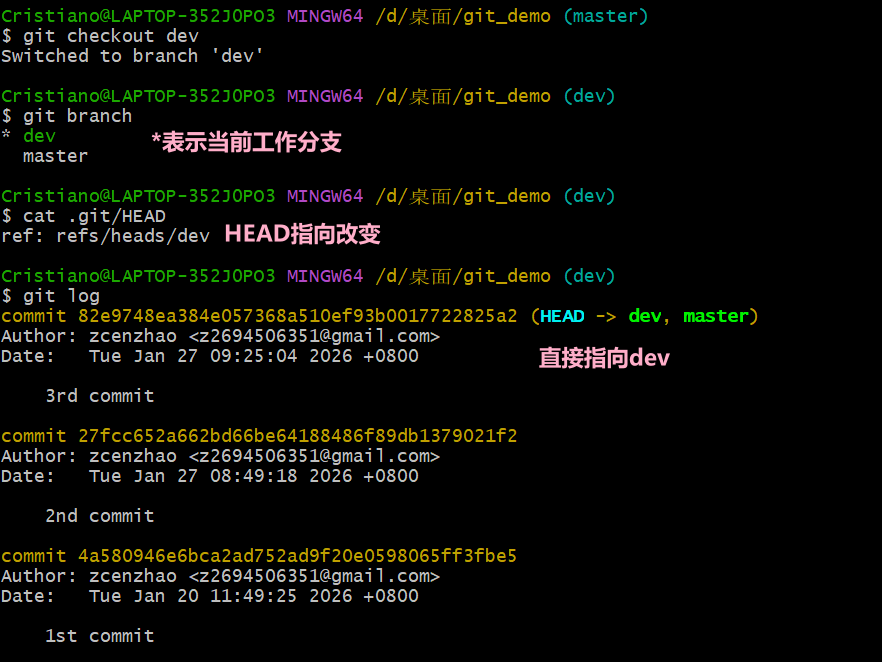</p>

为了观察两个分支如何产生差异，在 `dev` 上新建一个内容为 `dev` 的文件 `dev.txt`，添加到暂存区后进行提交。

```bash
echo "dev" > dev.txt
ls
git add dev.txt
git commit -m "1st commit from dev branch"
git log
```

提交后，`dev` 指向新提交，截图中的哈希值为 `e71aeb1`，而 `master` 仍停留在 `82e9748`。`HEAD` 继续指向 `dev`，因此也通过 `dev` 关联到这次新提交。这说明在一个分支上提交，不会让其他分支一起向前移动。

此时 `dev` 比 `master` 多了一次提交。如果切回 `master`，再基于它创建不同的新提交，两个分支就会从共同的提交处分叉。不过，本次演示先不创建这个提交，而是继续观察分支的删除。

<p align="center">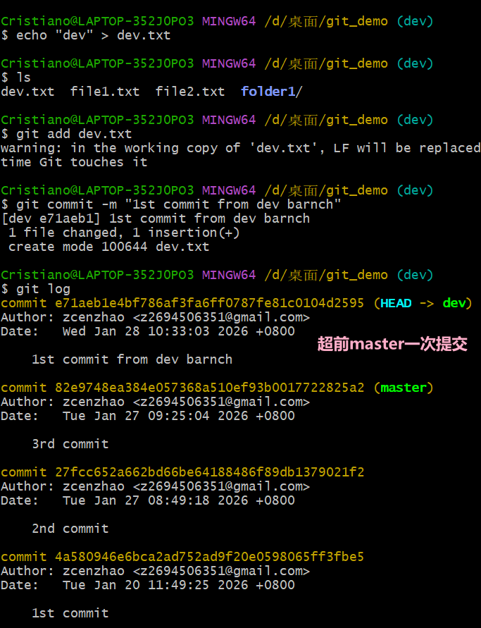</p>

删除分支前，需要先离开这个分支。当前位于 `dev` 时，即使执行 `git branch -D dev`，也会报错，不能删除正在使用的分支。

执行 `git checkout master` 切回 `master`，再执行 `git log`，看到的最新提交又是 `82e9748`。默认的 `git log` 从当前提交开始沿历史向前查找，因此这里不会显示只在 `dev` 上的新提交。

接着执行 `git branch --delete dev`，也就是 `git branch -d dev`。在本例中，`dev` 上的新提交尚未合并到 `master`，Git 会拒绝删除，避免误删尚未合并的工作。如果确定要删除，可以执行 `git branch -D dev`，跳过未合并检查。命令会直接执行，不再要求确认，并输出被删除分支原来指向的提交缩写 `e71aeb1`。

删除分支会不会同时删除它对应的对象？可以继续执行以下命令验证：

```bash
git cat-file -t e71aeb1
git cat-file -p e71aeb1
git cat-file -p b48a27
git cat-file -p 38f8e8
```

`e71aeb1` 的类型仍然是 `commit`，其中记录了根目录树 `b48a27` 和父提交 `82e9748`。查看 `b48a27`，还能找到 `dev.txt`，对应的 `blob` 对象为 `38f8e8`；继续读取该对象，内容仍为 `dev`。

<p align="center">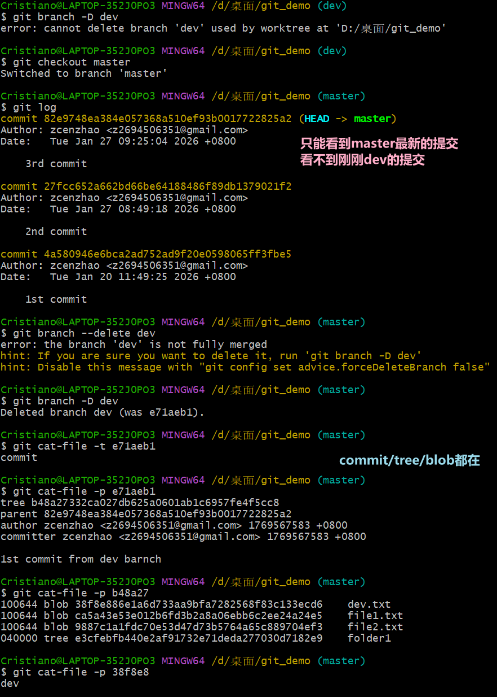</p>

因此，删除 `dev` 分支，删除的是分支引用，不会立即删除相关的 `commit`、`tree` 和 `blob` 对象。这些对象暂时还在，所以仍能通过哈希值读取，但不一定会永久保留。之后是否会被清理，留到介绍垃圾对象时再说明。

前面多次修改文件并执行 `git add` 时，也会留下类似的对象：每次添加不同的内容，都可能生成新的 `blob` 对象，索引则改为指向最近添加的内容。旧对象不会立即消失，其中仍被其他提交等引用的对象还需要保留，其余对象则可能在之后被清理。

本节演示了分支的基本操作。分支合并尚未展开，将在后续章节中介绍。

## 10. checkout 特定的 commit

上一节使用 `git checkout <分支名>` 切换工作分支。切换时，`HEAD` 会改为指向目标分支，两个分支各自指向的提交不会因此改变；同时，Git 通常也会更新索引区和工作区，使其对应检出的版本。

除了分支名，`git checkout` 还可以接收某次提交的哈希值。此时，`HEAD` 会直接指向这次提交，而不再通过分支引用间接指向它。这种状态称为分离头指针状态（detached HEAD），也就是前面提到的 `HEAD` 游离态。

图中以检出第二次提交 `27fcc6` 为例，`HEAD` 直接指向该提交，而 `master` 仍停留在第三次提交 `82e9748`。检出历史提交，并不会将 `master` 分支一起移回去。

<p align="center"></p>

接下来在实际仓库中检出第一次提交。先执行 `git log` 查看历史，当前 `master` 指向第三次提交 `82e9748`。再查看 `.git/HEAD` 和 `.git/refs/heads/master`，可以确认 `HEAD` 指向 `master`，而分支引用中保存的是这次提交的哈希值。

执行 `git checkout 4a5809`，检出第一次提交。Git 会提示当前进入了 `detached HEAD` 状态，终端提示符中也不再显示 `master`，而是显示提交哈希值。执行 `ls`，可以看到这个版本只有 `file1.txt` 和 `file2.txt`，还没有后来创建的 `folder1`。

此时，`HEAD` 直接指向第一次提交。默认的 `git log` 从当前提交开始沿父提交查找，因此只会显示这次根提交，并不表示后续提交已经被删除。

在游离态下，仍然可以查看文件、修改内容、创建新文件，甚至进行提交。不过，新提交不会自动归到某个本地分支上。如果需要保留这些提交，最好在离开前创建分支，以免之后难以找回。

如果准备继续修改，可以先执行 `git checkout -b tmp`，在当前提交上创建并切换到 `tmp` 分支。之后执行 `git log`，仍会看到第一次提交，但标记已经变为 `HEAD -> tmp`，表示重新回到了通过分支引用提交的状态。在支持 `git switch` 的 Git 版本中，也可以使用 `git switch -c tmp`。

创建分支只是为当前提交建立引用，不会代替 `git add` 和 `git commit` 保存尚未提交的修改。如果已经在游离态下创建了新提交，也可以在离开前创建分支，让分支指向当前的新提交。

<p align="center"></p>

检出特定提交还可以用于恢复误删分支上的工作。上一节删除了 `dev`，但它曾经指向的提交及相关对象仍在仓库中。要恢复，只需找到那次提交，再重新建立分支引用。

先执行 `git checkout master` 返回 `master`，再通过 `git log` 和 `ls` 查看当前版本。可以看到三个原有提交，工作区中有 `file1.txt`、`file2.txt` 和 `folder1`，但没有只在 `dev` 上提交过的 `dev.txt`。

如果记得之前删除分支时显示的哈希值，就可以直接使用它。否则，也可以逐个检查对象库中的提交对象，但对象多时会很麻烦。更方便的方法是执行 `git reflog`，查看本地引用的更新记录。这里不带参数时，显示的是 `HEAD` 的引用日志，其中记录了之前的切换和提交操作，具体原理将在后续介绍。

在本例的输出中，可以找到 `e71aeb1`，对应先前在 `dev` 上创建的那次提交。执行 `git checkout e71aeb1`，就会检出该提交并进入游离态。再执行 `ls`，可以看到 `dev.txt` 已重新出现在工作区中。

最后执行 `git checkout -b dev`，在这次提交上重新创建并切换到 `dev` 分支，就恢复了之前删除的分支。

```bash
git checkout master
git log
ls
git reflog
git checkout e71aeb1
ls
git checkout -b dev
```

<p align="center"></p>

恢复后，`dev` 仍比 `master` 多一次提交。重新创建分支后，就又能通过分支名找到原来的提交、目录树和文件内容。这次能找回，是因为对象还在，并且可以从 `git reflog` 中找到对应的提交哈希值。

本节介绍了检出特定提交、在该提交上创建分支，以及通过引用日志找回已删分支的操作。游离态本身并不表示出错，关键是理解 `HEAD` 此时直接指向提交，并在需要保留新提交时为它建立引用。

## 11. 聊聊 git diff 命令

前面通过 `git status` 查看了哪些文件发生变化，如果想知道具体改了哪些内容，可以使用 `git diff`。编辑器也提供了直观的差异对比界面，本节先以 VS Code 为例，再观察命令行中的输出。

假设 `README.md` 已经提交，工作区、索引区与当前提交的内容一致。现在在文件中添加一个空格并保存，VS Code 会将文件标记为 `M`，表示已修改，源代码管理图标上的数字则提示当前待处理的更改数量。本例中只有一个文件发生变化，因此显示为 `1`；如果另一个文件也发生变化，数字就会相应增加。

编辑器左侧的蓝色标记表示该行有修改，点击后可以查看修改前后的内容。截图中，在 `git init` 与后面的括号之间新增了一个空格。

<p align="center"></p>

在源代码管理面板中点击“更改”列表下的文件，可以打开差异对比视图。本例比较的是索引区与工作区：左侧为索引区的内容，右侧为工作区的内容。删除、修改和新增的部分会被高亮显示。

继续在文件末尾添加一个空行和一行 `Thanks`，保存后，右侧就会显示这两行新增内容。通过这种视图，可以直接看到文件的具体变化。

<p align="center"></p>

命令行也可以查看相同的差异。执行 `git status`，可以确认 `README.md` 已修改但尚未暂存；再执行 `git diff`，即可比较索引区与工作区，查看尚未暂存的修改。如果有多个已跟踪文件发生变化，输出中会依次列出相应的文件差异。命令行插件也可能通过提示符号表示仓库有变动，但这些符号不是 `git diff` 本身的输出。

本例的输出以 `diff --git a/README.md b/README.md` 开头，表示正在比较 `README.md` 的两个版本。接下来的 `index 9f38f38..233e00d 100644` 给出两侧内容对应的对象哈希值缩写和文件模式。其中，`9f38f38` 对应索引区中的 `blob` 对象，`233e00d` 对应工作区当前内容按 `blob` 对象规则计算出的哈希值。

`--- a/README.md` 和 `+++ b/README.md` 分别表示比较前后的文件版本。在本次 `git diff` 中，前者来自索引区，后者来自工作区。具体比较哪两个版本，取决于执行的命令。

差异按块（hunk）显示，每块除了改动本身，还会保留附近的上下文，不必把整个文件都输出一遍。本例有两块：

- `@@ -4,7 +4,7 @@`：旧版本从第 4 行开始显示 7 行，新版本也从第 4 行开始显示 7 行
- `@@ -19,4 +19,6 @@`：旧版本从第 19 行开始显示 4 行，新版本从第 19 行开始显示 6 行

第一块包含添加空格的那一行，附近的上下文一直显示到 `git rm` 所在行。第二块包含文件末尾的变化，新版本比旧版本多一个空行和一行 `Thanks`，因此两侧显示的行数不同。这些范围包括上下文，不表示其中每一行都发生了修改。

差异内容中，行首的 `-` 表示旧版本中删除的行，`+` 表示新版本中添加的行，空格表示未改变的上下文。截图中的 `\ No newline at end of file` 则说明相应版本的文件末尾没有换行符，不是文件中新增的一行文字。

<p align="center"></p>

可以进一步验证输出中的两个哈希值。执行 `git cat-file -p 9f38f38`，能够读取索引区对应的对象，看到添加空格和 `Thanks` 之前的内容。再执行 `git cat-file -p 233e00d`，则会报 `Not a valid object name`。

这是因为本例中的工作区修改尚未执行 `git add`，对应的对象还没有写入对象库。`git diff` 可以计算这份内容对应的对象哈希值，却不会仅为显示差异就把它保存为对象。因此，输出中出现哈希值，并不意味着对象库中已经存在对应的对象。

<p align="center"></p>

除了查看尚未暂存的修改，还可以执行 `git diff --cached`，比较当前提交与索引区，查看已经暂存、准备提交的更改。默认比较的提交是 `HEAD` 指向的当前提交。

在本例中，刚开始只有工作区发生变化，索引区仍与当前提交一致，因此 `git diff --cached` 没有输出。执行 `git add README.md` 后，索引区更新为文件的最新内容；如果没有继续编辑，工作区与索引区就会一致，此时 `git diff` 没有输出，而 `git diff --cached` 会显示刚才的差异。

```bash
git diff --cached
git add README.md
git diff
git diff --cached
```

<p align="center"></p>

因此，可以根据要查看的范围选择命令：`git diff` 查看尚未暂存的修改，`git diff --cached` 查看已暂存、准备包含在下一次提交中的更改。编辑器中的差异视图也可以按照相同的比较关系来理解。

## 12. 远程仓库的添加

前面的操作都在本地完成。本节将已有的本地仓库关联到 GitHub 上的远程仓库，再进行推送，观察远程配置、分支引用和本地 `.git` 目录的变化。

首先，在 GitHub 上创建名为 `git-demo` 的仓库。因为本地已经有文件和提交历史，这里不勾选添加 README、`.gitignore` 或许可证，先创建一个空仓库。

<p align="center"></p>

创建后，GitHub 会分别提供新建本地仓库和推送已有仓库的操作指引。本例采用推送已有仓库的方式。页面中的示例使用 `main`，但本地一直使用 `master`，因此后续命令继续使用 `master`，不执行示例中重命名分支的步骤。

远程地址可以选择 HTTPS 或 SSH。HTTPS 地址形如 `https://github.com/用户名/仓库名.git`，SSH 地址形如 `git@github.com:用户名/仓库名.git`，需要根据已经配置好的认证方式选择。本例先复制 HTTPS 地址，后面再改用 SSH。

<p align="center"></p>

进入本地仓库，确认要推送的文件修改已经提交，再执行 `git remote add origin https://github.com/zcenzhao/git-demo.git`。其中，`git remote` 用来管理远程仓库配置，`add` 表示新增配置，`origin` 是给远程仓库起的名字，最后是远程地址。`origin` 是常见的约定名称，并不是固定不变的名称。

可以在添加前后分别执行 `tree .git`。仅添加远程配置时，本例中的目录结构没有变化，但 `.git/config` 中新增了对应的配置。执行 `cat .git/config`，可以看到：

```ini
[remote "origin"]
    url = https://github.com/zcenzhao/git-demo.git
    fetch = +refs/heads/*:refs/remotes/origin/*
```

`url` 保存远程仓库地址，`fetch` 指定获取远程分支时引用的对应关系：远程的分支会记录到本地 `refs/remotes/origin/` 下。这里只是添加了远程配置，还没有把本地提交上传。

<p align="center"></p>

本次操作使用 HTTPS 时出现错误，因此改用已经配置好认证的 SSH 方式。先执行 `git remote -v` 查看地址，再通过 `git remote set-url` 修改 `origin` 的地址，然后推送本地 `master`。

```bash
git remote -v
git remote set-url origin git@github.com:zcenzhao/git-demo.git
git remote -v
git push -u origin master
tree .git
```

`git push -u origin master` 将本地 `master` 分支推送到远程 `origin` 的同名分支。`-u` 是 `--set-upstream` 的简写，用于为本地分支设置上游关系。远程原先是空仓库，因此本次推送也会在远程创建 `master` 分支。

推送输出中可以看到，Git 枚举并写入了 14 个对象，其中 9 个对象参与压缩。`[new branch] master -> master` 表示在远程创建了分支，随后提示本地 `master` 已设置为跟踪 `origin/master`。对象如何压缩，留到后续介绍。刷新 GitHub 页面，也可以看到上传的文件和提交历史。

<p align="center"></p>

再查看本地 `.git`，本次推送后新增了四个目录和两个文件。分支引用相关的变化包括目录 `.git/refs/remotes`、`.git/refs/remotes/origin`，以及文件 `.git/refs/remotes/origin/master`。

<p align="center"></p>

另一部分是对应的引用日志：新增目录 `.git/logs/refs/remotes`、`.git/logs/refs/remotes/origin`，以及文件 `.git/logs/refs/remotes/origin/master`。这里的 `master` 是文件，不是目录。

<p align="center"></p>

执行 `cat .git/refs/remotes/origin/master`，可以看到它记录的提交哈希值以 `65c45d1` 开头。使用 `git cat-file -t 65c45d1ad51e7ed62d1d083f255e7dc7d2bb1c9b`，可以确认它指向的是一个 `commit` 对象。再读取 `.git/refs/heads/master`，得到的也是同一个哈希值。

这里需要区分：GitHub 上有远程仓库自己的 `master` 分支，本地的 `master` 保存在 `refs/heads/master`，而 `origin/master` 是本地保存的远程跟踪引用，用来记录本地已知的远程分支位置。它不是直接读取远程服务器的实时结果。

执行 `git log`，可以看到 `HEAD -> master, origin/master` 同时标在提交 `65c45d1` 旁边。结合刚才成功推送的结果，说明此时本地分支与远程分支指向同一次提交。这次提交的信息为 `add README.md`，在原有三次提交的基础上增加了 README，因此此时 `master` 的历史中共有四次提交。

<p align="center"></p>

接下来修改本地的 `README.md`，添加到暂存区并创建新的提交。

```bash
git add README.md
git commit -m "update README.md"
git log
```

新提交为 `c1c4d22`，本地 `master` 随之向前移动，但尚未推送，所以 `origin/master` 仍记录在 `65c45d1`。此时本地分支比远程跟踪引用多一次提交，远程仓库也还没有这次更新。

<p align="center"></p>

首次推送时已经通过 `-u` 建立了上游关系，在本例的配置下，后续可以直接执行 `git push`，不必每次都重新指定远程仓库和分支。也可以明确写成 `git push origin master`。

<p align="center"></p>

执行 `git push` 后，再通过 `git log` 查看，可以看到 `HEAD -> master, origin/master` 都出现在 `c1c4d22` 旁边。推送成功后，本地远程跟踪引用也更新到了这次提交。

<p align="center"></p>

刷新 GitHub 页面，可以看到 `master` 的历史中已有五次提交，最新一条为 `update README.md`。添加远程配置、提交本地修改与推送是不同的操作：`git remote add` 记录连接信息，`git commit` 创建本地提交，`git push` 则将相关提交和分支更新发送到远程仓库。

## 13. 远程仓库到底“长啥样”

平时使用 GitHub 或 GitLab，通常看到的是网页上的文件和提交记录。远程仓库在服务器上实际保存成什么样？本节通过一个自行搭建、可以登录后台的 GitLab 服务器，观察仓库的存储方式。演示从 GitLab 的 `Demo` 群组开始，在其中创建一个新项目。

<p align="center"></p>

选择创建空白项目，命名为 `git-test`，不勾选“Initialize repository with a README”，使它成为一个没有初始提交的空仓库。

<p align="center"></p>

创建后，登录服务器查看仓库存储目录，可以看到新增了 `git-test.git`。本例中，服务器当前目录为 `/var/opt/gitlab`，执行 `sudo ls git-data/repositories/Demo/`，就能列出该群组下的仓库。截图中还出现了 `git-test.wiki.git`，它对应项目的 Wiki 仓库，这里主要观察代码仓库 `git-test.git`。

本例的完整仓库路径为 `/var/opt/gitlab/git-data/repositories/Demo/git-test.git`。实际位置取决于 GitLab 的配置和存储方式，后面就通过这个路径查看仓库。

<p align="center"></p>

执行 `sudo ls git-data/repositories/Demo/git-test.git`，可以看到 `config`、`description`、`HEAD`、`hooks`、`info`、`objects` 和 `refs`，与本地普通仓库的 `.git` 目录中的内容类似。

<p align="center"></p>

再用 `tree` 查看完整结构，可以看到 `hooks` 下的示例脚本、`objects` 下的 `info` 和 `pack`，以及 `refs` 下的 `heads` 和 `tags`。此时还没有提交，因而没有对应的对象文件，`refs/heads` 下也没有分支引用文件。

<p align="center"></p>

服务器端用于接收推送的仓库通常是裸仓库（bare repository）：仓库目录本身保存对象、引用和配置，没有普通仓库那样供直接编辑的工作区，也不需要在其中再套一层 `.git` 目录。因此，服务器上并不是另外检出了一份与本地相同的工作区文件。

接下来回到本地，创建并进入 `git-test` 目录，执行 `git init` 初始化仓库。通过 `echo "this is readme" > README.md` 创建文件，再执行 `git add README.md` 和 `git commit -m "first commit"`，完成第一次提交。输出中的提交哈希值缩写为 `bda7292`。

随后，通过 `git remote add origin https://gitlab-demo.com/Demo/git-test` 添加远程地址，再执行 `git push origin master`，将本地 `master` 推送到服务器。推送输出显示共传输了三个对象，对应本次提交的 `commit`、`tree` 和 `blob` 对象。命令中使用的地址没有 `.git` 后缀，因此本次还出现了重定向到 `.git/` 地址的提示。

<p align="center"></p>

推送后，再查看服务器上的 `git-test.git`，可以看到 `objects` 下新增了三个对象文件，`refs/heads` 下也出现了 `master`。

在服务器上执行 `sudo cat git-data/repositories/Demo/git-test.git/refs/heads/master`，可以看到远程分支引用记录的完整提交哈希值为 `bda7292c197a23aa20ed03d19ad2e0bc72d550fb`。

<p align="center"></p>

回到本地执行 `git log`，最新提交也是前面的 `bda7292`，提交信息为 `first commit`。旁边标有 `HEAD -> master, origin/master`，说明本地分支和远程跟踪引用指向同一次提交。再与服务器上的记录比较，就能确认这次推送后，两端的 `master` 已经同步。

<p align="center"></p>

刷新 GitLab 页面，可以看到仓库已有一次提交、一个分支，并显示了 `README.md`，内容为 `this is readme`。网页上显示的提交缩写 `bda7292c`，与前面查看的是同一个提交。

网页中的目录和文件内容，可以通过分支指向的提交，再沿着 `commit`、`tree` 和 `blob` 对象之间的引用找到，并不要求服务器上存在一份检出的工作区。

<p align="center"></p>

因此，推送不仅是将工作区中的文件复制到服务器，而是将远程缺少的相关 Git 对象传过去，并更新远程的分支引用。理解了本地对象和引用的关系，也就能理解远程仓库保存这些信息的基本方式。

## 14. git 对象的压缩

这里所说的 Git 对象压缩，主要指 `blob` 对象的压缩。文件内容保存在 `blob` 对象中，压缩后可以减少存储空间占用。

前面介绍过，`blob` 对象中保存的是压缩后的文件内容，类似于 `zip` 压缩。压缩效果与文件内容有关：文本文件通常比较容易压缩，二进制文件则较难压缩。除了这种针对单个对象的压缩，Git 还有另一种压缩机制，本节将通过几个例子来介绍。

首先，准备三个文件，每个文件的大小都是 10 MB。

- `file1.txt` 和 `file2.txt` 为文本文件
- `file.bin` 为二进制文件

<p align="center"></p>

`file1.txt` 的内容比较简单，主要是重复的字符，因此容易压缩。

<p align="center"></p>

`file2.txt` 的内容是随机的 Base64 可打印字符，较难压缩。

<p align="center"></p>

`file.bin` 是二进制文件，无法直接以文本形式阅读其中的内容。

接下来，在当前目录初始化一个 Git 仓库，再依次添加这三个文件，观察生成的 `blob` 对象有多大。

先执行 `git add file1.txt`，将 `file1.txt` 添加到索引区。生成的 `blob` 对象位于 `.git/objects/d4` 目录下，大小只有 45 KB。原文件中的重复字符较多，因此压缩效果很好。

<p align="center"></p>

接着添加 `file2.txt`。生成的 `blob` 对象位于 `.git/objects/d7` 目录下，大小为 7.7 MB。这个文件的内容比较随机，压缩后的大小与原文件相比减少得不多。

<p align="center"></p>

最后添加 `file.bin`，生成的 `blob` 对象位于 `.git/objects/26` 目录下，后面再查看它的大小。对于二进制文件，生成的 `blob` 对象通常比原文件更大。例如，原文件大小为 10486780 字节，而 `blob` 对象大小为 10489990 字节。

<p align="center"></p>

这个二进制文件压缩后，体积反而增大了。以上就是三个文件对应的 `blob` 对象的压缩情况。前面已经做过类似的演示，这里再次比较，是为了在此基础上引出另一个问题。

先将仓库恢复到初始状态：删除 `.git` 目录，重新初始化仓库。然后删除 `file.bin` 和 `file1.txt`，只保留 `file2.txt`。

将 `file2.txt` 添加到索引区后，会生成一个约 7.7 MB 的 `blob` 对象，再进行第一次提交。此时，仓库中共有三个对象：一个 `blob` 对象、一个 `tree` 对象和一个 `commit` 对象。其中，绝大部分空间都被 `blob` 对象占用。

<p align="center"></p>

<p align="center"></p>

接下来，继续修改这个文件，直到完成四次提交。每次只做很小的修改，例如删除两三个字符，然后添加并提交。

第一次修改后，添加文件会生成一个新的 `blob` 对象，`objects` 目录的大小随之增至约 15 MB。此时，主要占用空间的是两个 `blob` 对象：最初的对象约为 7.7 MB，修改后生成的对象也差不多大。随后进行第二次提交，目录大小没有明显变化。再重复两次，完成第三次和第四次提交。此时，仓库中共有四次提交记录，再查看 `objects` 目录的大小。

<p align="center"></p>

<p align="center"></p>

此时，`objects` 目录占用了约 31 MB，其中主要是四个 `blob` 对象，每个约 7.7 MB，合计约 30 MB。而工作区中的文件只有 10 MB，`.git/objects` 目录却已经占用了 31 MB。

回顾前面的操作，每次提交只修改了三到五个字符，但 Git 仍会保存整个文件内容压缩后的版本，每次约 7.7 MB。如果提交成百上千次，这些对象就会占用大量空间。

<p align="center"></p>

单独压缩每个文件，7.7 MB 已经接近本例中的压缩极限。不过，这四个对象的内容几乎相同，只有少量字符不同，是否还能进一步压缩？

Git 提供了相应的方法：执行 `git gc` 命令，对这些对象进行压缩。

执行后再查看 `.git/objects` 目录，可以看到它的大小已经降至约 7.6 MB。原先的对象文件也不在原来的位置了，而是被打包到了 `.git/objects/pack` 目录中。这个目录就是用来存放打包压缩后的对象文件的。

<p align="center"></p>

关于 `gc` 具体执行的操作以及 `.git/objects/pack` 文件夹的作用，将在第 16 节继续介绍。

## 15. 关于 SHA-1 的小插曲

本节介绍 Git 中使用的 SHA-1 哈希算法。在本例使用的 SHA-1 仓库中，Git 生成对象时，会计算对象的 SHA-1 哈希值，并用它来命名对象。不过，SHA-1 已经不再适合安全用途。2017 年，谷歌宣布首次成功实现 SHA-1 哈希碰撞：研究人员找到了两个内容不同的文件，但它们的 SHA-1 哈希值完全相同。

<p align="center"></p>

谷歌在网站上提供了这两个 PDF 文件（PDF 1 和 PDF 2），可以下载验证。两个文件的内容明显不同，但使用 `sha1sum` 工具计算文件内容的 SHA-1 哈希值，会发现结果完全一致。

<p align="center"></p>

<p align="center"></p>

如果将 SHA-1 用于数字签名等安全用途，哈希碰撞就会带来风险。例如，HTTPS 网站证书可以使用基于 SHA-1 的签名，浏览器负责验证证书。攻击者可能利用不同内容具有相同哈希值这一点伪造签名，因此主流浏览器已停止支持使用 SHA-1 签名的网站证书。对这两个 PDF 文件计算 SHA-256 哈希值，则会得到不同的结果。主流的安全相关操作也普遍采用 SHA-256 或更安全的算法。

回到 Git，如果把这两个 PDF 文件放进仓库，会发生什么？Git 保存文件时会生成对应的 `blob` 对象，对象的文件名由其哈希值决定，而哈希值与文件内容有关。

先初始化仓库，将第一个 PDF 文件添加到索引区，再执行 `git ls-files -s`，查看它对应的 `blob` 对象的 SHA-1 哈希值。接着添加第二个 PDF 文件，再次查看索引，可以发现两个文件对应的 `blob` 对象的哈希值并不相同。这次测试没有在 Git 中产生碰撞。

<p align="center"></p>

如果两个内容完全不同的文件，在 Git 中生成了相同的 `blob` 对象哈希值，会有什么后果？添加第一个文件时，Git 会生成一个 `blob` 对象；添加第二个文件时，如果哈希值相同，Git 就可能不再创建新的对象，导致第二个文件的内容无法正确保存，或被当作第一个文件的内容，从而破坏仓库的完整性。

本次演示中没有出现这种情况，是因为 Git 计算 `blob` 对象的哈希值时，会先在文件内容前添加一个头部（`header`），再计算 SHA-1。头部包含对象类型、大小和用于分隔的空字符等信息，因此参与计算的数据与直接使用 `sha1sum` 计算文件内容时不同。这两个 PDF 文件虽然具有相同的文件 SHA-1 哈希值，在 Git 中却得到了不同的对象哈希值。

找到两个内容不同、SHA-1 哈希值却相同的 PDF 文件，本身就需要大量计算资源。Git 在文件内容前增加了头部信息，进一步加大了碰撞的难度。因此，在 Git 中实现 SHA-1 碰撞更加困难，相对安全。

为了降低对 SHA-1 的依赖，Git 已支持使用 SHA-256 创建仓库，例如 `git init --object-format=sha256`。本系列仍以 SHA-1 仓库为例，实际选择时还需要考虑相关工具和托管平台的支持情况。

## 16. git pack 的压缩

前面通过 `git gc` 对仓库中的对象进行了压缩。从输出可以看到，Git 共处理了 12 个对象，并使用了差异压缩（delta compression）。最后显示的 `Total 12 (delta 3)`，表示包中仍有 12 个对象，其中 3 个采用差异存储，并不是压缩后只剩下 3 个对象。

<p align="center"></p>

为什么有 3 个差异对象？回顾前面的操作，我们对一个文件修改了三次，共进行了四次提交。本例中，每次添加并提交都生成了一个新的 `blob`、一个 `tree` 和一个 `commit` 对象，因此共有 12 个对象，其中 4 个 `blob` 对应文件的四份内容。

由于每次只修改了少量字符，这 4 个 `blob` 的内容很接近，可以保存一个基础对象，再用差异数据表示另外 3 个对象。这样，原来四个各约 7.7 MB 的对象，打包后就只需约 7.6 MB。

接下来查看 `pack` 文件。它位于 `.git/objects/pack` 文件夹中。这里有两个文件，扩展名分别为 `.idx` 和 `.pack`，文件名都以 `pack-` 开头，后面跟着一串哈希值。这个哈希值如何计算，暂时不展开介绍。

查看文件大小，可以看到 `.idx` 只有约 1.4 KB，而 `.pack` 约为 7.6 MB，压缩后的主要数据就保存在 `.pack` 中。

<p align="center"></p>

`.idx` 是索引文件，Git 通过它快速找到 `.pack` 中的对象。虽然对象已经打包，但仍然可以用原来的命令读取。例如，通过 `git cat-file -p` 查看一个 `commit` 对象，可以看到其中的 `tree` 和 `parent` 信息；继续查看 `tree`，可以找到它引用的 `blob`；再读取 `blob`，就能看到原来的文件内容。

<p align="center"></p>

因此，打包后不需要改变查看对象的方式，Git 会通过索引找到对象，并还原出它的完整内容。

如果想知道包里有哪些对象，可以使用 `git verify-pack -v`，`-v` 会让它列出详细信息。后面跟上文件路径，通常使用 `.git/objects/pack/` 下的 `.idx` 文件，也可以写对应的 `.pack` 文件。不过，两种写法都需要保留配套的 `.idx`。路径使用相对路径即可。

下面是本例的命令，换到其他仓库时，需要替换为对应的文件名。

```bash
git verify-pack -v .git/objects/pack/pack-eae125acb0e7e940db9774bf4abaf506f0efc98c.idx
```

<p align="center"></p>

输出中可以看到四个 `commit`、四个 `blob` 和四个 `tree` 对象，后面的数值记录了大小、包内位置等信息。其中，`d7a81d` 开头的 `blob` 是本例使用的基础对象，另外三个 `blob` 保存的是相对于它的差异数据，因此行末都附有这个基础对象的哈希值。

这样就不必为四份相近的内容分别保存完整副本，整个包约为 7.6 MB，而不是原先接近 31 MB。需要注意，基础对象不一定是时间上最早的版本。

对象压缩也有助于提高本地与远程仓库之间的传输效率。例如，从 GitHub 克隆 Ansible 这样的大型项目时，Git 会传输打包后的对象，客户端再接收并处理其中的差异数据。

<p align="center"></p>

克隆完成后，进入项目的 `.git/objects`，可以看到只有 `info` 和 `pack` 两个子目录，对象都保存在包中。进入 `pack`，可以看到对应的 `.pack` 和 `.idx` 文件。

同样可以用 `git verify-pack -v` 查看其中的对象。由于这个项目包含大量文件、目录和历史版本，输出会很长，处理也需要一定时间。

<p align="center"></p>

<p align="center"></p>

本例中，`.pack` 文件约为 173 MB。如果将包中的对象全部展开，所占空间会大得多。下一节将演示具体操作，观察展开前后的变化。

<p align="center"></p>

在克隆或推送等需要本地与远程服务器通信的操作中，压缩可以提高传输效率，节省带宽；在本地存储时，也能节约硬盘空间。

不过，读取对象时可能需要额外的处理。例如，检出某个历史版本时，Git 需要从包中找到对应的 `commit`、`tree` 和 `blob`，还原其中的差异对象，这可能增加一些耗时。

以上就是对 Git 中 `pack` 文件的简要介绍。下一节将演示如何把包中的对象分别取出保存，观察这种以更多存储空间换取更直接访问的方式，以及相关命令的用法。

## 17. git pack 的解压缩

上一节克隆了一个较大的 Ansible 仓库，其中的对象保存在约 173 MB 的 `.pack` 文件中。本节继续操作，将包中的对象分别取出，保存为单独的对象文件。

Git 提供了 `git unpack-objects` 命令。对命令的用法不熟悉时，可以通过 `git help` 查看帮助，例如执行 `git help unpack-objects`，就能看到它的说明。

<p align="center"></p>

文档说明，这个命令从标准输入读取 `.pack` 文件，将对象写成松散格式（loose format），也就是一个对象对应一个文件。这些单独保存的对象仍然是压缩的，和前面介绍的 `blob` 等对象文件一样。

其中有一点需要注意：仓库中已经存在的对象，不会被重复展开。如果包文件仍在 `.git/objects/pack` 中，Git 能从中找到这些对象，就不会再生成对应的松散对象。因此，本例先将 `.pack` 移出这个目录，让 Git 不再通过原来的包找到它们。

先在仓库根目录执行 `tree .git/objects`，确认当前只有 `info` 和 `pack` 两个子目录，对象都保存在包中。然后将 `.pack` 文件移到 `.git` 目录，原来的 `.idx` 暂时保留在原处。

<p align="center"></p>

移动后再查看 `.git` 的目录结构，可以看到 `.pack` 已经与 `objects` 目录处于同一层级。这并不是移出了整个仓库，而是移出了 Git 查找包文件的目录。

<p align="center"></p>

接下来，在仓库根目录执行以下命令。`<` 是输入重定向符号，用来把移出的包文件内容交给 `git unpack-objects`。

```bash
git unpack-objects < .git/pack-b1af892e76b9f126906567c0ae309d81f90498fc.pack
```

执行后，Git 会将对象写入 `.git/objects`，生成按哈希值前两位命名的子目录，以及各个对象文件。终端中可以看到解包进度。

<p align="center"></p>

本次共展开了 525687 个对象。完成后，执行 `du -sh .git/objects`，可以看到目录占用了约 2.6 GB，而原来的 `.pack` 只有约 173 MB。确认解包完成后，就可以删除之前移出的 `.pack` 文件。

<p align="center"></p>

通过这个实验可以看到，打包与差异压缩减少了大量重复数据，不仅节省本地空间，也能减少克隆仓库时需要传输的数据。如果直接传输这些单独保存的对象，需要的空间和传输量都会大得多。

`git unpack-objects` 在日常使用中较少直接调用，这里主要通过实际展开对象，观察打包前后存储方式和空间占用的差别。

## 18. git 垃圾对象的清理

前面提到，多次添加文件或删除分支后，对象库中可能留下不再使用的对象。本节通过两个实验，观察这些对象如何产生，以及怎样清理。

先初始化一个新仓库，执行 `echo 'abc' > test.txt` 创建文件，再通过 `git add test.txt` 添加到索引区。查看 `.git/objects`，可以看到一个 `blob` 对象。

<p align="center"></p>

随后修改 `test.txt`，增加一行 `123`，保存后再次执行 `git add test.txt`，生成第二个 `blob` 对象。

<p align="center"></p>

继续增加一行 `xyz`，保存并第三次执行 `git add test.txt`。此时对象库中共有三个 `blob`，分别对应三次添加时的文件内容。

<p align="center"></p>

接下来执行 `git commit -m '1st commit'`。提交后共有五个对象：一个 `commit`、一个 `tree` 和三个 `blob`。这次提交只引用文件的最新内容，因此沿着提交和目录树能找到的只有三个对象；另外两个 `blob` 是添加过程中留下的中间内容，没有被当前索引或提交引用，是本次准备清理的对象。

<p align="center"></p>

先执行 `git gc`，可以看到 Git 打包了三个对象。

<p align="center"></p>

再查看对象目录，另外两个 `blob` 仍作为松散对象保留。通过 `git verify-pack -v` 查看包，里面只有提交引用的 `commit`、`tree` 和最新的 `blob`。

<p align="center"></p>

这并不是 `git gc` 不会清理对象。它还会考虑对象的保留时间，近期生成的不可达对象（`unreachable objects`）通常不会立即删除。如果想进一步了解清理命令，可以执行 `git help prune` 查看说明。文档中提到，一般使用 `git gc` 即可，它会调用相应的清理操作；`git prune` 则用于删除不可达的松散对象，包中的不可达对象不由它直接移除。

<p align="center"></p>

实际删除前，可以先执行 `git prune -n`。`-n` 表示模拟执行（dry run），只列出将要删除的对象，不真正删除。本例输出的正是前面两个中间状态的 `blob`。

<p align="center"></p>

也可以使用 `git fsck` 检查仓库。本例中，它列出了相同的两个对象，标记为 `dangling blob`，即悬空的 `blob` 对象。它们仍然存在，只是不再被当前索引或提交等保留。

<p align="center"></p>

接着执行 `git prune`，再查看 `.git/objects`，可以看到那两个松散对象已经被删除，原来的包文件仍然保留，其中的三个对象没有变化。

<p align="center"></p>

以上是多次执行 `git add` 留下中间对象的情况。接下来再观察删除分支后留下的对象。

通过 `git checkout -b tmp` 创建并切换到 `tmp` 分支，新建内容为 `tmp` 的 `tmp.txt`，添加并提交，提交信息为 `1st commit from tmp`。这次提交新增了三个对象：`commit`、`tree` 和 `blob`，提交哈希值为 `604b16d`。

<p align="center"></p>

此时旧包中仍是原来 `master` 提交相关的三个对象，新提交的三个对象则单独保存在对象目录中。

<p align="center"></p>

如果现在执行 `git gc`，这些新对象也会被打包。不过，先不打包，而是切回 `master`，尝试删除 `tmp`。由于它的提交尚未合并，执行 `git branch -d tmp` 会被拒绝，再使用 `git branch -D tmp` 强制删除。

<p align="center"></p>

分支删除后，相关对象并没有立即消失。这与前面恢复误删分支的实验相同：提交仍可能通过引用日志找到，因此 Git 还会保留它以及相关的目录树和文件内容。

尝试执行 `git prune`，再查看对象目录，可以看到这三个对象仍然存在。

<p align="center"></p>

接着执行 `git gc`，输出显示共打包了六个对象，包括刚才删除分支后留下的三个对象。

<p align="center"></p>

通过 `git verify-pack -v` 查看新包，可以看到两个 `commit`、两个 `tree` 和两个 `blob`。再运行 `git fsck`，也没有输出悬空对象。这说明仅仅删除分支，并不代表相关对象已经失去所有保留它们的记录；本例中的引用日志仍然能找到这次提交。

<p align="center"></p>

如果确定不再需要这些临时提交，就还需要处理引用日志和对象保留时间。截图中的命令通过 `git -c` 为本次 `gc` 临时设置配置：将 `gc.reflogExpire` 和 `gc.reflogExpireUnreachable` 设为 `0`，让引用日志记录立即过期，同时将 `gc.pruneExpire` 设为 `now`，不再等待通常的对象保留期限。命令中还设置了与 `rerere` 记录清理有关的选项。

```bash
git -c gc.reflogExpire=0 \
    -c gc.reflogExpireUnreachable=0 \
    -c gc.rerereResolved=0 \
    -c gc.rerereUnresolved=0 \
    -c gc.pruneExpire=now gc "$@"
```

执行后，再通过 `git verify-pack -v` 检查新包，可以看到只剩下 `master` 提交所需的三个对象。这次清理移除了原本由引用日志保留的临时提交及其相关对象，也失去了通过这些日志恢复它们的机会。

<p align="center"></p>

这个实验说明，清理对象不只是看某个分支是否还存在，还要看对象是否仍被其他记录保留。多次添加留下的中间对象，与删除分支后仍能从引用日志找到的提交，处理起来会有不同。

对象较大时，清理不再需要的内容可以释放本地空间。不过，本地包里保留了某个对象，并不代表执行普通推送时一定会把它上传；推送主要围绕要更新的引用和相关对象进行。

如果是不小心提交了大文件或密码等内容，也要先判断它是否还被保留的提交引用。仍在提交历史中的内容，不能仅靠这些清理命令删除；已经推送出去的内容，也不会因为本地清理而自动从远程消失。本节演示的是不再需要的对象如何被清理，并不是任意删除历史文件的方法。

## 19. fast-forward 合并

从本节开始介绍分支合并。合并的情况有多种，这里先看最简单的一种：快进合并（fast-forward）。

先通过图示理解它的过程。假设 `master` 指向提交 `C2`，当前正在 `master` 上工作，因此 `HEAD` 指向 `master`。基于它创建并切换到 `bugfix`，再进行一次提交，就得到 `C3`。此时，`bugfix` 指向 `C3`，`C3` 的父提交是 `C2`，而 `master` 仍停留在 `C2`。

<p align="center"></p>

现在要将 `bugfix` 合并到 `master`，先执行 `git checkout master`，切回接收合并的分支，再执行 `git merge bugfix`。

由于 `master` 仍停留在 `C2`，Git 只需将它的指针向前移动到 `C3`，就能包含 `bugfix` 的全部提交。`HEAD` 仍然指向 `master`，通过它找到的提交也就变成了 `C3`。这个过程就是快进合并，不会额外生成一个合并提交。

<p align="center"></p>

这里的关键是：创建 `bugfix` 后，新的提交都发生在 `bugfix` 上，`master` 没有产生新的提交，两个分支的历史没有分叉。因此，合并时只需向前移动分支指针。即使 `bugfix` 上有多次新提交，只要 `master` 指向的提交仍是它的祖先，也可以进行快进合并。

接下来实际操作。当前仓库位于 `master`，只有一次提交。执行 `git checkout -b bugfix`，创建并切换到 `bugfix` 分支。

<p align="center"></p>

执行 `git log`，可以看到 `HEAD -> bugfix, master`。两个分支此时都指向 `8d44826`，但当前工作分支已经是 `bugfix`。

<p align="center"></p>

在 `bugfix` 上创建 `test2.txt`，内容为 `test2`，再添加并提交。

```bash
echo 'test2' > test2.txt
git add test2.txt
git commit -m '2nd commit'
```

<p align="center"></p>

再次执行 `git log`，可以看到新提交为 `bd57d7a`，`HEAD` 指向 `bugfix`，而 `master` 仍指向 `8d44826`。`bugfix` 已比 `master` 多一次提交。

<p align="center"></p>

接下来执行 `git checkout master`，切回 `master`，准备将 `bugfix` 合并进来。

<p align="center"></p>

合并前，先通过 `tree .git` 查看目录结构。当前共有 18 个目录、17 个文件，其中对象文件有 6 个：两个 `commit`、两个 `tree` 和两个 `blob`。本例中，两次添加并提交各产生了三个新对象；第二次提交的目录树仍会引用第一次提交中未改变的文件内容。

<p align="center"></p>

`refs/heads` 下有 `bugfix` 和 `master` 两个分支引用，它们指向不同的提交。执行 `git merge bugfix`，输出显示 `Updating 8d44826..bd57d7a` 和 `Fast-forward`，说明 `master` 从原来的提交移动到了 `bugfix` 的最新提交。工作区中也出现了 `test2.txt`。

<p align="center"></p>

合并后再次查看 `.git`，目录数量仍为 18 个，文件数量变为 18 个，新增的是 `ORIG_HEAD`。它保存了本次合并前的提交哈希值，可以用于之后撤销这次合并。

<p align="center"></p>

分别执行 `cat .git/HEAD`、`cat .git/ORIG_HEAD` 和 `cat .git/refs/heads/master`，可以看到：`HEAD` 仍指向 `master`，`ORIG_HEAD` 记录的是合并前的 `8d44826`，`master` 已指向合并后的 `bd57d7a`。对象目录中仍是原来的 6 个对象，快进合并没有创建新的对象。

需要退回合并前的位置时，可以借助 `ORIG_HEAD` 执行 `git reset`。

<p align="center"></p>

这里执行 `git reset ORIG_HEAD`，让 `master` 回到合并前的 `8d44826`。这个命令默认同时重置索引，但保留工作区文件，因此 `test2.txt` 还在，只是在合并前的版本中没有它，现在便显示为未跟踪文件（`Untracked files`）。后续可以根据需要修改、删除或重新添加并提交。

这并没有删除 `bd57d7a` 这个提交，`bugfix` 仍然指向它。这里只是让当前的 `master` 退回原来的位置，`reset` 的其他用法留到后续介绍。

<p align="center"></p>

以上就是快进合并的过程。如果实际开发时，其他成员的工作先合并到了 `master`，使 `master` 和自己的 `bugfix` 各自有了新提交，历史就会出现分叉，不能再只靠向前移动指针完成合并。下一节将继续介绍这种情况下如何合并。

## 20. 什么是 3 way merge

上一节介绍了快进合并，本节继续看两个分支各自有新提交时的情况，也就是三方合并（three-way merge）。

先看示意图。`master` 原来指向 `C2`，基于它创建 `bugfix`，并在 `bugfix` 上生成提交 `C3`。如果这时直接合并，可以进行快进。但如果合并前，`master` 也产生了新提交 `C4`，两个分支的历史就出现了分叉。

<p align="center"></p>

此时再执行 `git merge bugfix`，就不能只移动 `master` 的指针。Git 需要结合两边的内容生成合并结果。这里的“三方”，指两个分支各自的最新版本，以及它们的共同祖先版本；图中就是 `C3`、`C4` 和 `C2`。

接下来实际演示。当前 `bugfix` 比 `master` 多一次提交，最新提交为 `02d3ab4`，而 `master` 仍指向第一次提交 `48959a5`。如果现在合并，仍然是上一节的快进合并。

<p align="center"></p>

先执行 `git checkout master`，切回 `master`，创建内容为 `test3` 的 `test3.txt`，添加到索引区后提交，提交信息为 `3rd commit`。

```bash
echo 'test3' > test3.txt
git add test3.txt
git commit -m '3rd commit'
```

截图中第一次提交时还没有执行 `git add`，所以 Git 提示文件未跟踪；添加后再次提交才成功，得到新提交 `148d53f`。

<p align="center"></p>

这时执行 `git log`，可以看到 `master` 的最新提交为 `148d53f`，它的父提交仍是 `48959a5`。另一边，`bugfix` 从同一个起点产生了 `02d3ab4`。两个分支各自有了新提交，正好对应前面的分叉示意图。

<p align="center"></p>

合并前先执行 `tree .git/objects`，查看对象库。本例共有 9 个对象：三次添加并提交，各生成了一个 `blob`、一个 `tree` 和一个 `commit`。

<p align="center"></p>

接着在 `master` 上执行 `git merge bugfix`。本次合并可以自动完成，Git 随后打开 Vim，让我们填写合并提交的信息。保留默认的 `Merge branch 'bugfix'`，输入 `:wq` 保存并退出。

<p align="center"></p>

命令行显示 `Merge made by the 'recursive' strategy.`，表示本次使用 `recursive` 策略完成了合并。`bugfix` 中新增的 `test2.txt` 也出现在合并结果中。

<p align="center"></p>

再执行 `git log`，可以看到 `master` 指向了新提交 `3b04f8f`，提交信息为 `Merge branch 'bugfix'`。`bugfix` 本身没有移动，仍指向 `02d3ab4`。与快进合并不同，这次合并创建了一个新的合并提交（merge commit）。

<p align="center"></p>

执行 `git cat-file -p 3b04f8f`，查看这个提交，可以看到两行 `parent`：第一行指向合并前 `master` 的最新提交 `148d53f`，第二行指向 `bugfix` 的最新提交 `02d3ab4`。也就是说，这个合并提交有两个父提交，将两边的历史连接起来。

<p align="center"></p>

还可以分别查看 `.git/refs/heads/bugfix`、`.git/ORIG_HEAD` 和 `.git/refs/heads/master`。它们依次记录了 `bugfix` 的位置 `02d3ab4`、合并前当前分支的位置 `148d53f`，以及合并后的新提交 `3b04f8f`。

<p align="center"></p>

回到示意图，合并前的 `master` 和 `bugfix` 分别指向 `C4`、`C3`。合并完成后，`master` 指向新提交 `C5`，`C5` 同时以 `C4` 和 `C3` 为父提交，`bugfix` 仍停留在 `C3`。两条分支上的原有提交都保留在历史中。

<p align="center"></p>

默认的 `git log` 将提交逐条列出，不容易一眼看清分叉与合并的关系。使用 Sourcetree 这样的可视化工具，可以更直观地看到：第一次提交后，两边分别产生新的提交，最后又在合并提交处汇合。合并节点连接的两条线，就对应它的两个父提交。

<p align="center"></p>

本次演示中，`bugfix` 新建了 `test2.txt`，`master` 新建了 `test3.txt`，两边的改动没有冲突，因此 Git 可以自动完成合并。如果两边对同一处内容作出了不同修改，Git 无法判断该保留哪种结果，就可能产生冲突，需要手动处理。

修改同一个文件并不一定会冲突；如果改动位于互不影响的位置，Git 也可能自动合并。下一节将通过具体操作，演示发生冲突时如何完成合并。

## 21. 带冲突的 3 way merge

上一节演示了可以自动完成的三方合并，最终生成了一个具有两个父提交的合并提交。如果两边的修改发生冲突，Git 就会暂停合并，等待我们处理冲突后再提交。本节通过一个例子观察这个过程。

假设第一次提交 `C1` 创建了 `test.txt`，其中只有一行 `test`。基于 `C1` 创建 `bugfix`，在提交 `C2` 中增加一行 `add from bugfix`；同时在 `master` 上生成提交 `C3`，在相同位置增加一行 `add from master`。这两处新增内容不同，Git 无法自动决定如何组合，因此合并时会产生冲突。

<p align="center"></p>

先准备仓库。在 `master` 上创建 `test.txt` 并提交，提交信息为 `1st commit`。再执行 `git checkout -b bugfix`，修改文件，增加一行 `add from bugfix`，添加后提交，信息为 `2nd commit`。

<p align="center"></p>

切回 `master`，在原来的 `test` 后增加一行 `add from master`，执行 `git add test.txt` 和 `git commit -m '3rd commit'`。

<p align="center"></p>

分别查看两边的日志，`master` 上可以找到第一次和第三次提交，最新提交为 `8efad53`。

<p align="center"></p>

`bugfix` 上则是第一次和第二次提交，最新提交为 `674cc50`。它们共同的起点是第一次提交 `bb670d1`。

<p align="center"></p>

接下来回到 `master`，准备执行合并。先查看 `.git`，此时对象库中共有 9 个对象，来自三次添加并提交；`refs/heads` 下有 `master` 和 `bugfix` 两个分支引用。

<p align="center"></p>

执行 `git ls-files -s`，索引中只有一个 `test.txt` 条目，对应当前 `master` 的文件内容，阶段编号为 `0`。

<p align="center"></p>

执行 `git merge bugfix`，输出提示 `CONFLICT (content)`，说明 `test.txt` 发生了内容冲突，自动合并失败。再执行 `git status`，可以看到 `both modified: test.txt`，需要先解决冲突，再完成提交。此时合并提交还没有生成。

<p align="center"></p>

执行 `cat test.txt`，可以看到 Git 在工作区文件中加入了冲突标记。`<<<<<<< HEAD` 与 `=======` 之间是当前 `master` 的内容，`=======` 与 `>>>>>>> bugfix` 之间是 `bugfix` 的内容。开头共同的那一行 `test` 则不在冲突标记内。

<p align="center"></p>

在编辑文件前，再执行 `git ls-files -s`。这次同一个 `test.txt` 出现了三个条目，阶段编号分别为 `1`、`2`、`3`，对应合并需要参考的三份内容。这些编号是索引中的合并阶段，不是提交版本号。

<p align="center"></p>

通过 `git cat-file -p` 读取各条目对应的 `blob`，可以看到：

- 阶段 `1`，对象 `9daeafb98`：共同祖先中的内容，只有一行 `test`
- 阶段 `2`，对象 `25059ba`：当前 `master` 的内容，包含 `add from master`
- 阶段 `3`，对象 `4c539ed6cb`：待合并的 `bugfix` 内容，包含 `add from bugfix`

<p align="center"></p>

工作区中的冲突文件就是根据这三份内容生成的。我们需要编辑它，决定保留哪一部分，也可以重新组合两边的内容，并删除冲突标记。

可以直接用文本编辑器修改，也可以使用编辑器提供的冲突处理功能。例如，执行 `code .` 用 VS Code 打开仓库，可以看到冲突区域上方提供了几个按钮。

<p align="center"></p>

`Accept Current Change` 表示接受当前变更，本例来自 `master`；`Accept Incoming Change` 表示接受传入变更，本例来自 `bugfix`；`Accept Both Changes` 则保留两边。本次选择同时接受，编辑器会移除冲突标记，文件内容变为 `test`、`add from master` 和 `add from bugfix` 三行。检查结果符合预期后保存文件。

<p align="center"></p>

保存后回到命令行，执行 `git status`，仍会看到未合并的提示，因为还没有告诉 Git 我们已经处理完冲突。执行 `git add test.txt`，将解决后的内容添加到索引区，再运行 `git ls-files -s`，就只剩下一个阶段为 `0` 的条目，对应最终准备提交的内容。

<p align="center"></p>

接着执行 `git commit`，完成这次合并。Git 仍记得正在进行的合并，并准备了默认提交信息，所以这里可以不加 `-m`。打开提交信息编辑界面后，可以保留 `Merge branch 'bugfix'`，确认并保存退出。

<p align="center"></p>

提交完成后，执行 `git log`，可以看到新生成的合并提交 `2a9b9cb`，它有两个父提交：合并前的 `master` 提交 `8efad53` 和 `bugfix` 提交 `674cc50`。`master` 指向新提交，`bugfix` 仍停留在原来的位置。

<p align="center"></p>

再通过 `git cat-file -p 2a9b9cb5ea` 查看提交对象，可以看到两行 `parent`，以及指向合并结果的 `tree`。与上一节相比，最终提交的结构相同，区别是在提交前多了手动处理冲突和执行 `git add` 的过程。

<p align="center"></p>

合并后，如果不再需要 `bugfix`，可以删除这个分支。本例执行的是 `git branch -D bugfix`，删除的只是 `.git/refs/heads/bugfix` 这个分支引用。本例合并后对象库中有 13 个对象，删除分支不会因此减少对象数量；相关提交已经包含在 `master` 的历史中。

<p align="center"></p>

至此，带冲突的三方合并就完成了：先编辑文件得到需要的结果，再用 `git add` 标记冲突已解决，最后执行 `git commit` 创建合并提交。

## 22. 什么是 git rebase

前面几节介绍了快进合并（fast-forward）和三方合并（three-way merge）。本节先通过图示回顾这两种情况，再介绍 `git rebase` 的基本原理和使用时需要注意的问题。

先看快进合并。下图中，`dev` 的历史已经包含 `master` 的最新提交，因此可以将 `dev` 快进合并到 `master`。

<p align="center"></p>

执行 `git merge dev` 后，Git 只需将 `master` 移动到 `dev` 所指向的提交，不会生成新的提交，合并后的这段历史仍是一条直线。

<p align="center"></p>

如果两个分支分叉后各自有了新提交，就无法直接快进合并。下图左侧展示了这种情况：`master` 和 `dev` 都有对方尚未包含的提交。

<p align="center"></p>

这时进行三方合并，会生成一个具有两个父提交的合并提交，将两边的历史连接起来。历史图中也会保留分支分叉和汇合的关系。

<p align="center"></p>

线性历史看起来比较简洁，但不容易直观看出哪些提交曾经属于同一个开发分支，以及它们何时合并到主分支。三方合并保留了合并节点，通过它的两个父提交，可以看出两边各自的开发过程，以及最终如何汇合。

因此，这两种方式没有绝对的好坏之分。三方合并虽然让历史图多了一些分叉，但也保留了合并过程；快进合并让历史更简洁，却不会留下单独的合并节点。具体选择哪一种，取决于我们希望怎样组织提交历史。

如果两个分支已经分叉，又希望在合并时保持线性历史，不产生具有两个父提交的合并提交，就可以先使用 `git rebase`（变基）整理开发分支上的提交。

要将 `dev` 快进合并到 `master`，需要让 `master` 的最新提交成为 `dev` 的祖先，也就是 `dev` 的历史中已经包含这个提交。如果创建 `dev` 后，`master` 没有继续提交，通常就能直接快进合并。如果两边各自有了新提交，则不再满足这个条件。

`git rebase` 可以将 `dev` 上独有的提交，按原来的顺序重新应用到 `master` 的最新提交之后。这样，`dev` 就包含了 `master` 的最新历史，同时保留自己所做的修改，为后续的快进合并做好准备。

例如，下图中 `master` 指向 `ec5be`，`dev` 则从较早的提交 `i8fe5` 分出，依次产生了 `76d12` 和 `e3475` 两次提交。此时两个分支已经分叉。

<p align="center"></p>

在 `dev` 上执行 `git rebase master` 后，这两次提交的修改会依次应用到 `ec5be` 之后，形成新的提交 `e45cb` 和 `3a2e2`。新的提交与原提交具有不同的父提交关系，因此哈希值也发生了变化。

完成后，`dev` 指向最后一个新提交 `3a2e2`，而 `master` 仍指向 `ec5be`，两边的提交已经连成了一条线。

<p align="center"></p>

此时，`dev` 的历史中已经包含 `master` 的最新提交。切回 `master`，执行 `git merge dev`，就可以进行快进合并，将 `master` 移动到 `dev` 所指向的提交。

执行 `git rebase master` 时也可能遇到冲突。如果 `dev` 上某次提交的修改无法直接应用到新的基础上，Git 就会暂停。解决冲突后，用 `git add` 标记已解决的文件，再执行 `git rebase --continue` 继续处理后面的提交。

rebase 可以整理提交历史，但使用时需要注意：它会重写提交。如果原来的提交已经推送到 GitHub 等远程仓库，rebase 后再次普通推送通常会被拒绝，因为本地与远程的提交历史已经不同。虽然可以通过强制推送更新远程分支，但这也会改写远程分支的历史。

如果其他开发者已经拉取了这些提交，并在此基础上继续工作，改写远程历史就会影响他们后续的开发和同步。因此，已经共享、并且被其他人用于开发的提交，通常不应再进行 rebase。

对于仅由自己使用的开发分支，在确认没有其他人依赖原提交的情况下，可以根据需要进行 rebase；如果涉及强制推送，也需要确认远程分支没有他人的新提交。`master` 等多人共同使用的分支，通常应避免通过 rebase 改写已经共享的历史。

本节介绍了 `git rebase` 的基本思路：将开发分支上的修改重新应用到新的基础提交之后，使后续合并能够保持线性历史。使用时，尤其需要留意这些提交是否已经共享给其他开发者。

## 23. 标签 tag 到底是怎么回事

本节介绍 Git 标签（tag）的创建、查看和删除，并通过实际操作，观察轻量标签（lightweight tag）与附注标签（annotated tag）的区别。

<p align="center"></p>

常用的标签操作有以下几种。

- `git tag <标签名>`：创建轻量标签，例如 `git tag v1.0`
- `git tag -a <标签名> -m "标签说明"`：创建附注标签，例如 `git tag -a v1.0 -m "version 1.0"`
- `git tag -a <标签名> <提交哈希值>`：为指定提交创建附注标签，未使用 `-m` 时会打开编辑器填写标签说明
- `git tag`：列出已有标签
- `git tag -d <标签名>`：删除指定标签，例如 `git tag -d v1.0`

轻量标签只记录所指向的对象，附注标签则还会记录标签说明、创建者姓名、邮箱和时间等信息。创建标签时，如果没有指定提交，默认会基于 `HEAD` 所指向的提交创建。与分支不同，标签不会随着后续提交自动向前移动，适合用来标记某个固定版本。

接下来通过一个只有一次提交的仓库，观察这两种标签在 `.git` 目录中的存储方式。此时使用 `tree` 查看 `.git`，共有 15 个目录和 12 个文件。

<p align="center"></p>

先执行 `git tag v1.0.0`，基于当前提交创建一个轻量标签。再次查看 `.git`，目录数量没有变化，文件数量增加到 13 个。新增的文件就是 `.git/refs/tags/v1.0.0`。

<p align="center"></p>

执行 `cat .git/refs/tags/v1.0.0`，查看这个文件的内容。

<p align="center"></p>

文件中保存的是提交 `b8a8` 的完整哈希值，也就是创建标签时 `master` 所指向的提交。轻量标签仅增加了这样一个引用，并没有生成新的 Git 对象。

通过 `git tag` 可以看到标签 `v1.0.0`。再执行 `git tag -d v1.0.0` 删除它，`.git/refs/tags/` 下对应的文件也随之删除，目录结构恢复为 15 个目录和 12 个文件。

<p align="center"></p>

以上是轻量标签的创建、查看和删除。接下来使用同一个标签名创建附注标签，执行 `git tag -a v1.0.0 -m "version v1.0.0"`，再用 `git tag` 查看，可以看到标签已经存在。

<p align="center"></p>

此时再观察 `.git`，可以看到共有 16 个目录和 14 个文件。与创建标签前相比，多了一个目录和两个文件：一个是 `.git/refs/tags/v1.0.0`，另一个是 `objects` 下新生成的标签对象。这里的标签引用指向标签对象，再由标签对象指向对应的提交。

<p align="center"></p>

通过 `git cat-file -t` 分别查看几个对象的类型，结果如下。

- `a5bc`：`blob`
- `b8a8`：`commit`
- `c0da`：`tree`
- `c267`：`tag`

至此，已经见到了 Git 的四种对象类型，其中 `tag` 就是创建附注标签时生成的标签对象。

<p align="center"></p>

再执行 `git cat-file -p c267`，查看标签对象的具体内容。

<p align="center"></p>

其中，`object` 一行记录了目标提交 `b8a8` 的完整哈希值，`type commit` 表示目标对象的类型是 `commit`，并不是说标签对象本身是 `commit` 类型。`tag` 一行是标签名 `v1.0.0`，`tagger` 一行记录创建标签的姓名、邮箱、时间戳和时区，空行之后则是标签说明 `version v1.0.0`。

这就是附注标签比轻量标签多出的内容。接着执行 `git tag -d v1.0.0`，删除标签引用后，`objects` 下的 `c267` 对象仍然存在。如果没有其他引用指向它，它就成为一个悬空的标签对象，可通过 `git fsck` 查看，之后可能被垃圾回收清理。

<p align="center"></p>

除了为当前提交创建标签，也可以明确指定目标提交。例如，执行 `git tag -a v1.0.0 b8a8 -m "version 1"`，为提交 `b8a8` 创建附注标签。这里仍然指向同一次提交，只是通过命令明确指定了它；为历史提交创建标签时，也可以使用这种方式。

执行后，对象库中新增了一个标签对象 `7f5d`，而之前删除标签后留下的 `c267` 仍然存在。此时共有五个对象，`.git/refs/tags/v1.0.0` 则指向新生成的标签对象。

<p align="center"></p>

为什么没有复用原来的 `c267`？因为标签对象的哈希值由其完整内容计算得出，其中也包括创建时间。本例两次创建标签的时间不同，标签说明也从 `version v1.0.0` 改成了 `version 1`，因此生成了不同的对象。即使标签名、说明和创建者相同，只要记录的时间戳不同，哈希值也会不同。

通过 `git cat-file -t 7f5d` 可以确认新对象的类型为 `tag`，再执行 `git cat-file -p 7f5d`，可以看到它仍然指向提交 `b8a8`，但创建时间和标签说明已经变化。原来的 `blob` 对象 `a5bc`、`tree` 对象 `c0da`，以及旧的标签对象 `c267` 都仍保留在对象库中。

<p align="center"></p>

两种标签的主要区别在于：轻量标签只是一个引用；附注标签除了引用，还会创建一个 `tag` 对象，用来保存目标对象、标签名、创建者、时间和标签说明。

<p align="center"></p>

## 24. 本地分支和远程分支（1）

本节开始介绍本地分支与远程分支，主要关注三个问题。

- 本地分支与远程分支分别是什么
- 两者之间有什么关联
- 两边发生变化后，如何进行同步

本地分支保存在自己的仓库中，远程分支则保存在 GitHub 等服务器上的仓库中。多人协作时，本地可能产生新提交，远程也可能被其他人更新，因此两边的状态不一定始终一致。

下面以 GitHub 上的 `git-demo` 仓库为例。该仓库目前只有一个默认分支 `master`，先执行 `git clone https://github.com/git2022/git-demo.git`，再进入克隆得到的 `git-demo` 目录。

<p align="center"></p>

克隆后，本地也创建了一个 `master` 分支，对应远程仓库的默认分支。执行 `git branch` 可以查看本地分支，添加 `-r` 参数，即 `git branch -r`，则可以查看远程跟踪分支（remote-tracking branch）。

<p align="center"></p>

这里列出了 `origin/master`，以及指向它的 `origin/HEAD`。`origin/master` 是保存在本地的引用，用来记录远程仓库 `master` 分支的位置；`origin/HEAD` 则表示这个远程仓库的默认分支对应哪个远程跟踪分支。

这些引用通常可以在 `.git/refs/remotes/` 下找到，也可能被集中保存在 `.git/packed-refs` 中。本例中，`refs/remotes/origin/` 下只有 `HEAD`，而 `origin/master` 的记录保存在 `packed-refs` 中。

<p align="center"></p>

执行 `git log`，最新提交 `c0ef1d4` 后面显示了 `HEAD -> master`、`origin/master` 和 `origin/HEAD`，说明当前本地 `master` 与本地记录的远程 `master` 指向同一个提交。刚完成克隆时，两边的状态是一致的。

<p align="center"></p>

执行 `cat .git/packed-refs`，也可以看到 `refs/remotes/origin/master` 对应的提交哈希值。不过，这只是本地最近一次获取到的远程状态。克隆之后，其他人仍可能向远程仓库提交代码，本地的 `origin/master` 不会自动跟着变化。

<p align="center"></p>

要更新这些记录，可以执行 `git fetch`。它会从远程获取本地缺少的对象，并更新相应的远程跟踪引用。例如，远程 `master` 有新提交时，本地的 `origin/master` 就会更新；如果远程新增了 `dev` 分支，在本例的默认配置下，也会获取到对应的 `origin/dev`。不过，fetch 不会自动将这些变化合并到本地 `master`。

<p align="center"></p>

除了查看分支，还可以查看远程仓库的配置。执行 `git remote` 会列出远程仓库名称，这里是 `origin`；执行 `git remote -v` 则会显示它的地址，其中 `(fetch)` 和 `(push)` 分别表示获取与推送时使用的地址，本例中两者相同。

<p align="center"></p>

`git branch -r` 和 `git remote -v` 显示的都是本地已有的信息。如果想连接远程仓库，查看它当前的分支情况，可以执行 `git remote show origin`。

输出中，`Remote branch` 下的 `master tracked` 表示远程 `master` 已有对应的本地远程跟踪引用。下面的 `master merges with remote master` 才说明本地 `master` 配置了从远程 `master` 拉取并合并；再往下则显示推送目标及状态，例如 `local out of date` 表示本地分支落后于远程。

<p align="center"></p>

接下来准备演示两种远程变化：在 `master` 上增加提交，以及新建分支。本节先看第一种。操作前，分别查看 `.git/packed-refs` 和 `.git/refs/heads/master`，可以看到本地 `origin/master` 与 `master` 都指向 `c0ef1d4`。

<p align="center"></p>

然后在 GitHub 网页上修改 `master` 分支中的 `file1.txt`，增加一行 `file1`，并提交，以此模拟其他协作者对远程仓库的更新。

<p align="center"></p>

提交后，远程 `master` 的最新提交变为 `b32548c`，前一次提交是 `c0ef1d4`。

<p align="center"></p>

回到本地，此时记录的 `origin/master` 仍停留在旧提交。执行 `git fetch`，输出中的 `c0ef1d4..b32548c master -> origin/master` 表明已经获取到新提交，并更新了本地的远程跟踪引用。但再次查看 `.git/packed-refs`，其中仍然是旧值 `c0ef1d4`，这是为什么？

<p align="center"></p>

查看 `.git/refs/remotes/origin/`，可以发现多了一个 `master` 文件，里面记录的正是新提交 `b32548c`。同一个引用既有单独的文件，又在 `packed-refs` 中有记录时，Git 会优先读取单独文件中的值。因此，`origin/master` 实际上已经更新，不能只根据 `packed-refs` 中的旧记录判断同步是否成功。

这里还可以看到，`origin/HEAD` 的内容是 `ref: refs/remotes/origin/master`，它仍然指向 `origin/master`。

<p align="center"></p>

再次执行 `git log`，最新提交仍然是 `c0ef1d4`，旁边只显示 `HEAD -> master`。这是因为不带其他参数的 `git log` 从当前 `HEAD` 开始查看历史，而本地 `master` 还没有移动。`origin/master` 已经指向更新的提交，所以不再标注在这里；它所指向的新提交，也不在当前 `master` 的历史中。

<p align="center"></p>

通过这个过程可以看出，`git fetch` 更新的是本地记录的远程状态，本地工作分支仍停留在原来的位置。至于远程新建分支后，本地会发生什么变化，将在下一节继续介绍。

## 25. 本地分支和远程分支（2）

上一节介绍了几个查看分支和远程仓库的命令。`git branch` 用来查看本地分支，加上 `-r` 可以查看远程跟踪分支，加上 `-a` 则可以同时查看两者。`git remote -v` 显示远程仓库的地址，`git remote show origin` 则会连接远程仓库，查看分支状态，以及本地分支的拉取和推送配置。

此外，`git fetch` 会获取远程仓库中本地缺少的 Git 对象，并更新对应的远程跟踪引用。本节继续观察：如果远程仓库创建或删除了分支，本地会发生什么变化？

先在 GitHub 上创建分支。当前远程仓库只有 `master`，在分支选择框中输入 `dev`，点击创建，就可以基于 `master` 创建一个新的 `dev` 分支。

<p align="center"></p>

回到本地，执行 `git branch -r`，仍然只能看到 `origin/master` 和指向它的 `origin/HEAD`。由于尚未获取远程的变化，检查 `.git/packed-refs` 或 `.git/refs/remotes/origin/`，也找不到 `dev` 对应的引用。

<p align="center"></p>

<p align="center"></p>

在 fetch 之前，可以先执行 `git remote show origin`。它会连接远程仓库，因此能够发现新创建的 `dev`，并将其标记为 `new`。后面的提示 `next fetch will store in remotes/origin` 表示，下一次 fetch 时会在本地建立对应的远程跟踪引用。

<p align="center"></p>

接着执行 `git fetch`，输出中出现 `[new branch] dev -> origin/dev`。再次运行 `git remote show origin`，`dev` 已从 `new` 变为 `tracked`，说明本地已有对应的远程跟踪引用。此时执行 `git branch -r`，也可以看到 `origin/dev`；查看 `.git/refs/remotes/origin/`，则会发现新增的 `dev` 文件。

<p align="center"></p>

<p align="center"></p>

<p align="center"></p>

再查看 `.git/refs/remotes/origin/HEAD`，其内容仍然是 `ref: refs/remotes/origin/master`。新建 `dev` 并没有改变远程仓库的默认分支，因此这里仍指向 `origin/master`。

<p align="center"></p>

接下来看删除分支的情况。在 GitHub 上删除刚才创建的 `dev`，远程仓库就只剩下 `master`。但回到本地执行 `git branch -r`，仍然能看到 `origin/dev`，`.git/refs/remotes/origin/dev` 也还在，相关 Git 对象同样不会因为远程删除分支就自动消失。

<p align="center"></p>

<p align="center"></p>

<p align="center"></p>

此时，即使执行一次普通的 `git fetch`，`origin/dev` 仍然存在。在本例没有开启自动修剪的配置下，fetch 会获取更新，但不会自动清理远程已删除的分支所对应的本地引用。

<p align="center"></p>

执行 `git remote show origin`，可以看到 `refs/remotes/origin/dev` 被标记为 `stale`，表示这个引用已经过时，因为远程的 `dev` 不存在了。可以按照提示执行 `git remote prune origin`，清理这类失效的远程跟踪引用。

<p align="center"></p>

也可以像下面这样执行 `git fetch --prune`，在获取更新的同时清理失效引用。输出中的 `[deleted] (none) -> origin/dev` 表示本地的 `origin/dev` 已被删除。这里清理的是引用，不会直接删除相关的 `commit`、`tree` 或 `blob` 对象，也不会删除本地的同名工作分支。

<p align="center"></p>

清理后，再执行 `git remote show origin`，远程分支列表中就只剩下 `master tracked`，不再显示过时的 `origin/dev`。

<p align="center"></p>

以上演示了远程创建、删除分支后，如何更新和清理本地记录。这里是在 GitHub 网页上操作远程分支，也可以通过本地命令向远程仓库创建或删除分支，相关操作将在后续介绍。

接下来回到本地分支。克隆仓库时，Git 通常会为远程默认分支创建一个本地分支，并设置上游关系。例如，本地 `master` 的上游是 `origin/master`。如果本地没有 `dev`，且只有一个远程仓库中存在对应的 `dev`，执行 `git checkout dev` 通常也会自动创建本地 `dev`，并将 `origin/dev` 设为上游。

但直接从本地分支执行 `git checkout -b dev` 创建的新分支，不一定设置了上游。下面的例子就是如此：执行 `git branch -vv`，可以看到 `master` 后面有 `[origin/master: behind 3]`，表示它的上游是 `origin/master`，并且落后 3 次提交；`dev` 后面没有上游标注，说明它目前只是一个未设置上游的本地分支。分支名前的星号表示当前位于 `dev`。

<p align="center"></p>

这里也可以再次看出 fetch 与更新本地工作分支的区别：`origin/master` 已经通过 fetch 更新，但本地 `master` 仍停留在原来的提交。要将获取到的变化合并到本地，可以先执行 `git checkout master`，再执行 `git merge origin/master`。

本例中，本地 `master` 只是落后于 `origin/master`，没有产生分叉，因此可以快进合并，从 `c0ef1d4` 移动到 `26db882`。

<p align="center"></p>

合并后，再执行 `git branch -vv`，`master` 已指向 `26db882`，后面的上游标注仍然是 `[origin/master]`，但不再显示 `behind 3`，说明它与 `origin/master` 已经同步。`dev` 则仍停留在原来的提交。

<p align="center"></p>

除了分两步执行，还可以使用 `git pull`。采用合并方式时，它相当于先执行 fetch 获取远程更新，再将相应分支合并到当前本地分支；也可以通过选项或配置改用 rebase。关于 `git pull` 与 `git fetch` 的具体区别，将在后续继续介绍。

## 26. Git Fetch & Git Pull

前面两节介绍了本地分支、远程分支，以及两者之间的关系。本节在此基础上，进一步说明 `git fetch` 与 `git pull` 的区别，以及各自适合的使用场景。这里以 pull 采用合并方式为例；如果配置了 rebase，它会在 fetch 后进行变基。

先通过一张简图回顾 fetch。上方是 GitHub 上的远程仓库，下方是本地仓库。克隆后，本地的 `master` 和远程跟踪分支 `origin/master` 都指向提交 `b4a9`，与远程 `master` 保持一致。

<p align="center"></p>

一段时间后，其他人向远程仓库推送了新提交 `987a`，远程 `master` 随之向前移动，但本地记录的 `origin/master` 不会自动更新。

执行 `git fetch` 后，本地获取到新提交，`origin/master` 移动到 `987a`，而本地 `master` 仍停留在 `b4a9`。这就是 fetch 的作用：获取远程更新，但不自动将它们合并到当前工作分支。

<p align="center"></p>

如果希望本地 `master` 也更新，可以在该分支上执行 `git merge origin/master`。由于本地没有新增提交，只需进行快进合并，就能将 `master` 移动到 `987a`。

<p align="center"></p>

这里的 fetch 和 merge 也可以通过一次 `git pull` 完成：先获取远程更新，再合并到当前分支。

<p align="center"></p>

上一节已经演示过这种快进合并。不过，合并并不总是这样简单，还可能遇到三方合并。

- 快进合并（fast-forward）：本地分支只是落后，可以直接向前移动
- 三方合并（three-way merge）：两边各自有新提交，需要合并双方的修改，过程中可能有冲突，也可能没有冲突

下面看三方合并的情况。最初，本地与远程都指向 `C3`。随后，其他人向远程推送了 `C4`，但本地尚未获取这次更新，因此本地 `master` 和 `origin/master` 仍指向 `C3`。

<p align="center"></p>

接着，我们在本地 `master` 上创建提交 `C5`。执行 `git fetch` 后，`origin/master` 更新到远程的 `C4`，本地 `master` 则指向 `C5`，两边从 `C3` 开始分叉。

此时执行 `git merge origin/master`，就需要进行三方合并。如果双方的修改能够自动合并，Git 会生成合并提交；如果存在冲突，则需要先处理冲突，再完成提交。

<p align="center"></p>

合并完成后，新提交 `C6` 有两个父提交 `C5` 和 `C4`，本地 `master` 指向 `C6`。需要注意，下面图中的 `origin/master` 提前画到了 `C6` 上；实际上，此时它仍指向 `C4`，因为远程仓库还没有收到这个合并提交。

<p align="center"></p>

随后执行 `git push origin master`，将本地结果推送到远程。推送成功后，远程 `master` 与本地的 `master`、`origin/master` 才都指向 `C6`。

<p align="center"></p>

这个过程中的 fetch 和 merge，同样可以通过 `git pull` 一次完成。没有冲突时，Git 可以直接完成合并；有冲突时，则需要先编辑文件、执行 `git add` 标记已解决，再执行 `git commit` 完成合并。无论采用哪种方式，合并后的结果都需要另外 push，才能更新远程仓库。下图中 `origin/master` 的位置也应按这个过程理解。

<p align="center"></p>

接下来通过实际操作观察。假设本地与远程原本同步，先在 GitHub 上新增 `file3.txt`，内容为 `file3`，并提交。此时远程共有 14 次提交，最新提交为 `633068a`，提交信息是 `Create file3.txt`；前一次提交为 `26db882`，信息是 `Update README.md`。

<p align="center"></p>

回到本地，暂时不执行 fetch 或 pull。通过 `git log` 可以看到，本地 `master` 和 `origin/master` 仍然指向 `26db882`，还不知道远程已经有了新提交。

<p align="center"></p>

然后在本地创建 `file4.txt`，添加并提交，提交信息为 `add file4`。新提交是 `c24b2b9`，本地 `master` 指向它，而 `origin/master` 仍停留在 `26db882`。

<p align="center"></p>

如果这时执行 `git fetch`，`origin/master` 就会更新到远程的 `633068a`，而本地 `master` 保持不变，两者形成分叉。直接运行 `git log` 时，默认只查看当前 `HEAD` 可到达的历史，因此不会显示另一边的最新提交及其 `origin/master` 标注。

下面直接演示 `git pull`。它先获取远程提交，将 `origin/master` 更新到 `633068a`，再将其合并到本地 `master`。由于两边分别新增了不同文件，本例没有冲突。Git 会打开编辑器，填写合并提交信息，默认内容以 `Merge branch 'master'` 开头。保存并退出后，合并完成。

<p align="center"></p>

<p align="center"></p>

<p align="center"></p>

再次执行 `git log`，可以看到新生成的合并提交 `ce87351`，两个父提交分别是本地的 `c24b2b9` 和从远程获取的 `633068a`。此时本地 `master` 指向合并提交，`origin/master` 仍指向 `633068a`。

相对于 `origin/master`，本地多了两次提交：一次是新增 `file4.txt` 的提交，另一次是合并提交。合并前两边各自有新提交，合并后本地已经包含远程的提交，但本地新增的两次提交还没有推送。

<p align="center"></p>

执行 `git branch -vv`，也可以看到 `[origin/master: ahead 2]`，表示本地 `master` 领先其上游两次提交。

<p align="center"></p>

接着执行 `git push origin master`，按提示完成身份验证，将本地结果推送到远程。推送后再查看 `git branch -vv`，`ahead 2` 已经消失；`git log` 中的 `master`、`origin/master` 和 `origin/HEAD` 也都标注在合并提交 `ce87351` 上，说明两边恢复同步。

<p align="center"></p>

<p align="center"></p>

<p align="center"></p>

以上演示的是 pull 进行三方合并且没有冲突的情况。如果双方修改了同一位置，也可能需要手动处理冲突，可以结合前面几节的内容自行练习。

那么，什么时候使用 fetch，什么时候使用 pull？主要区别在于，是否希望在获取更新后，先查看变化，再决定如何合并。

- 使用 fetch，可以先获取远程更新，再查看差异，最后单独执行 merge
- 使用 pull，则把获取更新和合并放在一次操作中完成

如果已经了解远程的修改，希望直接合并到当前分支，使用 pull 比较方便。如果不确定远程改了什么，或者预计合并可能需要处理冲突，可以先 fetch，给自己留出检查的机会。分开执行不会消除冲突，但可以在开始合并前先了解情况。

fetch 后，可以使用 diff 查看差异。截图中的命令是 `git diff origin/master`，它比较工作区与 `origin/master` 的文件内容；如果工作区与本地 `master` 一致，也就能反映两边的内容差异。若只想明确比较两个提交，可以使用 `git diff master origin/master`。不过，查看差异只能帮助了解修改，不能仅凭 diff 就断定合并是否会产生冲突。

<p align="center"></p>

因此，熟悉两边的变化时，可以用 pull 直接完成更新；希望先检查再合并时，就分成 fetch 和 merge 两步。如果实际合并出现冲突，再按照前面介绍的方法处理并完成提交即可。

## 27. 什么是 FETCH_HEAD？

前面已经介绍了 `git fetch` 和 `git pull` 的基本用法，本节继续观察 fetch 后 `.git` 目录中的变化，重点看看 `FETCH_HEAD` 这个文件记录了什么。

仍以 GitHub 上的 `git-demo` 仓库为例。当前远程只有 `master` 分支，克隆到本地后，执行 `git branch -a`，可以看到本地 `master`、远程跟踪分支 `origin/master`，以及指向它的 `origin/HEAD`。再通过 `git remote show origin` 检查，输出中的 `up to date` 表明本地 `master` 与远程 `master` 当前保持同步。

<p align="center"></p>

<p align="center"></p>

<p align="center"></p>

<p align="center"></p>

接着，在 GitHub 上基于 `master` 创建 `dev` 分支，并在 `dev` 中新增 `file5.txt`，内容为 `file5`，然后提交。这样，远程 `dev` 就比 `master` 多了一次提交。

<p align="center"></p>

回到本地，由于还没有执行 fetch，本地尚未建立 `origin/dev` 引用，需要通过 `git fetch` 获取这次远程变化。这里要与 `git remote show origin` 区分：后者会联网查询，所以即使尚未 fetch，也能发现远程新建的分支，但不会因此建立对应的远程跟踪引用。

为了便于观察目录变化，先执行 `git gc`，将现有对象打包，减少零散的对象文件，再删除 `.git/hooks/` 下以 `.sample` 结尾的示例文件。整理后，`.git` 中共有 16 个目录和 14 个文件。

<p align="center"></p>

<p align="center"></p>

<p align="center"></p>

然后执行 `git fetch`，输出中出现 `[new branch] dev -> origin/dev`。再次查看 `.git`，共有 19 个目录和 20 个文件，比之前增加了 3 个目录和 6 个文件。

<p align="center"></p>

<p align="center"></p>

其中，`objects` 下新增了 3 个目录和 3 个对象文件，对应远程这次提交带来的 `blob`、`tree` 和 `commit` 对象，分别保存文件内容、目录结构和提交信息。其余 3 个新增文件是：

- `.git/refs/remotes/origin/dev`：记录远程 `dev` 分支所指向的提交
- `.git/FETCH_HEAD`：记录本次 fetch 获取的引用及其对应的提交
- `.git/logs/refs/remotes/origin/dev`：记录本地远程跟踪引用 `origin/dev` 的更新日志

本节重点看 `FETCH_HEAD`。执行 `cat .git/FETCH_HEAD`，可以看到两行记录。

<p align="center"></p>

第一行是远程 `master` 对应的提交 `ce87351`，后面说明了分支名称及仓库地址；第二行是远程 `dev` 对应的提交 `d0c6c15`，其中多了一个 `not-for-merge` 标记。

此时，本地只有 `master` 分支，它的上游是 `origin/master`。因此，本次 fetch 将远程 `master` 的记录作为后续合并的候选，而 `dev` 虽然也被获取到了，却标记为 `not-for-merge`，表示它不作为本次默认合并的候选。这并不是说 `dev` 不能合并，而是不会因为本次获取就被自动选中。

下面切换分支，观察这个文件如何变化。先执行 `git checkout dev`，Git 会基于 `origin/dev` 创建本地 `dev`，并设置上游关系。此时本地有 `master` 和 `dev` 两个分支，分别跟踪 `origin/master` 和 `origin/dev`。

切换后立即查看 `FETCH_HEAD`，内容仍与之前相同：`master` 在前，`dev` 带有 `not-for-merge`。可见，单纯切换分支不会改写上一次 fetch 的记录。

接着在 `dev` 上执行：

```bash
git fetch
cat .git/FETCH_HEAD
```

这时，`dev` 对应的 `d0c6c15` 出现在第一行，不再带有 `not-for-merge`；`master` 对应的 `ce87351` 则出现在后面，并带上了这个标记。因为当前 `dev` 的上游是 `origin/dev`，默认合并的候选也随之变成了远程 `dev`。

最后切回 `master`，再次执行 fetch 并查看：

```bash
git checkout master
git fetch
cat .git/FETCH_HEAD
```

文件又恢复为前面的情况：第一行是 `master`，没有 `not-for-merge`；第二行是 `dev`，带有 `not-for-merge`。

在本例的配置和命令下，可以观察到以下规律。

- 当前分支的上游所对应的远程分支记录排在前面，不带 `not-for-merge`
- 其他获取到的分支记录带有 `not-for-merge`，不作为本次默认合并的候选
- 单纯切换分支不会更新文件，再次 fetch 后才会按本次获取的结果改写记录

<p align="center"></p>

<p align="center"></p>

因此，理解 `FETCH_HEAD` 时，重点在于它记录了本次获取的结果，以及哪些记录可供后续合并使用，而不只是看哪一行排在最前面。`git pull` 内部也会执行 fetch，并使用这些记录完成后续操作。下一节将继续介绍 `FETCH_HEAD` 与 `git pull` 的关系。

## 28. git pull 详解

本节继续介绍 `git pull`，结合输出信息和 `.git` 目录的变化，观察它如何先获取更新，再完成合并，以及如何回到合并前的状态。这里仍以 pull 采用合并方式为例。

先回顾当前仓库。本地有 `dev` 和 `master` 两个分支，分别以上游 `origin/dev` 和 `origin/master` 跟踪远程仓库中的 `dev` 与 `master`。

<p align="center"></p>

执行 `git fetch -v`，可以看到更详细的输出。两行 `up to date` 表明，本地的 `origin/master` 和 `origin/dev` 都已经与远程对应分支保持一致。再通过 `git branch -vv` 查看，本地 `dev` 指向 `d0c6c15`，`master` 指向 `ce87351`，与各自的上游也都保持同步。

<p align="center"></p>

<p align="center"></p>

执行 `git remote show origin`，还可以看到远程分支的跟踪情况，以及本地分支的拉取和推送配置：`dev` 从远程 `dev` 拉取，`master` 从远程 `master` 拉取，两者也分别推送到远程同名分支，当前状态都是 `up to date`。

<p align="center"></p>

上一节还观察过 `FETCH_HEAD`。在本例的配置下，在 `master` 上执行 fetch，远程 `master` 的记录排在前面，不带 `not-for-merge`；切换到 `dev` 后再次 fetch，则由远程 `dev` 的记录成为默认合并的候选。下面显示的是在 `master` 上 fetch 后的结果。

<p align="center"></p>

为了演示 pull，先在 GitHub 上切换到 `dev`，修改 `file5.txt`，增加一行内容并提交，提交信息为 `Update file5.txt`。这样，远程 `dev` 就有了一次新提交。

<p align="center"></p>

回到命令行，先查看 `.git`，此时共有 19 个目录和 22 个文件。pull 的合并目标取决于当前分支及其配置。如果此时在 `master` 上执行 pull，fetch 阶段可以获取远程 `dev` 的更新，但由于远程 `master` 没有变化，本地 `master` 不需要再合并新的提交，也不会因此合并 `dev`。

<p align="center"></p>

下面切换到本地 `dev` 进行演示。目录和文件数量仍是 19 个与 22 个。执行 `cat .git/FETCH_HEAD`，第一行仍是 `master`，因为单纯切换分支不会改写这个文件，它保存的还是上一次 fetch 的结果。

<p align="center"></p>

接着执行 `git pull -v`。它会先进行 fetch，重新写入 `FETCH_HEAD`。由于当前 `dev` 的上游是 `origin/dev`，本次远程 `dev` 的记录不再带有 `not-for-merge`，而 `master` 的记录则带上这个标记。后续合并会使用本次获取的合并候选，并不是直接取执行 pull 之前文件中的第一行。

输出开头的 `POST git-upload-pack` 是通过 HTTPS 获取 Git 数据时的一次请求。客户端与服务器会协商需要传输哪些对象，再由服务器发送本地缺少的数据。这里远程 `dev` 已有新提交，因此 `origin/dev` 从 `d0c6c15` 更新到 `4b3a280`；`master -> origin/master` 则显示 `up to date`，无需更新。

<p align="center"></p>

fetch 完成后，接下来是合并。输出中的 `Updating d0c6c15..4b3a280` 和 `Fast-forward` 表明，本地 `dev` 没有产生分叉，可以直接快进合并到 `4b3a280`。这次更新使 `file5.txt` 增加了一行。

再查看 `FETCH_HEAD`，第一行已经变为远程 `dev` 的最新提交 `4b3a280`，`master` 的记录则带有 `not-for-merge`。因此，fetch 阶段先更新了 `origin/dev` 和 `FETCH_HEAD`，合并阶段再将本地 `dev` 移动到这个新提交。

<p align="center"></p>

继续观察 `.git`，目录数量从 19 个增加到 22 个，文件数量从 22 个增加到 26 个。`objects` 下原来有 3 个松散对象，现在有 6 个；新获取的 `blob`、`tree` 和 `commit` 对象各占一个文件，本例也各新增了一个对象目录。加上这些后，文件数量应该是 25 个，实际却有 26 个，说明还多了一个文件。这里的松散对象数量不包括之前已打包到 `.pack` 中的对象。

<p align="center"></p>

额外的文件就是 `.git/ORIG_HEAD`。执行 `cat .git/ORIG_HEAD`，可以看到它保存了提交 `d0c6c15` 的完整哈希值，也就是本次合并前 `HEAD` 所指向的提交。合并前，本地 `dev` 指向 `d0c6c15`；合并后，则指向 `4b3a280`。

需要区分的是，`ORIG_HEAD` 与前面见过的 `origin/HEAD` 并不是同一个引用。这里的 `ORIG_HEAD` 保存的是操作前的位置，而 `origin/HEAD` 对应远程仓库的默认分支。

<p align="center"></p>

如果希望回到这次合并前的状态，可以执行 `git reset --hard ORIG_HEAD`。该命令会将当前分支、暂存区和工作区恢复到指定提交，因此执行前应确认没有需要保留的未提交修改。

本例执行后，`dev` 回到 `d0c6c15`，但 `origin/dev` 仍指向 fetch 获取到的 `4b3a280`。再用 `git branch -vv` 查看，会显示 `[origin/dev: behind 1]`，表示本地分支落后上游一次提交。也就是说，这次 reset 撤销了 pull 中的合并结果，并没有撤销 fetch 获取的数据或远程跟踪引用的更新。

<p align="center"></p>

<p align="center"></p>

由于新提交仍保存在本地，如果想重新合并，不需要再次获取，只需在 `dev` 上执行 `git merge origin/dev`。这仍然是一次快进合并，会将本地 `dev` 从 `d0c6c15` 更新到 `4b3a280`。

合并后再查看 `git branch -vv`，`behind 1` 已经消失；`git log` 中也能看到 `HEAD -> dev` 与 `origin/dev` 都指向 `4b3a280`，两者再次同步。

<p align="center"></p>

<p align="center"></p>

<p align="center"></p>

通过这次操作，可以进一步看清 pull 中两个步骤的关系：fetch 获取远程更新并记录在本地，merge 再将选定的提交合并到当前分支。`FETCH_HEAD` 保存本次获取的结果，而本例中的 `ORIG_HEAD` 则记录了合并前的位置，方便需要时返回。

## 29. 详细聊聊 git push 命令

前面介绍了如何从远程获取更新，本节来看相反的操作：通过 `git push` 将本地提交推送到远程仓库。如果目标分支在远程还不存在，推送时也可以创建它。

<p align="center"></p>

先通过 `git branch -vv` 查看当前状态。本地 `master` 的上游是 `origin/master`，`dev` 的上游是 `origin/dev`，两者都与各自的上游保持同步。接下来，在 `master` 上执行 `git checkout -b feature-1`，创建并切换到新分支。

<p align="center"></p>

<p align="center"></p>

此时，`feature-1` 与 `master` 指向同一个提交，但它还没有设置上游，`git branch -vv` 中也没有对应的中括号标注。

在这个分支上创建 `feature-1` 目录，并在其中新建 `feature-1.txt`，内容为 `feature-1`。回到仓库根目录，执行 `git add feature-1/`，将新文件添加到暂存区。

<p align="center"></p>

然后执行 `git commit -m 'add feature1'`，生成提交 `b23a482`。目前这些修改只存在于本地，远程还没有 `feature-1` 分支。尝试直接执行 `git push`，Git 提示当前分支没有上游，推送没有成功。

<p align="center"></p>

对比一下，在已经设置上游的 `dev` 上直接执行 `git push`，就可以按现有配置推送到远程同名分支。由于本例没有新的提交，输出为 `Everything up-to-date`。再切回 `feature-1`，直接 push 仍会提示缺少上游。

<p align="center"></p>

Git 给出的提示是：

```bash
git push --set-upstream origin feature-1
```

这条命令既会将本地 `feature-1` 推送到远程 `origin` 的同名分支，也会将 `origin/feature-1` 设为本地分支的上游。其中，远程仓库中的分支名是 `feature-1`，`origin/feature-1` 则是本地保存的远程跟踪引用。

为了看清 `--set-upstream` 的作用，先不加这个参数，直接执行 `git push origin feature-1`。由于已经明确指定了远程仓库和分支，即使尚未设置上游，也可以完成推送。按提示完成身份验证后，远程便创建了 `feature-1`。

<p align="center"></p>

执行 `git branch -a`，可以看到本地 `feature-1` 和新增的 `origin/feature-1`。在 GitHub 页面上，也可以确认远程分支已经创建。

<p align="center"></p>

但再用 `git branch -vv` 查看，`feature-1` 后面仍然没有上游标注。可见，在本例的配置下，将分支推送到远程，并不等于同时设置了上游关系。

<p align="center"></p>

`--set-upstream` 就是用来补上这个关系的，通常简写为 `-u`。为了对比，先执行 `git push origin -d feature-1`，删除刚才创建的远程分支。

<p align="center"></p>

删除后，执行 `git branch -a`，`origin/feature-1` 已经消失，但本地 `feature-1` 仍然保留。

<p align="center"></p>

接着执行 `git push -u origin feature-1`，再次推送。这次除了创建远程分支，输出中还多了一行提示，说明本地 `feature-1` 已设置为跟踪远程 `origin` 中的 `feature-1`。

<p align="center"></p>

再用 `git branch -vv` 检查，`feature-1` 后面已经出现 `[origin/feature-1]`，说明上游设置成功。这就是加上 `-u` 与前一次推送的区别。

<p align="center"></p>

此时 GitHub 上共有 `master`、`dev` 和 `feature-1` 三个分支，`feature-1` 就是通过 push 创建的。首次推送新分支时，可以使用下面的形式，同时完成推送和上游设置：

```bash
git push -u origin <分支名>
```

建立关系后，在本例的配置下，后续就可以直接执行 `git push`，不必每次指定远程仓库和分支名。

例如，继续在 `feature-1` 上修改 `feature-1/feature-1.txt`，增加一行并保存。执行 `git add feature-1/`，再以 `update feature-1.txt` 为信息提交，得到新提交 `9b58d19`。此时 `git branch -vv` 显示 `[origin/feature-1: ahead 1]`，表示本地领先上游一次提交。直接执行 `git push`，就可以将这次提交推送到远程。

<p align="center"></p>

<p align="center"></p>

<p align="center"></p>

最后再看删除分支。执行 `git push origin -d feature-1`，可以删除远程的 `feature-1`，本地分支仍然存在。通过 `git branch -vv` 查看，会出现 `[origin/feature-1: gone]`，表示上游配置还在，但对应的远程跟踪引用已经不存在；`git branch -a` 中也不再列出 `origin/feature-1`。

<p align="center"></p>

<p align="center"></p>

如果连本地分支也不再需要，先执行 `git checkout master`，离开当前分支，再执行 `git branch -d feature-1`。本例中，`feature-1` 的提交尚未合并到 `master`，Git 因此拒绝删除，并提示可以使用 `-D` 强制删除。确认不再需要这个分支后，执行 `git branch -D feature-1`，即可将其删除。

<p align="center"></p>

删除完成后，执行 `git branch -vv`，本地只剩下 `dev` 和 `master`。

<p align="center"></p>

本节介绍了如何推送本地分支、通过 `-u` 设置上游，以及删除远程分支。更多参数和用法，可以通过 `git push --help` 查看。

## 30. 聊聊本地的 git hook

从本节开始介绍 Git 钩子（hook）。在演示具体用法之前，先了解它是什么，以及它会在什么时机执行。

钩子可以理解为在 Git 操作的特定阶段自动执行的脚本。例如，在提交前检查代码，如果检查未通过，就中止提交；也可以在提交完成后执行一些额外任务。不同钩子的触发时机和作用各不相同。

下图分为本地（Local）和远程（Remote）两部分。左侧展示了从工作区修改、执行 `git add` 和 `git commit`，到最终 `git push` 的过程，旁边的彩色方块表示在相应阶段触发的钩子。并不是每条命令前后都有对应的钩子，图中主要展示了提交和推送过程中的几个常用钩子。

<p align="center"></p>

以提交为例，执行 `git commit` 时，会先运行 `pre-commit`，可以在这里检查待提交的内容。如果脚本返回非零退出状态，Git 就会中止本次提交。

接下来是 `prepare-commit-msg`。它在 Git 准备好初始提交信息之后、启动编辑器之前执行，可以用来补充或调整提交信息。如果通过 `-m` 直接指定信息，不需要打开编辑器，这个钩子也会运行。

提交信息准备好后，会运行 `commit-msg`，可以在这里检查信息是否符合要求。提交真正完成后，再运行 `post-commit`，执行通知等后续任务。也就是说，前面几个钩子都发生在提交完成之前，只有 `post-commit` 在完成之后执行。

同样，执行 `git push` 时，可以通过本地的 `pre-push` 在推送前进行检查。远程仓库也有自己的钩子，例如 `pre-receive`、`update` 和 `post-receive`，分别用于接收推送后、更新引用前的检查，以及引用更新完成后的处理。

图中通过颜色区分钩子的行为。

- 蓝色：不阻止操作完成的钩子，例如 `post-commit` 和 `post-receive`，用于操作完成后的额外处理
- 黄色：可以中止操作，也可以通过相应命令的 `--no-verify` 选项跳过，例如 `pre-commit` 和 `commit-msg`
- 红色：图中表示可以中止操作、不能通过 `--no-verify` 跳过的钩子，例如 `prepare-commit-msg`，以及服务器端的 `pre-receive` 和 `update`

这里有一处图示需要注意：`pre-push` 虽然被画成红色，实际上可以通过 `git push --no-verify` 跳过。颜色可以帮助理解，但具体能否跳过，仍要看对应钩子和命令的规定。

本节先了解钩子的基本概念和触发时机，接下来将通过实际操作介绍几个常用钩子。

## 31. pre-commit 钩子

上一节介绍了钩子的基本概念，本节通过一个提交前检查的例子，看看 `pre-commit` 是如何工作的。

先创建 `git-hook-local` 目录，进入后执行 `git init`，再用 `code .` 在 VS Code 中打开。此时仓库中只有初始化生成的 `.git`，但由于它默认被 VS Code 隐藏，文件列表看起来是空的。

<p align="center"></p>

在设置中找到 `Files: Exclude`，移除 `**/.git` 这条隐藏规则，就可以在文件列表中看到 `.git`，展开后能找到 `hooks` 目录。

<p align="center"></p>

这个目录下有一些以 `.sample` 结尾的文件，它们是 Git 提供的钩子示例，还没有启用。Git 会按约定的名称查找钩子，带有 `.sample` 后缀的文件不会作为对应钩子执行。

<p align="center"></p>

本例使用 `pre-commit.sample`，它是一个 Shell 脚本。将文件重命名为 `pre-commit` 后，就可以在提交前触发它。在 macOS、Linux 等系统上，钩子文件还需要有可执行权限；这里沿用了示例文件原有的权限。

<p align="center"></p>

这个示例脚本会检查待提交的新增文件名。在未开启允许非 ASCII 文件名的配置时，如果发现这类文件名，就输出提示并执行 `exit 1`，中止提交。脚本中还包含空白字符问题的检查，本节主要观察文件名检查这一部分。

先在仓库中新建 `测试.txt`。执行 `git status`，可以看到它处于未跟踪状态。再用 `git add 测试.txt` 添加到暂存区，执行 `git commit -m '1 commit'`，触发提交前检查。

<p align="center"></p>

<p align="center"></p>

由于文件名中包含中文，钩子输出 `Error: Attempt to add a non-ASCII file name.`，并以退出码 1 结束，本次提交因此没有完成。这说明 `pre-commit` 已经生效。这里是示例脚本设置了文件名限制，并不是 Git 本身不支持中文文件名。

接着，将这处检查中的 `exit 1` 改成 `exit 0`，保存后再次执行相同的提交命令。虽然终端仍然打印了原来的错误提示，但这次提交成功，生成了根提交 `c755e07`。

<p align="center"></p>

<p align="center"></p>

从这个对比可以看出，Git 根据钩子的退出状态决定是否继续，而不是根据脚本打印了什么。对 `pre-commit` 而言，退出码为 0 表示检查通过，非零退出码则会中止提交；本例用 1 表示失败，但并不只有 1 才能中止提交。

其他钩子也可以参考这些 `.sample` 文件来编写。例如，`pre-rebase` 可以在 rebase 前执行检查。我们可以根据需要加入规则检查、测试或代码风格验证，并按照相应钩子的约定返回退出状态。本例使用 Shell 脚本，也可以通过合适的解释器运行其他语言编写的脚本。

不过，这种做法还有一个协作上的问题：`.git/hooks` 不属于普通的版本控制内容，其中的修改不会随 push 上传，也不会在其他人 clone 时自动同步。即使自己已经设置好了检查，其他开发者的本地仓库也不一定有同样的钩子。

为了验证，将这个仓库推送到 GitHub，再重新克隆到 `git-hook-local-github` 目录。进入新仓库的 `.git/hooks` 并列出文件，可以看到只有默认的 `.sample` 示例，没有之前修改过的 `pre-commit`。

<p align="center"></p>

那么，多人协作时，怎样让大家方便地使用同一套钩子检查？下一节将继续介绍。

## 32. git hook 和 python

在上一节课中，我们介绍了 Git Hook 的基本概念，并通过一个简单的演示了解了 Git Hook 的工作机制。通过上节课的内容，我们了解到手动在 `.git/hooks` 目录中创建的 Hook 文件不会随 `git push` 上传到远程仓库。然而，在多人协作的软件开发过程中，我们通常希望所有开发者能够使用相同的 Hook 配置。因此，我们需要寻找一种方法，将 Hook 的配置与工具纳入代码仓库，以便所有协作者可以生成一致的本地 Hook 文件。

不同的编程语言有不同的实现方式。本节课将以 Python 为例，演示如何通过工具和配置自动生成 Hook 文件，使得这些配置成为代码仓库的一部分，从而确保所有开发者可以使用相同的流程生成本地 Hook。

假设我们有一个 Python 代码仓库，首先将其克隆到本地。如果对 Python 不熟悉，也无需担心，只需理解整个流程即可，其他编程语言的实现方式也类似。

首先，进入项目目录。在 `requirements.txt` 文件中，我们定义了一个名为 `pre-commit` 的软件包。通常，我们会先创建一个 Python 虚拟环境，激活该环境后，通过 `pip install -r requirements.txt` 安装 `pre-commit` 工具包。

<p align="center"></p>

安装完成后，用 VS Code 打开项目，可以看到根目录中的 `.pre-commit-config.yaml`。执行 `pre-commit install`，就会在 `.git/hooks/pre-commit` 中安装一个钩子脚本。截图中生成的是 Python 脚本，提交时会由它按照配置运行检查。

<p align="center"></p>

<p align="center"></p>

<p align="center"></p>

本例配置了 Black 和 flake8：Black 用于格式化代码，flake8 用于检查代码风格及部分代码问题。提交时会依次运行这些检查；如果检查失败，或者工具修改了文件，就需要处理后重新暂存，再次提交。检查通过后，才会继续提交。

例如，我们在 `test.py` 文件中添加一个未使用的变量 `a = 1`，然后尝试提交。执行 `git commit -m "update test.py"` 后，Hook 会自动运行 `black` 和 `flake8`。由于存在未使用的变量，`flake8` 检查失败，提交被阻止。错误信息会提示具体的问题位置。

<p align="center"></p>

<p align="center"></p>

<p align="center"></p>

删除未使用的变量后，如果没有重新执行 `git add`，检查的仍是暂存区中的旧内容。截图中第一次重试因此仍然失败；执行 `git add test.py`，再运行 `git commit`，检查才通过，提交成功。

<p align="center"></p>

通过这种方式，我们将 Hook 所需的工具和配置以代码形式存储在仓库中。其他开发者克隆仓库后，只需安装 `pre-commit` 工具并根据配置文件运行相应命令，即可在本地生成相同的 Hook 文件。本例仅演示了 `pre-commit` 这一种 Hook，但类似工具和配置方式也适用于其他编程语言，如 JavaScript 或 Java，开发者可以根据需要查找相关工具进行配置。

本节课以 Python 项目为例，演示了如何通过工具和配置管理 Git Hook。对于其他编程语言，大家可以参考相关文档进行尝试。本节课内容到此结束，谢谢。

## 33. 结尾

本节为“Git 基本原理介绍”系列做一个收尾。

从 2020 年 5 月 15 日开始录制，到本节录制时已经过去近四个月，共制作了三十一期内容。视频总时长没有精确统计，估计已有六七个小时以上。

原计划讲解的大部分内容都已经涵盖，因此按当时的安排，系列到这里结束，不再继续更新。虽然主题是 Git 的基本原理，但讲解过程中也穿插了不少常用命令，重点是弄清楚执行这些命令时，Git 在背后做了什么。

这些原理在日常操作中不一定经常用到，有些细节看过之后也可能逐渐忘记。不过，了解它们仍然有价值：既能帮助理解常用命令的工作方式，遇到问题时也更容易找到排查的方向。

如果想继续深入学习，推荐阅读 Git 官方文档中的《Pro Git》。在 Git 官网的 `Documentation` 部分，可以通过 `Book` 入口找到这本书。它由浅入深，是很值得阅读的一本 Git 书籍。

本系列涉及的原理内容，主要对应第十章“Git Internals”。这一章内容很丰富，视频大约只覆盖了其中一半，还有一些更深入、更底层的细节没有展开。有兴趣的话，可以继续阅读完整章节。这本书也有中文译本，录制时对翻译是否完整还不确定，可以根据需要查阅。

至此，“Git 基本原理介绍”系列的主要讲解就结束了，感谢大家一直以来的支持。后续会将所有视频上传至 B 站；截至本节录制时，B 站的更新进度还没有与公众号完全同步，之后会逐步补齐。

## 34. git-submodule

本节介绍 Git 子模块（submodule）。当一个项目需要引入另一个独立仓库，又希望保留各自的提交历史时，可以将它作为子模块放在项目目录中，由父仓库记录所使用的版本。

<p align="center"></p>

先准备一个名为 `git-submodule` 的仓库。它目前只有一次初始提交 `861f782`，其中包含 `README.md`，接下来将把它引入另一个项目。

<p align="center"></p>

在本地新建 `git-test`，进入目录并执行 `git init`。再用 `touch README.md` 创建一个空文件，执行 `git add .`，以 `add readme` 为信息提交，得到根提交 `4a1038f`。

<p align="center"></p>

此时，父仓库的 `.git/objects` 下有三个对象：`4a1038` 是 `commit`，`f93e` 是 `tree`，`e69d` 是空文件对应的 `blob`。通过 `git cat-file -t` 可以查看它们的类型，具体原理前面已经介绍过，这里不再展开。

<p align="center"></p>

<p align="center"></p>

接着，在父仓库中执行以下命令，添加子模块：

```bash
git submodule add https://github.com/xiaopeng163/git-submodule
```

Git 会将子模块克隆到 `git-submodule` 目录，并生成 `.gitmodules`，记录子模块的路径和仓库地址。执行 `git status`，会看到 `.gitmodules` 和 `git-submodule` 两个待提交条目；进入 `git-submodule`，则可以看到其中的 `README.md`。

<p align="center"></p>

虽然状态中将 `git-submodule` 显示为 `new file`，它在工作区中仍然是一个目录。父仓库记录的是子模块所指向的提交，并不会把子模块内部的每个文件都当作自己的文件来跟踪。子模块有独立的仓库和历史；如果需要修改它，可以在子模块中单独提交，再由父仓库记录新的提交位置。

<p align="center"></p>

这种方式适合需要直接引入另一个仓库源码、同时保持独立版本管理的场景。如果只是使用普通的第三方库，语言本身的包管理工具往往更方便，例如 Python 的 pip。不过，有些依赖没有合适的安装包，或者项目需要固定使用某个源码版本，就可以根据需要考虑子模块。

回到父仓库，执行 `git add .` 和 `git commit -m 'add submodule'`，提交这次变化。输出中，`.gitmodules` 的模式为 `100644`，而 `git-submodule` 是 `160000`，表明后者记录的是子模块引用。

<p align="center"></p>

再查看 `.git`，可以找到 `.git/modules/git-submodule`。这里保存着子模块自己的 Git 仓库数据，包括 `HEAD`、`branches`、`config`、`hooks`、`index` 和 `objects` 等文件及目录；工作区中的 `git-submodule` 则用于检出它的文件内容。

<p align="center"></p>

接下来，为父仓库添加远程地址 `https://github.com/xiaopeng163/git-test.git`，确认分支名为 `master`，再执行 `git push -u origin master` 推送。

<p align="center"></p>

刷新 GitHub 页面，可以看到父仓库中原有的 `README.md`、新增的 `.gitmodules`，以及显示为 `git-submodule @ 861f782` 的子模块条目。这里的哈希值表示父仓库使用的是子模块的哪一次提交，而不是始终跟随子模块的最新版本。

<p align="center"></p>

然后删除本地父仓库并重新克隆。普通的 clone 不会自动检出子模块内容，因此虽然存在 `git-submodule` 目录，进入后却发现它是空的，还需要初始化并获取子模块。

<p align="center"></p>

回到父仓库目录，执行：

```bash
git submodule update --init --recursive
```

其中，`--init` 用来初始化尚未初始化的子模块，`--recursive` 表示一并处理嵌套的子模块。默认情况下，update 会将子模块检出到父仓库记录的提交，本例中是 `861f782`。

执行后，`git-submodule/README.md` 就出现了，`.git/modules/git-submodule` 中也可以看到子模块的仓库数据。

<p align="center"></p>

<p align="center"></p>

接下来看子模块有新提交的情况。在子模块的远程仓库中新增 `test.txt` 并提交，最新提交变为 `3aa13e5`，但父仓库仍记录着之前的 `861f782`。

<p align="center"></p>

在父仓库中执行 `git submodule status`，可以查看子模块当前检出的提交。本例仍显示 `861f782`，说明子模块不会因为远程出现新提交就自动切换版本。

<p align="center"></p>

此时在父仓库执行 `git pull origin master`，只会获取父仓库的更新，本例输出为 `Already up to date`。如果希望采用子模块远程分支的新版本，可以执行：

```bash
git submodule update --remote
```

它会获取子模块的远程更新，并使用所选远程分支的最新提交。本例没有另行指定分支，使用的是子模块远程默认分支 `master`，因此子模块从 `861f782` 更新到 `3aa13e5`。

<p align="center"></p>

更新后，父仓库的 `git status` 会显示 `modified: git-submodule (new commits)`。这表示子模块当前检出的提交与父仓库原先记录的位置不同，还需要将这个变化提交到父仓库，并不会自动生成提交。

本例执行 `git add .`，再执行 `git commit -m 'update submodule'`，得到父仓库的新提交 `803dc5c`，最后通过 `git push origin master` 推送。

<p align="center"></p>

刷新 GitHub 页面，子模块条目已经变为 `git-submodule @ 3aa13e5`，说明父仓库记录的子模块版本也已更新。

<p align="center"></p>

这里要区分两个目的：`git submodule update` 默认按父仓库记录的提交检出子模块，首次使用时可以加上 `--init --recursive`；`git submodule update --remote` 则用于采用子模块远程分支的新提交。两者的区别不只在于是不是第一次运行，而在于要使用父仓库指定的版本，还是主动更新子模块版本。是否采用子模块，可以结合项目的依赖管理方式和实际需要来决定。

## 35. git worktree

本节介绍 `git worktree`，它可以让同一个仓库在不同目录中检出多个分支，方便同时处理不同任务。

录制前一天，Python 创始人 Guido van Rossum 在 Twitter 上提到，自己此前并不知道这个命令。之前我也没有留意过，了解后发现它很实用，下面通过一个场景看看它能解决什么问题。

假设正在 `dev` 分支上开发，修改还没完成，暂时不想提交，但这时需要到 `master` 上处理另一项任务。通常可以先用 `git stash` 保存手头的修改，或者先做一次临时提交，再切换分支。

如果直接执行 `git checkout master`，有些未提交内容会保留在工作区，看起来像是被带到了另一个分支；如果切换会覆盖本地修改，Git 则会拒绝操作。下面的例子中，`inventories/testing/` 和 `roles/cisco_nxos/` 下的新文件，在切到 `master` 后仍然存在，这并不是我们希望的工作状态。

<p align="center"></p>

先看 stash 的处理方式。回到 `dev`，执行 `git add .`，将新文件加入暂存区，再执行 `git stash` 保存。这里先 add，是因为普通的 stash 默认不包含未跟踪文件。随后执行 `git status`，工作区已经干净，就可以切换到 `master` 处理其他任务。

<p align="center"></p>

处理完成后，切回 `dev`，执行 `git stash pop`，恢复之前保存的修改，继续开发。截图中，新增的 `inventories/testing/hosts` 和 `roles/cisco_nxos/tasks/main.yml` 已经恢复。

<p align="center"></p>

使用 worktree，则可以保留当前目录的状态，直接在另一个目录中处理 `master`。在原来的 `dev` 工作目录中执行：

```bash
git worktree add ../awx-ansible-demo-master master
git worktree list
```

第一条命令会在上一级目录下创建 `awx-ansible-demo-master`，并将 `master` 检出到那里。第二条命令列出当前工作树，可以看到原目录对应 `dev`，新目录对应 `master`。

这两个工作树共享同一个仓库的对象和分支，但各自有独立的工作区、暂存区和 `HEAD`，所以原来 `dev` 中尚未完成的修改可以继续保留。

<p align="center"></p>

需要处理 `master` 上的任务时，进入 `../awx-ansible-demo-master` 即可。完成后，再回到原来的 `awx-ansible-demo` 目录，仍然处于 `dev` 分支。通过 `git status` 可以确认，之前的修改没有受到影响。

<p align="center"></p>

<p align="center"></p>

如果不再需要新增的工作树，可以在原目录中执行 `git worktree remove awx-ansible-demo-master`。本例中这个目录名能够唯一匹配对应的工作树，也可以写出完整的相对路径 `../awx-ansible-demo-master`。

移除后再执行 `git worktree list`，就只剩下原来位于 `dev` 的工作树。移除工作树会删除对应的工作目录，但不会删除 `master` 分支；默认情况下，如果工作树中有未提交内容，Git 会拒绝移除。

<p align="center"></p>

当手头的开发还没完成，却又需要临时处理另一个分支时，worktree 就比较方便：不必先收起当前修改，只需进入另一个工作目录，完成任务后再回来继续。

## 36. git cherry-pick

本节介绍 `git cherry-pick`。它可以选取已有提交中的修改，应用到当前分支，而不必将对方分支的全部提交都合并过来。一次可以选取一个或多个提交，常见用途之一就是将某次 bug 修复应用到其他版本。

<p align="center"></p>

先看一个版本维护的场景。假设项目在 `master` 上开发，并从某次提交创建了稳定分支 `Stable/1.x`，用于维护 1.x 版本，同时打上标签 `1.0`，表示发布的 1.0 版本。

<p align="center"></p>

之后，`master` 继续开发，先后添加了 Feature 1、Feature 2，又通过提交 `095e9ec` 修复了一个 bug。如果这个问题同样存在于已经发布的 1.0 版本中，就需要把修复带到稳定分支。

但此时不适合直接合并整个 `master`，否则两个新功能也会一起进入旧版本。我们只想要修复 bug 的那次修改，就可以切换到 `Stable/1.x`，执行 `git cherry-pick 095e9ec`。

完成后，稳定分支上会新增一次提交，应用这次修复，而不引入前面两个功能提交。随后可以打上新标签 `1.1`，发布修复后的版本。

<p align="center"></p>

将新版本中的修复应用到旧版本分支，通常称为反向移植（backport）。在开源项目中，如果维护者要求将主分支的某次修复 backport 到旧版本，就可以使用 cherry-pick。

下面通过一个简单仓库演示。实际操作中的分支名使用小写 `stable/1.x`，标签使用 `v1.0` 和 `v1.1`。

1. 仓库最初只有 `main.py`，初始提交为 `ac8068c`，信息是 `first commit`；执行 `git checkout -b stable/1.x` 创建稳定分支，再执行 `git tag v1.0` 标记初始版本
2. 切回 `master`，新增 `feature.py`，添加后以 `add feature` 为信息提交，得到功能提交 `51e28ab`
3. 在 `master` 上修改 `main.py`，模拟修复 bug，以 `fix main.py bug` 为信息提交，得到修复提交 `0a36e70`
4. 执行 `git checkout stable/1.x`，再执行 `git cherry-pick 0a36e70`，只把修复提交的修改应用到稳定分支
5. 查看结果，`main.py` 已包含修复，但新增功能的 `feature.py` 没有被引入；稳定分支生成了新提交 `6e2a940`，保留了原来的提交信息 `fix main.py bug`
6. 最后执行 `git tag v1.1`，将修复后的提交标记为新版本，再用 `git tag` 可以看到 `v1.0` 和 `v1.1` 两个标签

<p align="center"></p>

<p align="center"></p>

<p align="center"></p>

<p align="center"></p>

这里主分支上的 `0a36e70` 与稳定分支上的 `6e2a940` 应用了相同的修复，提交信息也相同，但它们是不同的提交，父提交关系不同，因此哈希值也不同。cherry-pick 的作用是把选定提交的修改应用过来，而不是将原提交连同之前的全部历史一起合并。

本例中的修复可以直接应用。如果目标分支的代码已经发生变化，也可能遇到冲突，需要解决后再继续。维护多个版本时，可以根据需要选取相关的修复提交，避免把不需要的新功能一起带入旧版本。

## 37. git patch & apply | git 还能发邮件呢

上一节介绍了 `git cherry-pick`，本节继续看另一种传递修改的方式：将提交导出为补丁（patch），再将补丁应用到其他分支或仓库中。生成补丁使用的是 `git format-patch`，应用补丁则可以使用 `git apply`。

先补充上一节的两个问题。cherry-pick 不仅可以选取单个提交，也可以应用多个提交，具体的参数和范围写法可以查阅 Git 帮助文档。另外，它与 merge 的目的不同：如果只想把 bug 修复带到 `stable/1.x`，直接合并 `master` 会把前面的 Feature 1、Feature 2 也带进来，而这些功能可能计划在 2.x 版本才发布，因此这里需要选择性地应用修复。

补丁也可以用来传递这样的修改，并通过邮件提交给项目维护者。例如，Linux 内核开发中的补丁提交和审查就会使用邮件列表。浏览邮件列表时，可以看到许多标题带有 `[PATCH]` 的邮件，正文中包含修改说明和代码差异。

<p align="center"></p>

补丁的核心是 diff，也就是哪些文件、哪些代码发生了变化。`git format-patch` 生成的补丁还包含作者、时间和提交信息等内容，采用便于邮件传递的格式。一次可以导出多个提交，默认每个提交生成一个补丁文件，组成一组补丁，而不是把所有提交都放进同一个文件。

<p align="center"></p>

下面继续使用上一节的项目。在 `master` 上，最新提交修复了 `main.py` 中的问题。执行 `git format-patch -1`，就可以为当前分支的最新一次提交生成补丁，本例得到的文件是 `0001-fix-main.py-bug.patch`。

打开文件，可以看到 `From`、`Date` 和 `Subject` 等信息，主题是 `[PATCH] fix main.py bug`。后面是修改统计和 diff：将 `print('this is main')` 改成 `print('this is main.py')`。文件末尾的 `2.29.2.windows.3` 是生成补丁时使用的 Git 版本，可以通过 `git version` 查看本机版本。

<p align="center"></p>

本次演示以 `stable/1.x` 尚未包含这次修复的状态为起点。如果已经完成上一节的 cherry-pick，就不需要再应用同一份修复补丁。

接着切换到 `stable/1.x`，应用这个补丁。截图中将补丁放在用户目录下，通过带引号的路径传给 `git apply`，以处理路径中的空格：

```powershell
git checkout stable/1.x
git apply 'C:\Users\Peng Xiao\0001-fix-main.py-bug.patch'
git status
git add .
git commit -m 'fix bug'
```

不带其他选项的 `git apply` 只应用文件修改，不会自动暂存或创建提交。因此，执行后 `git status` 显示 `main.py` 已修改但尚未暂存，还需要执行 `git add` 和 `git commit`。本例手动提交后，生成了提交 `76b5f38`，提交信息是我们自己填写的 `fix bug`。

<p align="center"></p>

最后看如何通过邮件发送补丁。Git 提供了 `git send-email`，使用前需要配置发信账户、SMTP 服务器、端口和加密方式等信息。下面是截图中 Gmail 的配置示例，写在用户目录的 `.gitconfig` 中，邮箱地址需替换为自己的账户：

```ini
[sendemail]
    smtpEncryption = tls
    smtpServer = smtp.gmail.com
    smtpUser = yourname@gmail.com
    smtpServerPort = 587
```

认证方式还取决于邮箱服务商和账户设置。截图中提到，开启双重验证的账户可以生成应用专用密码供 send-email 使用；其中也有未开启双重验证时允许低安全性应用的旧说明。这部分属于录制时的认证方式，实际配置应以邮箱服务商现行要求为准，不能直接照搬。

<p align="center"></p>

配置后，执行 `git send-email <补丁文件路径>`，就可以按提示填写收件人并确认发送。本例将 `0001-fix-main.py-bug.patch` 发给自己，终端会列出发件人、收件人、主题等信息，确认并完成密码验证后发送。

随后打开收件箱，可以看到主题为 `[PATCH] fix main.py bug` 的邮件，正文中包含修改统计、代码差异和 Git 版本信息。这就是将补丁作为邮件内容发送出去的过程。

<p align="center"></p>

<p align="center"></p>

<p align="center"></p>

本节介绍了用 `git format-patch` 导出提交、用 `git apply` 应用修改，以及用 `git send-email` 发送补丁的基本过程。日常开发中不一定经常用到这些命令，但参与通过邮件协作的项目时，就会遇到这种工作方式。

## 38. 再谈 pre-commit

前面介绍过 Git 钩子，例如提交前执行的 `pre-commit`、推送前执行的 `pre-push`，以及 rebase 前执行的 `pre-rebase`。初始化仓库时，`.git/hooks` 中会提供一些示例，启用后就可以在相应操作中运行检查。对于提交前检查，退出码为 0 表示通过，非零则会中止提交。

如果一个项目需要运行多种检查，逐个编写和维护钩子会比较麻烦。本节介绍一个同样名为 pre-commit 的工具，用来统一管理这些检查。它基于 Python 开发，但不局限于 Python 项目，也支持其他语言和工具。

<p align="center"></p>

先安装命令行工具。可以使用 `pip install pre-commit`，在 macOS 上也可以通过 `brew install pre-commit` 安装。完成后，执行 `pre-commit --version` 查看版本，截图中使用的是 `3.1.1`。

<p align="center"></p>

下面用 VS Code 中打开的 `fastapi-mongodb-demo` 项目演示。项目根目录的 `.pre-commit-config.yaml` 用来定义要运行哪些检查，注意文件名开头有一个点。配置中通过 `repo` 指定工具仓库，`rev` 指定版本，再在 `hooks` 下用 `id` 选择具体检查项。

可用的钩子可以到 pre-commit 官网的 [Supported hooks](https://pre-commit.com/hooks.html) 页面查找，按类型筛选，再进入对应仓库查看用法。例如，Python 项目可以使用 Black 等代码格式化工具，也可以选择其他适合项目的检查。

<p align="center"></p>

本例的配置中，第一个仓库是 `pre-commit/pre-commit-hooks`，其中选择了多个钩子，例如 `trailing-whitespace` 清理行尾空白，`end-of-file-fixer` 调整文件结尾，`check-yaml` 检查 YAML 语法，`requirements-txt-fixer` 整理 `requirements.txt`。

后面还配置了 `reorder-python-imports`、`autopep8` 和 `flake8`，分别用于整理 Python 导入、调整代码格式和检查代码问题。具体有哪些 ID、支持哪些参数，可以查看各工具仓库的文档。

<p align="center"></p>

准备好配置并安装工具后，在项目中执行 `pre-commit install`。它会在 `.git/hooks/pre-commit` 中安装一个脚本，提交时由 Git 调用该脚本，再按照 `.pre-commit-config.yaml` 运行检查。检查通过才会继续提交；如果检查失败，或钩子修改了文件，就需要处理后重新暂存、再次提交。

配置文件可以随项目一起提交，方便协作者使用同一套规则。不过，每个人克隆仓库后，仍需安装工具并执行 `pre-commit install`，才能在自己的仓库中启用自动检查。

<p align="center"></p>

除了提交时自动运行，也可以手动检查。执行 `pre-commit run --all-files`，会对仓库中所有受跟踪且匹配配置的文件运行检查；只想运行某一项时，可以指定 ID，例如 `pre-commit run check-yaml`。如果希望对全部匹配文件只运行这一项，可以执行 `pre-commit run check-yaml --all-files`。

接着在 `app/database.py` 中加入一行未使用的 `import os`，再运行检查。输出中，`reorder-python-imports` 显示失败，并提示它已经修改了文件、调整了导入顺序；`flake8` 则报告 `F401 'os' imported but unused`，指出 `os` 被导入却没有使用。

<p align="center"></p>

将修改添加到暂存区，再执行 `git commit -m 'update'`，同样会触发这些检查。由于未使用的导入还在，`flake8` 失败，提交也就没有完成。

如果确实需要临时跳过检查，可以使用 `git commit -m 'update' --no-verify`。这会绕过提交前钩子，并不会修复文件中的问题。

<p align="center"></p>

处理完 Python 文件的问题后，再演示只修改 `README.md` 的情况。执行 `git add .` 和 `git commit -m 'update'`，通用的行尾、文件结尾检查通过，而 Python 相关钩子显示 `Skipped`，因为本次提交没有匹配的 Python 文件，最终提交成功。

这里的 `Skipped` 表示本次没有文件需要交给该钩子处理，并不是它已经检查并通过了整个项目。想对全部文件重新检查时，仍可以使用 `pre-commit run --all-files`。

<p align="center"></p>

配置钩子时，可以根据项目实际使用的语言和工具来选择。除了 Python，Dockerfile、JavaScript、Java、JSON 等也有相应的检查工具。还可以参考其他项目的配置，包括 pre-commit 自身仓库中的 `.pre-commit-config.yaml`，看看它们如何组合检查项，再按自己的需要调整。

## 39. git config 详解（ChatGPT 版）

本节借助 ChatGPT 梳理 `git config` 的用法，包括配置级别、优先级，以及配置文件的存储位置。

前面已经用过 `git config` 来设置用户名和邮箱。加上 `--global` 参数后，设置的是当前用户的全局配置，可以在该用户的各个仓库中使用。如果某个仓库单独设置了同一项配置，就会优先使用仓库中的值。这里的“全局”只针对当前用户，不会影响这台计算机上的其他用户。

<p align="center"></p>

首先，向 ChatGPT 提问：`git config` 有哪些配置级别？请举例说明。

<p align="center"></p>

回答列出了三个常用级别：仓库级别（local）、用户级别（global）和系统级别（system）。

平时设置用户名和邮箱，通常会使用 `--global`，让当前用户的各个仓库都能使用这组信息。如果希望某个仓库使用不同的身份，可以在该仓库中执行 `git config user.name "Your Name"` 和 `git config user.email "youremail@example.com"`，设置就会写入当前仓库的 `.git/config` 文件。

这里需要区分读取和写入：写入配置时，如果没有指定级别，默认写入当前仓库；读取配置时，如果没有指定级别，默认会综合读取各级配置，并不只读取 local 配置。

系统级配置对这台计算机上的所有用户和 Git 仓库生效，可通过 `--system` 指定。在 Linux 或 Unix 系统中，常见的存储位置是 `/etc/gitconfig`；Windows 中的位置则与 Git 的安装路径等因素有关，后面会通过命令查看。

如果同一个配置项在不同级别中都设置了值，Git 会使用哪一个？接下来继续询问配置的优先级。

<p align="center"></p>

这三个级别的优先级从高到低依次为：local > global > system。以用户名为例，如果当前仓库设置了 `user.name`，就优先使用仓库中的值；如果没有，再使用用户级配置；前两者都没有设置时，才使用系统级配置。

这种覆盖是针对同一个配置项的。例如，仓库中只设置了用户名，没有设置邮箱，邮箱仍然可以使用全局配置中的值。

接着，询问各级配置文件的具体存储位置。

<p align="center"></p>

在普通本地仓库中，常见位置如下：

- local 配置保存在当前仓库的 `.git/config` 文件中
- global 配置通常保存在用户主目录下的 `.gitconfig` 文件中
- system 配置在 Linux 或 Unix 系统中通常位于 `/etc/gitconfig`

Windows 中，local 配置同样保存在仓库的 `.git/config` 中，global 配置通常位于 `C:/Users/<用户名>/.gitconfig`。此外，Git 也支持从 `~/.config/git/config` 等位置读取用户级配置。

对于 Windows 的系统级配置，ChatGPT 给出了 `C:/ProgramData/Git/config`，但不能直接把它当作当前环境中的实际位置。截图中的验证结果是 `C:/Program Files/Git/etc/gitconfig`，也就是这次安装的 Git 目录下的 `etc/gitconfig`。如果 Git 安装在其他位置，路径也可能不同。

可以像截图中一样，在 PowerShell 中分别查看系统级和用户级配置的来源：

```powershell
git config --system --list --show-origin
git config --global --list --show-origin
```

其中，`--list` 用于列出配置，`--show-origin` 用于显示配置来自哪个文件。若要查看当前仓库的配置，可以在仓库目录中将级别改为 `--local`。

ChatGPT 可以帮助梳理用法，但涉及具体路径等信息时，仍应通过实际命令确认。

<p align="center"></p>

## 40. git 多用户之间的切换

如果在同一台计算机上同时维护工作项目和个人项目，提交时就可能需要使用不同的用户名和邮箱。本节介绍如何根据仓库所在的目录，自动切换这两项配置。

用户主目录下的 `.gitconfig` 通常保存着 Git 的全局配置，其中最常用的就是 `user.name` 和 `user.email`。创建提交时，这些信息会记录在 `commit` 对象中。

例如，当前全局配置中的用户名为 `Peng Xiao`，邮箱为 `peng.xiao@company.com`。在 `~/project/` 下创建一个 `test` 仓库，初始化后新建空文件 `test.txt`，将其暂存并以 `test` 为提交信息创建一次提交。

<p align="center"></p>

执行 `git log`，可以看到这次提交的作者信息使用了全局配置中的姓名和公司邮箱。

<p align="center"></p>

如果此时克隆一个私人项目，并直接在其中提交，也可能使用公司邮箱。这样既容易混淆工作与个人身份，也可能在公开项目的提交记录中暴露不希望公开的邮箱信息。

一种解决办法是在当前仓库的 `.git/config` 中添加 `[user]` 配置，填写个人用户名和邮箱。仓库级配置的优先级高于全局配置，因此后续提交会使用这里的值。

不过，如果个人项目较多，就需要逐个设置，也容易遗漏。

<p align="center"></p>

另一种方法是先按目录区分项目，再让 Git 根据路径加载对应的配置。

这里删除刚才用于演示的 `test` 仓库，在 `~/project/` 下创建 `work` 和 `personal` 两个目录，分别存放工作项目和个人项目。

先在 `work` 中创建并初始化 `demo1` 仓库，新建文件 `test` 后提交。由于没有单独设置用户信息，这次提交仍然使用全局配置中的公司邮箱。

<p align="center"></p>

接着，在 `personal` 中创建并初始化 `demo2` 仓库。此时还没有添加任何特殊配置，执行 `git config -l`，看到的同样是全局配置中的姓名和公司邮箱。

<p align="center"></p>

为了让 `personal` 下的各个仓库自动使用个人身份，先在用户主目录下创建一份配置文件。截图中使用 `vim ~/.my-gitconfig` 打开该文件。

<p align="center"></p>

在 `~/.my-gitconfig` 中写入个人用户名和邮箱：

```ini
[user]
    name = zhang san
    email = zhang.san@gmail.com
```

<p align="center"></p>

然后编辑全局配置文件 `~/.gitconfig`，在原有的公司用户信息后面添加 `includeIf` 条件包含规则：

```ini
[user]
    name = Peng Xiao
    email = peng.xiao@company.com

[includeIf "gitdir:~/project/personal/"]
    path = ~/.my-gitconfig
```

<p align="center"></p>

这条规则表示：当仓库的 Git 目录位于 `~/project/personal/` 下时，加载 `~/.my-gitconfig` 中的配置。路径末尾的 `/` 使规则也能匹配其中各级子目录下的仓库。

这里将 `includeIf` 放在默认用户信息之后，加载的个人用户名和邮箱就会覆盖前面对应的值。如果仓库自己的 `.git/config` 又设置了同一项，则仍以仓库级配置为准。

保存后，在 `demo2` 中执行 `git config -l`，可以同时看到公司和个人两组用户信息。这不表示配置没有生效：对于这里的用户名和邮箱，后读取的个人配置会覆盖前面的公司配置。也可以分别执行 `git config user.name` 和 `git config user.email`，查看当前使用的值。

接着，新建文件 `test`，执行 `git add .` 和 `git commit -m 'test'`。再通过 `git log` 查看，可以看到这次提交的作者已变为 `zhang san`，邮箱为 `zhang.san@gmail.com`。当前仓库的 `.git/config` 中并没有额外的用户配置，个人信息来自条件规则加载的文件。

<p align="center"></p>

这样就不需要逐个配置个人仓库，只要按约定存放项目即可：

- 个人项目放在 `personal` 目录下，通过条件规则使用个人用户名和邮箱
- 工作项目放在 `work` 目录下，继续使用全局配置中的公司用户名和邮箱

回到 `work/demo1`，新建文件 `ttt` 并以 `tt` 为提交信息再次提交。查看日志，可以看到作者信息仍然使用公司身份，说明个人目录的规则没有影响工作项目。

<p align="center"></p>

通过这种方式，可以在同一台计算机上为不同目录中的项目自动使用不同的提交身份，减少手动切换和忘记配置的情况。这里切换的是提交记录中的用户名和邮箱；连接 GitHub 等远程服务器时使用的登录凭据或 SSH 密钥，需要另外配置。

## 41. Git alias 技巧

本节介绍 Git 别名（alias）的用法，通过两个常见场景，看看如何简化平时反复输入的命令。

第一个场景是查看提交历史。例如，`git log --oneline --graph --all` 会以每次提交一行的形式显示提交信息，并用字符绘制提交关系图；`--all` 则让日志包含各个引用所能到达的提交，而不只显示当前分支的历史。

<p align="center"></p>

每次输入完整命令比较麻烦，可以使用 Shell 的别名功能。在 Bash 中执行 `alias gitlog="git log --oneline --graph --all"` 后，输入 `gitlog` 就能运行这条命令。

<p align="center"></p>

除了 Shell 别名，Git 本身也提供了别名功能，可以直接通过 Git 配置来设置。

<p align="center"></p>

例如，执行 `git config --global alias.st status`，就可以用 `git st` 代替 `git status`。这里使用 `--global`，让当前用户的各个仓库都能使用这个别名。

同样，可以为前面的日志命令设置别名：

```bash
git config --global alias.lg "log --oneline --graph --all"
```

设置后，执行 `git lg`，效果就和输入完整命令一样。普通 Git 别名的值中不需要再写开头的 `git`，否则会像截图中第一次尝试那样报错。

<p align="center"></p>

第二个场景是反复修改同一项任务。例如，修改 `test.txt` 后，先执行 `git add .`，再执行 `git commit -m 'fix bug'`。提交后发现还有问题，需要继续修改。如果每次都创建一次普通提交，同一项修复就会留下多条提交记录。

如果希望把补充的修改放进最近一次提交，可以先暂存修改，再执行：

```bash
git add .
git commit --amend --no-edit
```

其中，`--amend` 用新的提交替换最近一次提交，`--no-edit` 表示沿用原来的提交信息。查看日志可以看到，`fix bug` 对应的提交哈希值发生了变化，但这项修复仍然只占一条提交记录，之前的其他提交也都还在。

<p align="center"></p>

<p align="center"></p>

有时还需要把修改推送到远程仓库进行测试。第一次提交后可以正常推送；如果已经推送，又通过 `--amend` 替换了这次提交，普通推送通常会被拒绝，因为本地改写了远程已有的历史。截图中使用 `git push origin master --force`，将远程 `master` 更新为本地改写后的提交。

这样反复修改时，就需要依次执行暂存、修改最近一次提交和强制推送。除了编写 Shell 脚本，也可以把这些命令组合成一个 Git 别名。

<p align="center"></p>

打开全局配置文件 `~/.gitconfig`，在已有的 `[alias]` 中添加 `cp`。这里用 `cp` 表示 commit 和 push，截图中的配置如下：

```ini
[alias]
    st = status
    lg = log --oneline --graph --all
    cp = !sh -c 'git add . && git commit --amend --no-edit && git push origin $(git rev-parse --abbrev-ref HEAD) --force' -
```

<p align="center"></p>

与前面的普通别名不同，`cp` 的值以 `!` 开头，表示交给 Shell 执行。这里通过 `sh -c` 运行一组命令，用 `&&` 连接，只有前一条命令成功，才会继续执行下一条。

`git rev-parse --abbrev-ref HEAD` 用于获取当前分支名，因此推送目标不再写死为 `master`，而是 `origin` 上的同名分支。这个 Shell 别名会从仓库根目录执行，所以其中的 `git add .` 会暂存整个仓库中的改动。

保存后，再次修改 `test.txt`，直接运行 `git cp`，就会依次暂存修改、替换最近一次提交，并强制推送到远程仓库。截图中随后执行 `git lg`，可以看到 `fix bug` 的提交哈希值再次变化，本地分支与远程跟踪分支也指向了同一次提交。

<p align="center"></p>

这里的 `cp` 用于继续修改已有的最近一次提交，并不会根据情况自动切换为普通提交。它还包含强制推送，使用前需要确认暂存范围和推送目标；在多人协作的分支上，强制推送可能覆盖他人的提交。

Git 别名既可以简写单条命令，也可以组合一组操作。可以根据自己经常使用的命令来设置，减少重复输入。本节演示的 `cp` 配置也会在视频说明中提供链接，供后续参考。

## 42. Git 命令总结

本节汇总前面正文、代码块中出现的 Git 命令，并补充截图提示中的部分命令，按用途分类。同一命令中不同的文件名、分支名和对象哈希值合并为通用写法，保留主要参数的区别。`<文件路径>`、`<分支名>` 等表示需要替换的内容，不要连同尖括号一起输入。

1. 初始化仓库与配置

| 命令 | 作用 |
| --- | --- |
| `git init` | 在当前目录初始化 Git 仓库 |
| `git init --object-format=sha256` | 使用 SHA-256 对象格式初始化仓库，需考虑相关工具和平台的支持情况 |
| `git clone <仓库地址>` | 克隆远程仓库，通常同时检出默认分支 |
| `git config -l` | 列出读取到的配置，`-l` 与 `--list` 等价，同一配置项可能出现多次 |
| `git config --global -l` | 只列出当前用户的全局配置 |
| `git config user.name` | 查看当前使用的用户名 |
| `git config user.email` | 查看当前使用的邮箱 |
| `git config user.name "用户名"` | 设置当前仓库的用户名 |
| `git config user.email "邮箱"` | 设置当前仓库的邮箱 |
| `git config --global user.name "用户名"` | 设置当前用户的全局用户名 |
| `git config --global user.email "邮箱"` | 设置当前用户的全局邮箱 |
| `git config --global init.defaultBranch <分支名>` | 设置以后新初始化仓库的默认分支名，不修改已有分支名；见截图中的初始化提示 |
| `git config --unset user.name` | 删除当前仓库的用户名配置 |
| `git config --unset user.email` | 删除当前仓库的邮箱配置 |
| `git config --system --list --show-origin` | 列出系统级配置，并显示来源文件 |
| `git config --global --list --show-origin` | 列出用户级配置，并显示来源文件 |

写入配置时，不指定级别默认写入当前仓库；读取时，不指定级别则会综合读取各级配置。对于用户名、邮箱这样的配置项，仓库级配置优先于用户级配置，用户级配置优先于系统级配置。`includeIf` 是配置文件中的条件包含规则，不是单独的 Git 命令，具体写法见 [第40节](#_40-git-多用户之间的切换)。

2. 暂存、提交与删除文件

| 命令 | 作用 |
| --- | --- |
| `git status` | 查看已暂存、尚未暂存的更改，以及未跟踪文件等状态 |
| `git add <文件路径>` | 将指定文件的当前内容或变更添加到暂存区 |
| `git add <目录路径>/` | 将指定目录下符合条件的变更添加到暂存区 |
| `git add .` | 将当前目录及其子目录下符合条件的变更添加到暂存区 |
| `git commit` | 根据暂存区创建提交，通常会打开编辑器填写提交信息 |
| `git commit -m "提交信息"` | 创建提交，并直接指定提交信息 |
| `git commit -a` | 自动暂存已跟踪文件的修改和删除后提交，不包含未跟踪的新文件；见截图中的状态提示 |
| `git commit --amend --no-edit` | 用暂存区准备的状态替换最近一次提交，沿用原提交信息 |
| `git commit -m "提交信息" --no-verify` | 跳过 `pre-commit` 和 `commit-msg` 钩子进行提交，其他适用钩子仍可能运行 |
| `git rm <文件路径>` | 删除工作区中的指定受跟踪文件，并将删除操作暂存；前文只在 diff 示例中提到这一命令 |
| `git restore <文件路径>` | 默认用暂存区内容恢复工作区文件，会丢弃相应的尚未暂存修改；见截图中的状态提示 |

`git add` 保存的是执行时的状态。添加后如果继续修改文件，需要再次执行 `git add`，新的修改才会包含在下一次提交中。`--amend` 会改写最近一次提交，不是再追加一次普通提交。

3. 查看历史、索引与差异

| 命令 | 作用 |
| --- | --- |
| `git log` | 默认从当前提交出发，查看它及其祖先的提交历史 |
| `git log --oneline --graph --all` | 以每次提交一行的形式显示提交关系图，并包含各引用可到达的历史 |
| `git reflog` | 默认查看本地 `HEAD` 的引用更新日志，可用于寻找之前切换或提交过的位置 |
| `git ls-files` | 列出索引中记录的文件 |
| `git ls-files -s` | 同时显示文件模式、对象哈希值、暂存阶段编号和文件名 |
| `git diff` | 比较暂存区与工作区，查看尚未暂存的修改 |
| `git diff --cached` | 默认比较 `HEAD` 与暂存区，查看已暂存的更改 |
| `git diff origin/master` | 比较 `origin/master` 与当前工作区的内容 |
| `git diff master origin/master` | 比较本地 `master` 与远程跟踪引用 `origin/master` 所指向的两个版本 |

`git log` 查看提交历史，`git reflog` 查看本地引用如何移动，两者记录的内容不同。`origin/master` 是本地保存的远程状态，不会因为服务器上出现新提交就自动更新。

4. 创建、查看、切换和删除分支

| 命令 | 作用 |
| --- | --- |
| `git branch` | 查看本地分支，当前分支前有星号 |
| `git branch <分支名>` | 在当前提交上创建分支，不自动切换 |
| `git branch -m <新分支名>` | 重命名当前分支；见截图中的初始化提示 |
| `git branch -r` | 查看本地保存的远程跟踪分支 |
| `git branch -a` | 同时查看本地分支与远程跟踪分支 |
| `git branch -vv` | 查看本地分支指向的提交、上游关系及领先或落后情况 |
| `git branch -d <分支名>` | 检查合并情况后删除本地分支，`--delete` 是相同选项的完整写法 |
| `git branch -D <分支名>` | 跳过未合并检查，强制删除本地分支 |
| `git checkout <分支名>` | 切换到指定分支 |
| `git checkout <提交哈希值>` | 检出指定提交，进入分离头指针状态 |
| `git checkout -b <分支名>` | 从当前提交创建并切换到新分支 |
| `git switch -c <分支名>` | 创建并切换到新分支，是前文提到的另一种写法 |

不能删除正在使用的分支，需要先切换到其他分支。删除分支不会立即删除它关联的提交对象；在对象仍保留时，可以通过哈希值检出提交，再用 `git checkout -b <分支名>` 重新建立分支。

5. 合并、变基、重置与临时保存

| 命令 | 作用 |
| --- | --- |
| `git merge <分支名>` | 将指定分支合并到当前分支，例如 `git merge bugfix` 或 `git merge dev` |
| `git merge origin/master` | 将本地记录的远程 `master` 合并到当前分支，前文也演示了 `git merge origin/dev` |
| `git rebase master` | 将当前开发分支上需要重放的提交重新应用到 `master` 之后 |
| `git rebase --continue` | 解决并暂存冲突后，继续被暂停的 rebase |
| `git reset ORIG_HEAD` | 默认以 mixed 方式重置到 `ORIG_HEAD`，更新当前分支和索引，保留工作区内容 |
| `git reset --hard ORIG_HEAD` | 将当前分支、索引和工作区恢复到 `ORIG_HEAD` 对应的状态，会丢弃相关未提交修改 |
| `git stash` | 临时保存已跟踪文件的工作区和暂存区修改，默认不包含未跟踪文件 |
| `git stash pop` | 应用最近一次 stash，成功后将其从 stash 列表中移除 |

合并有冲突时，先编辑文件，再执行 `git add` 标记已解决，最后通过 `git commit` 完成合并。rebase 有冲突时，解决并暂存后执行的是 `git rebase --continue`。

`ORIG_HEAD` 记录某些操作前的位置，后续操作可能覆盖它。它与表示远程默认分支的 `origin/HEAD` 不同。

6. 管理远程仓库与获取更新

| 命令 | 作用 |
| --- | --- |
| `git remote` | 列出已配置的远程仓库名称 |
| `git remote -v` | 查看远程仓库获取和推送时使用的地址 |
| `git remote add origin <仓库地址>` | 添加名为 `origin` 的远程仓库配置 |
| `git remote set-url origin <仓库地址>` | 修改 `origin` 的地址，例如从 HTTPS 改为 SSH |
| `git remote show origin` | 连接远程仓库，查看分支状态及本地拉取、推送配置 |
| `git remote prune origin` | 清理远程已经删除的分支所对应的本地远程跟踪引用 |
| `git fetch` | 按配置获取远程更新，更新相应远程跟踪引用和 `FETCH_HEAD`，不自动合并当前分支 |
| `git fetch -v` | 获取更新并显示更详细的输出 |
| `git fetch --prune` | 获取更新，同时清理失效的远程跟踪引用 |
| `git pull` | 获取远程更新，再按选项或配置进行合并或变基 |
| `git pull -v` | 执行 pull 并显示更详细的输出 |
| `git pull origin master` | 获取远程 `master`，再将它整合到当前分支，并不是先自动切换到本地 `master` |

`git remote add` 只添加连接配置，不会上传提交。需要先检查远程变化时，可以分开执行 fetch 和 merge；希望直接整合更新时，可以使用 pull。

7. 推送与删除远程分支

| 命令 | 作用 |
| --- | --- |
| `git push` | 按已有配置推送，行为取决于上游、推送默认方式等设置 |
| `git push origin <分支名>` | 在本系列配置下，将本地分支推送到远程同名分支，例如 `git push origin master` |
| `git push -u origin <分支名>` | 推送分支并设置上游，`-u` 与 `--set-upstream` 等价 |
| `git push origin -d <分支名>` | 删除远程指定分支，保留本地同名分支 |
| `git push origin master --force` | 强制将远程 `master` 更新为本地结果，可能覆盖他人的提交 |
| `git push --no-verify` | 推送时跳过本地的 `pre-push` 钩子，不会跳过服务器端的检查 |

首次推送时设置上游，后续通常就可以直接使用 `git push`。本地提交不会因为 fetch 或 pull 自动上传，整合完成后仍需 push。

8. 标签

| 命令 | 作用 |
| --- | --- |
| `git tag` | 列出已有标签 |
| `git tag <标签名>` | 为当前提交创建轻量标签 |
| `git tag -a <标签名> -m "标签说明"` | 为当前提交创建附注标签 |
| `git tag -a <标签名> <提交哈希值>` | 为指定提交创建附注标签，并打开编辑器填写说明 |
| `git tag -a <标签名> <提交哈希值> -m "标签说明"` | 为指定提交创建附注标签，并直接指定说明 |
| `git tag -d <标签名>` | 删除本地标签 |

轻量标签只是引用；附注标签还会生成保存标签说明、创建者和时间等信息的 `tag` 对象。标签不会像分支一样随新提交自动移动。

9. 对象查看、打包与清理

| 命令 | 作用 |
| --- | --- |
| `git cat-file -t <对象哈希值>` | 查看对象类型，如 `blob`、`tree`、`commit`、`tag` |
| `git cat-file -s <对象哈希值>` | 查看对象内容的字节大小，不是压缩后的对象文件占用空间 |
| `git cat-file -p <对象哈希值>` | 按适合阅读的形式显示对象内容 |
| `git verify-pack -v <包索引路径.idx>` | 验证并列出包中的对象信息，也可以指定对应的 `.pack`，需要配套的 `.idx` |
| `git unpack-objects < .git/example.pack` | 从标准输入读取包，将尚未存在的对象写为松散对象；`<` 是 Bash 输入重定向符，需将示例路径替换为实际包文件路径 |
| `git gc` | 执行仓库维护，包括打包和按保留规则清理对象等 |
| `git prune -n` | 模拟清理不可达的松散对象，只显示结果，不实际删除 |
| `git prune` | 清理不可达的松散对象，通常由 `git gc` 配合其他维护步骤调用 |
| `git fsck` | 检查对象的完整性和连接关系，也可报告悬空对象等问题 |

前文还通过 `git -c <配置项>=<值> <命令>`，为一次命令临时设置配置。第 18 节用于让引用日志立即过期并取消对象保留等待的命令，整理为直接执行的形式如下：

```bash
git -c gc.reflogExpire=0 \
    -c gc.reflogExpireUnreachable=0 \
    -c gc.rerereResolved=0 \
    -c gc.rerereUnresolved=0 \
    -c gc.pruneExpire=now gc
```

这里省去了原脚本末尾用于转交参数的 `"$@"`。这组配置会影响依靠引用日志恢复旧提交的机会，应结合 [第18节](#_18-git-垃圾对象的清理) 的实验理解，不必作为日常固定操作。

10. 子模块

| 命令 | 作用 |
| --- | --- |
| `git submodule add <仓库地址>` | 在父仓库中添加子模块，记录其地址、路径和所用提交 |
| `git submodule status` | 查看子模块当前检出的提交等状态 |
| `git submodule update` | 默认按父仓库记录的提交检出子模块 |
| `git submodule update --init --recursive` | 初始化尚未初始化的子模块，并递归处理嵌套子模块 |
| `git submodule update --remote` | 获取并采用子模块所选远程分支的新提交 |

更新子模块后，如果希望父仓库记录新的子模块版本，仍需在父仓库中执行 `git add` 和 `git commit`，再推送父仓库。

11. 多个工作树

| 命令 | 作用 |
| --- | --- |
| `git worktree add <目录路径> <分支名>` | 在指定目录检出已有分支，创建额外工作树 |
| `git worktree list` | 列出仓库的工作树及其分支、提交位置 |
| `git worktree remove <工作树路径>` | 移除指定工作树，不删除它对应的分支；有未提交内容时通常会拒绝 |

第 35 节使用的是 `git worktree add ../awx-ansible-demo-master master`。多个工作树共享对象和分支，但各自拥有工作区、索引和 `HEAD`。

12. 选择提交、生成补丁与邮件发送

| 命令 | 作用 |
| --- | --- |
| `git cherry-pick <提交哈希值>` | 将指定提交的修改应用到当前分支，本系列用于把 bug 修复反向移植到稳定分支 |
| `git format-patch -1` | 将当前最新一次提交导出为邮件格式的补丁文件 |
| `git apply <补丁文件路径>` | 应用补丁中的文件修改，默认不会自动暂存或创建提交 |
| `git send-email <补丁文件路径>` | 按邮件配置发送补丁，需要预先配置 SMTP 和身份验证 |

`git format-patch` 还可以导出多个提交组成的补丁组，cherry-pick 也能处理多个提交；前文没有展开相应的范围参数，这里不另外扩展。

13. Git 别名

| 命令 | 作用 |
| --- | --- |
| `git config --global alias.st status` | 将 `git status` 设置为可通过 `git st` 调用 |
| `git config --global alias.lg "log --oneline --graph --all"` | 将前面的图形日志命令设置为可通过 `git lg` 调用 |
| `git st` | 执行已配置的 `status` 别名 |
| `git lg` | 执行已配置的日志别名 |
| `git cp` | 执行第 41 节定义的组合操作：暂存、修改最近一次提交并强制推送 |
| `git rev-parse --abbrev-ref HEAD` | 获取当前分支名，在 `cp` 别名中用于确定推送目标 |

`st`、`lg`、`cp` 都是自定义别名，需要先配置。其中 `cp` 通过修改 `.gitconfig` 定义，并不是 Git 自带的子命令，完整配置见 [第41节](#_41-git-alias-技巧)。

14. 帮助与版本

| 命令 | 作用 |
| --- | --- |
| `git help <命令名>` | 查看指定命令的帮助，例如 `git help unpack-objects`、`git help prune` |
| `git <命令名> --help` | 查看对应命令的帮助，前文示例为 `git push --help` |
| `git version` | 查看 Git 版本 |

笔记中的 `ls`、`cat`、`tree`、`echo`、`printf`、`shasum` 等属于终端工具，`pre-commit install`、`pre-commit run` 等属于 pre-commit 工具的命令，不是 Git 子命令，因此未混入上面的 Git 命令表。
